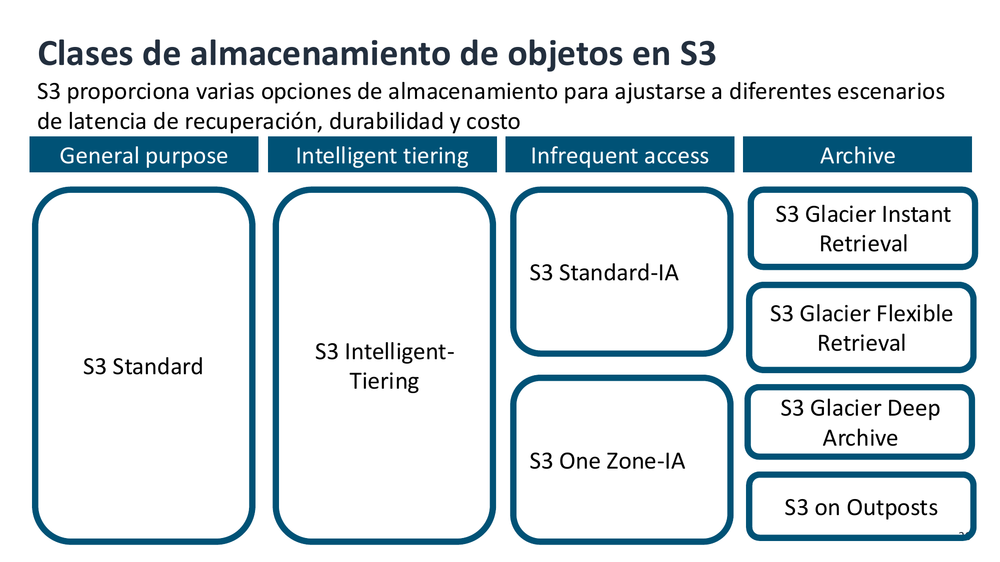
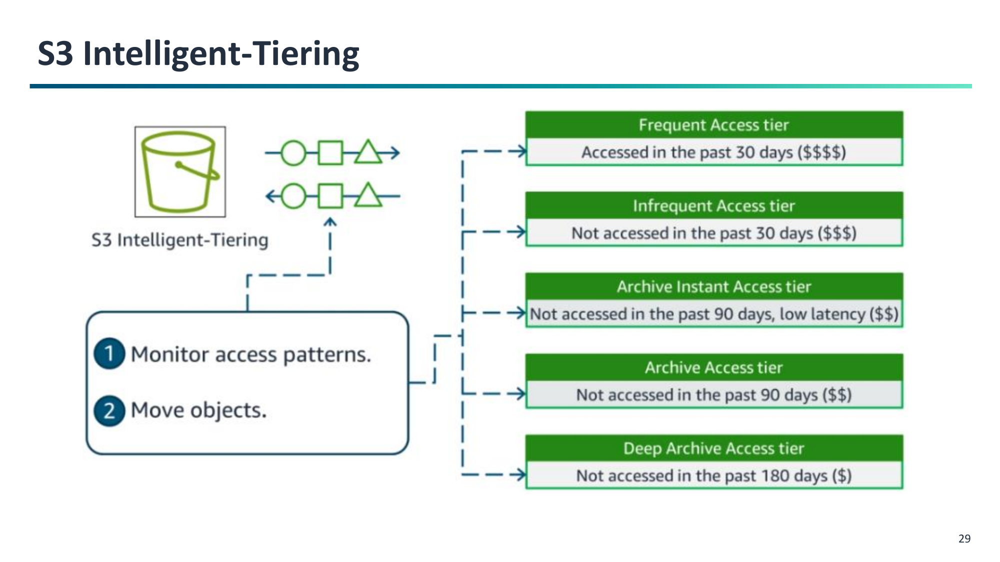
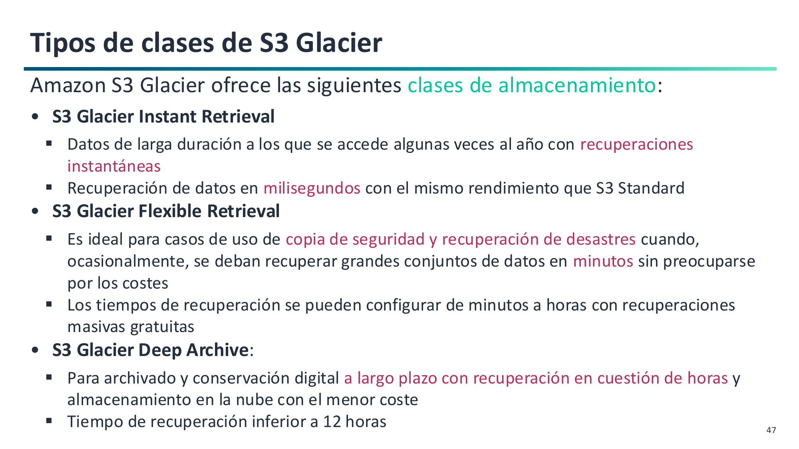

# 3. Clases de Almacenamiento y Amazon S3 Glacier

Amazon S3 ofrece diversas **clases de almacenamiento (Storage Classes)** diseñadas para optimizar costes sin comprometer la disponibilidad según el ciclo de vida, la latencia de recuperación y la frecuencia de acceso a los datos (**RA1.b** y **RA2.b**).

---

## Panorama de Clases de Almacenamiento

AWS agrupa sus clases de almacenamiento en cuatro categorías principales: propósito general, niveles inteligentes, acceso infrecuente y archivado histórico:

---

## 1. Almacenamiento de Acceso Frecuente y Propósito General

### Amazon S3 Standard

- **Diseñado para:** Datos de acceso frecuente e interactivo (sitios web dinámicos, distribución de contenido, aplicaciones móviles y análisis de Big Data).
- **Rendimiento:** Latencia de acceso en **milisegundos** y alto rendimiento de transferencia.
- **Redundancia:** Replicación síncrona en un mínimo de **3 Zonas de Disponibilidad (AZs)** con 11 nueves de durabilidad (99,999999999%) y 99,99% de disponibilidad.
- **Costes:** Sin tiempo mínimo de retención, sin tamaño mínimo por objeto y **sin tarifas de recuperación de datos**.

---

## 2. Almacenamiento Automático: S3 Intelligent-Tiering

Diseñado para conjuntos de datos con **patrones de acceso desconocidos, impredecibles o cambiantes**.

- **Monitorización automática:** S3 monitoriza los patrones de acceso a nivel de objeto y mueve los datos automáticamente entre distintos niveles de acceso:
    - **Nivel de acceso frecuente (Frequent Access):** Nivel base para datos activos.
    - **Nivel de acceso infrecuente (Infrequent Access):** Se traslada automáticamente tras **30 días consecutivos sin accesos** (~40% de ahorro en almacenamiento).
    - **Nivel de archivo opcional (Archive Instant Access):** Se traslada tras **90 días sin accesos** (~68% de ahorro).
    - **Niveles de archivo profundo opcionales (Archive / Deep Archive):** Tras 90 y 180 días respectivamente, para datos asíncronos.
- **Retorno instantáneo:** En cuanto un objeto es solicitado por un usuario o aplicación, vuelve automáticamente al nivel de acceso frecuente con latencia de milisegundos.

!!! tip "La gran ventaja de S3 Intelligent-Tiering: Sin cargos por recuperación"
    A diferencia de las clases tradicionales de acceso infrecuente, **Intelligent-Tiering no cobra tarifas por GB recuperado**. Solo aplica una pequeña tarifa fija mensual por cada 1.000 objetos monitorizados. Es la clase recomendada por defecto por AWS para lagos de datos y contenido generado por usuarios.

---

## 3. Almacenamiento de Acceso Infrecuente (Infrequent Access - IA)

Pensado para datos que se consultan esporádicamente pero que requieren **disponibilidad inmediata en milisegundos** cuando se solicitan (ej. copias de seguridad mensuales, repositorios de auditoría o planes de recuperación ante desastres).

### S3 Standard - Infrequent Access

- Redundancia en **≥ 3 Zonas de Disponibilidad (AZs)**.
- Ofrece el mismo rendimiento y durabilidad que S3 Standard, pero con un coste de almacenamiento por GB aproximadamente un **40% inferior**.
- **Reglas de facturación:**
    - Aplica una tarifa adicional por cada GB de datos recuperado (*Retrieval fee*).
    - Requiere un compromiso de retención mínima facturable de **30 días**.
    - Tamaño mínimo facturable de **128 KB** por objeto.

### S3 One Zone - Infrequent Access

- Almacena los datos en **una única Zona de Disponibilidad (1 AZ)** dentro de la región.
- Supone un ahorro adicional de aproximadamente un 20% respecto a Standard - Infrequent Access.
- **Riesgo:** Si ocurre una catástrofe que destruya físicamente esa Zona de Disponibilidad concreta, los datos se perderían.
- **Caso de uso ideal:** Almacenar copias secundarias de seguridad o imágenes redimensionadas/renderizadas que se puedan volver a generar fácilmente en caso de fallo.

---

## 4. Familia de Archivado a Largo Plazo: Amazon S3 Glacier

Para datos históricos, registros contables o retención legal regulatoria donde los accesos son testimoniales (1-2 veces al año o menos), AWS ofrece la familia Glacier con costes extremadamente reducidos:

### 1. S3 Glacier Instant Retrieval

- Diseñado para datos de archivo que rara vez se consultan, pero que cuando se necesitan requieren **acceso inmediato en milisegundos** (ej. radiografías médicas o grabaciones de seguridad).
- Retención mínima facturable de **90 días** y tamaño mínimo de **128 KB**.

### 2. S3 Glacier Flexible Retrieval (anteriormente S3 Glacier)

- Almacenamiento de archivo seguro y de coste muy bajo para copias de seguridad y recuperación ante desastres fuera de las instalaciones (*off-site backups*).
- Los datos no son directamente accesibles mediante una llamada HTTP inmediata; requieren iniciar un **proceso previo de restauración** (*Restore job*).
- Ofrece tres niveles de velocidad de recuperación:
    - **Acelerada (Expedited):** Datos disponibles en **1 a 5 minutos** (para objetos de hasta 250 MB).
    - **Estándar (Standard):** Datos disponibles en **3 a 5 horas** (opción predeterminada).
    - **Masiva (Bulk):** Recuperación en **5 a 12 horas** (**gratuita**, sin coste de recuperación por GB).
- Retención mínima facturable de **90 días**.

### 3. S3 Glacier Deep Archive

- **El almacenamiento más económico de toda la nube de AWS** (~1 $ por Terabyte al mes, aproximadamente un 95% más barato que S3 Standard).
- Diseñado para conservación digital a muy largo plazo (7 a 10+ años) en sectores altamente regulados (banca, sanidad, administraciones públicas).
- Dos opciones de recuperación asíncrona:
    - **Estándar:** Recuperación en **12 horas**.
    - **Masiva:** Recuperación en **48 horas**.
- Retención mínima facturable de **180 días**.

---

## Tabla Comparativa de Clases de Almacenamiento

| Clase de Almacenamiento | Zonas de Disp. (AZs) | Latencia de acceso | Tarifa por GB recuperado | Tamaño mín. facturable | Retención mín. facturable | Coste aprox. relativo (GB/mes) |
| :--- | :---: | :---: | :---: | :---: | :---: | :---: |
| **S3 Standard** | ≥ 3 | Milisegundos | **Ninguna** | Ninguno | Ninguna | 100% (Base) |
| **S3 Intelligent-Tiering** | ≥ 3 | Milisegundos | **Ninguna** | Ninguno* | Ninguna | Automático |
| **S3 Standard - Infrequent Access** | ≥ 3 | Milisegundos | Sí (~0,01 $/GB) | 128 KB | 30 días | ~60% |
| **S3 One Zone - Infrequent Access** | **1** | Milisegundos | Sí (~0,01 $/GB) | 128 KB | 30 días | ~48% |
| **S3 Glacier Instant** | ≥ 3 | Milisegundos | Sí (~0,03 $/GB) | 128 KB | 90 días | ~32% |
| **S3 Glacier Flexible** | ≥ 3 | Minutos a Horas | Sí (salvo Bulk) | Ninguno | 90 días | ~18% |
| **S3 Glacier Deep Archive** | ≥ 3 | 12 a 48 Horas | Sí (~0,002 $/GB) | Ninguno | 180 días | **~4%** |

*\* Los objetos menores de 128 KB en S3 Intelligent-Tiering permanecen siempre en el nivel de acceso frecuente sin cargo adicional de monitorización.*
