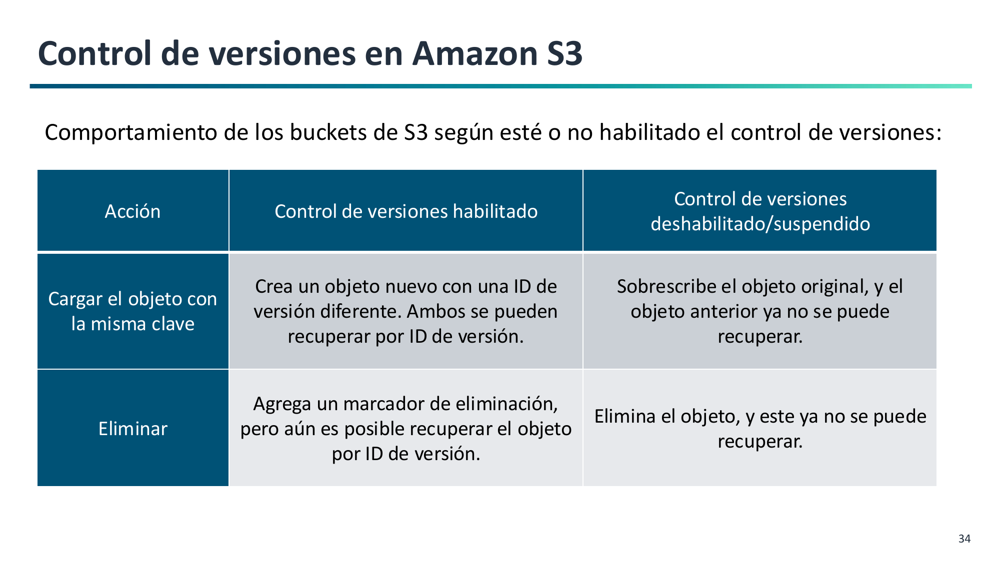
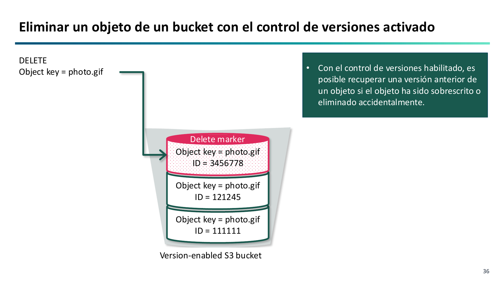
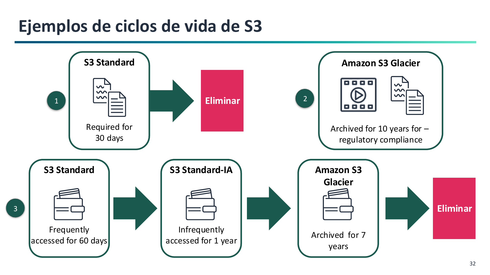

# 4. Gestión del Ciclo de Vida, Versionado e Inmutabilidad

Gestionar el ciclo de vida de los datos permite proteger los objetos contra borrados accidentales y optimizar los costes a medida que la información envejece (**RA2.g**).

---

## Control de Versiones en Amazon S3 (S3 Versioning)

El **control de versiones** mantiene múltiples variantes de un mismo objeto dentro del mismo bucket.

!!! warning "Estados del versionado"
    Un bucket nuevo empieza en estado **No versionado** (*Unversioned*). Una vez habilitado (*Enabled*), **nunca puede volver al estado inicial**; únicamente puede ser **suspendido** (*Suspended*).

### ¿Cómo operan las acciones con Versionado Habilitado?

1. **Subida (`PUT`):** Si subes un archivo con el mismo nombre que uno existente, S3 **no lo sobrescribe**. Asigna un nuevo `VersionId` criptográfico y lo sitúa como la versión actual. Las versiones anteriores siguen intactas.
2. **Lectura (`GET`):** Por defecto devuelve la versión actual. Se puede solicitar una versión histórica indicando su `VersionId`.
3. **Borrado lógico (`DELETE` sin `VersionId`):**
   S3 inserta un **marcador de eliminación (Delete Marker)** en la cabecera. El objeto parece haber sido eliminado (devuelve error 404 al intentar leerlo), pero sus versiones siguen guardadas.
   

4. **Recuperación:** Para recuperar el archivo, basta con **eliminar el Delete Marker**. La versión anterior vuelve a convertirse en la actual.
5. **Borrado permanente (`DELETE` con `VersionId`):** Solo si se especifica el identificador de versión concreto se destruyen físicamente los datos.

---

## Políticas de Ciclo de Vida (S3 Lifecycle Rules)

Una **política de ciclo de vida** automatiza el movimiento de objetos entre clases de almacenamiento y su eliminación definitiva:

Consta de dos tipos de acciones:

1. **Acciones de transición:** Trasladan objetos a clases más económicas a medida que envejecen (ej. de *Standard* a *Standard-IA* a los 30 días, y a *Glacier Flexible* a los 90 días).
2. **Acciones de expiración:** Destruyen versiones antiguas no actuales tras un número de días determinado (ej. purgar versiones de hace más de 180 días) o eliminan subidas multiparte incompletas (`AbortIncompleteMultipartUpload`).

---

## Bloqueo de Objetos (S3 Object Lock) e Inmutabilidad WORM

Permite implementar el modelo **WORM** (*Write Once, Read Many*), impidiendo la sobrescritura o eliminación de objetos durante un periodo fijado. Exige tener el **versionado activado**.

Dispone de dos modos de retención:

- **Modo Gobernanza (Governance Mode):** Los usuarios normales no pueden borrar el objeto, pero usuarios con el permiso especial `s3:BypassGovernanceRetention` pueden modificar el plazo o eliminarlo en caso de necesidad.
- **Modo Cumplimiento (Compliance Mode):** **Nadie**, ni siquiera el usuario *root* de la cuenta de AWS ni el soporte de Amazon, puede borrar el objeto antes de que venza la fecha de retención legal.
- **Retención Legal (Legal Hold):** Conmutador manual (`ON` / `OFF`) sin fecha de expiración fijada, utilizado durante litigios o auditorías.
