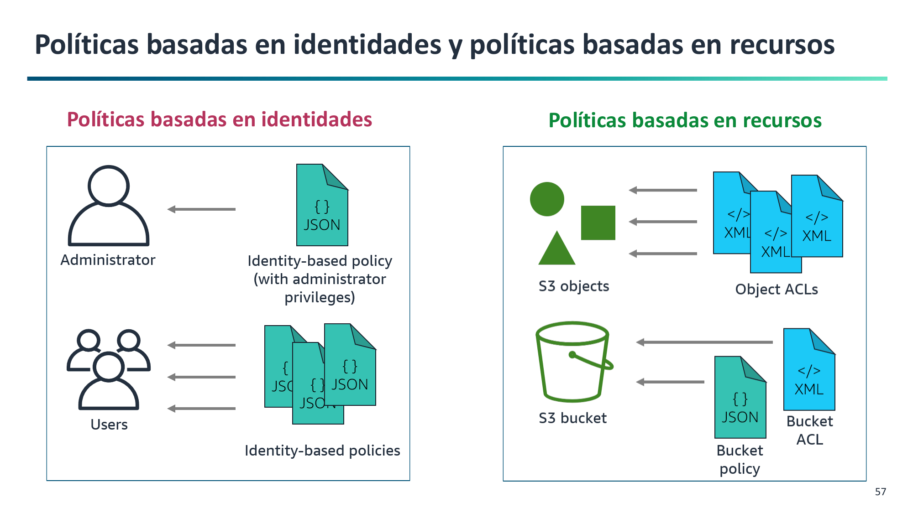
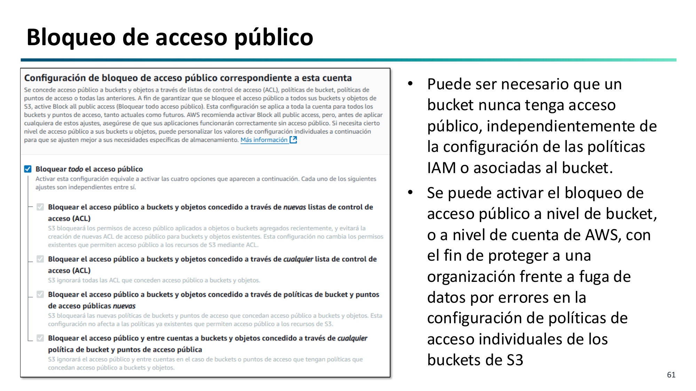
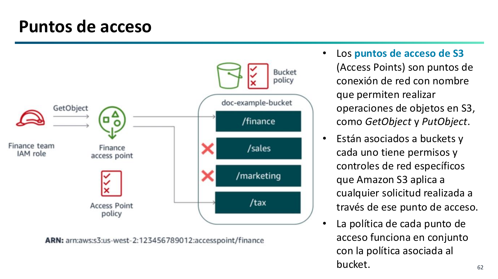
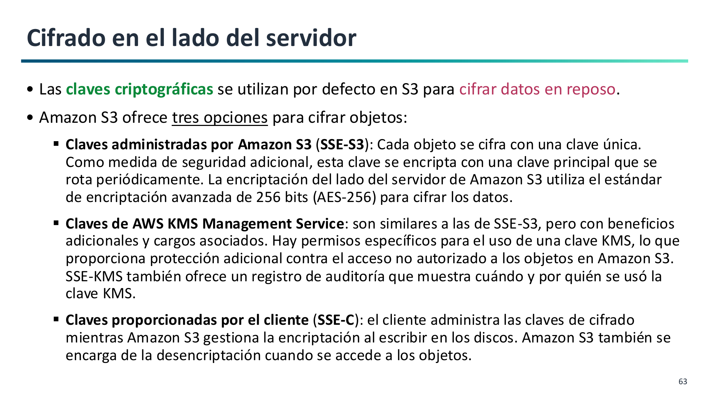

# 5. Seguridad, Control de Acceso y Cifrado en Amazon S3

La seguridad en S3 se rige por el principio de mínimo privilegio: **todos los buckets y objetos son completamente privados por defecto**. Solo el creador tiene permisos iniciales de acceso (**RA2.d** y **RA2.e**).

---

## Métodos de Control de Acceso

Para gestionar los permisos de acceso a S3, AWS proporciona dos enfoques complementarios:

1. **Políticas Basadas en Identidad (IAM Policies):**
    - Se adjuntan a usuarios, grupos o roles de IAM.
    - Responden a la pregunta: *¿Qué acciones puede realizar este usuario concreto sobre qué recursos?*

2. **Políticas Basadas en Recursos (Bucket Policies):**
    - Son documentos JSON adjuntados directamente al bucket de S3.
    - Responden a la pregunta: *¿Quién (usuarios internos, cuentas externas o público anónimo) tiene permiso para acceder a este bucket?*
    - Elementos del JSON: `Principal` (quién), `Effect` (`Allow` / `Deny`), `Action` (ej. `s3:GetObject`), `Resource` (`arn:aws:s3:::bucket/*`) y `Condition` opcional.

---

## Bloqueo de Acceso Público (S3 Block Public Access)

Es una barrera de seguridad centralizada que impide la exposición accidental de datos a Internet a través de ACLs o políticas permisivas:

- Puede activarse a nivel de cuenta completa de AWS o a nivel de bucket individual.
- **Recomendación de AWS:** Mantener siempre activadas las 4 protecciones de bloqueo, salvo cuando se vaya a publicar deliberadamente un sitio web estático.

---

## Puntos de Acceso de S3 (S3 Access Points)

Cuando un único bucket almacena conjuntos de datos compartidos por decenas de aplicaciones o departamentos diferentes, la política de bucket se vuelve compleja de gestionar:

- Los **Access Points** son nombres de host específicos con sus propias políticas de acceso independientes asociadas al bucket central.
- Permiten otorgar permisos concretos por aplicación sin tocar la política global del bucket.

---

## Cifrado de Datos en Amazon S3

### Cifrado en Tránsito
Todo el tráfico entre el cliente y S3 viaja protegido mediante **TLS/HTTPS**. Se puede forzar mediante política de bucket rechazando peticiones que no usen HTTPS (`aws:SecureTransport: "false"`).

### Cifrado en Reposo (Server-Side Encryption)
Asegura que los objetos se almacenen cifrados en los discos de AWS utilizando **AES-256**:

1. **SSE-S3 (Amazon S3-Managed Keys):**
    - Claves administradas y rotadas íntegramente por S3 con AES-256.
    - **Activado por defecto en todos los buckets nuevos sin coste adicional**.
2. **SSE-KMS (AWS Key Management Service):**
    - Claves gestionadas mediante AWS KMS.
    - Permite controlar quién tiene permiso para usar la clave y audita cada operación de descifrado en **AWS CloudTrail**.
3. **SSE-C (Customer-Provided Keys):**
    - El cliente envía su propia clave criptográfica en cada petición HTTP; AWS cifra/descifra en memoria y no guarda la clave.

---

## Auditoría y Observabilidad

- **S3 Server Access Logs:** Registra cada petición HTTP recibida por el bucket en archivos de log.
- **AWS CloudTrail:** Registra las llamadas a la API de S3 (operaciones de gestión y datos) para auditoría de cumplimiento normativo.
- **Amazon CloudWatch:** Métricas de volumen de almacenamiento diario y alarmas de peticiones.
