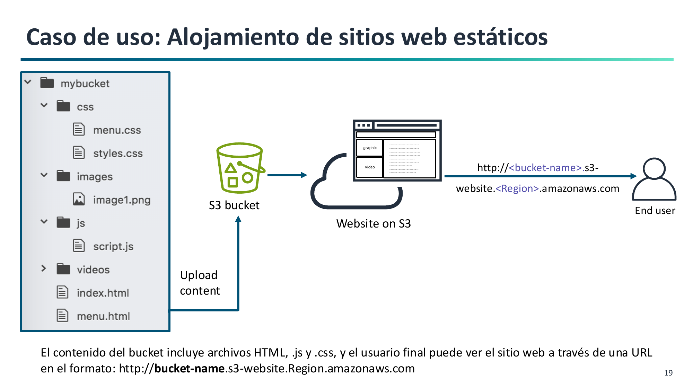

# 6. Alojamiento de Sitios Web Estáticos en Amazon S3

Amazon S3 permite alojar sitios web estáticos de alta disponibilidad sin necesidad de aprovisionar ni administrar servidores web como Apache o Nginx (**RA2.f**).

---

## Contenido Estático frente a Dinámico



- **Contenido soportado (Estático):** Archivos HTML, hojas de estilo CSS, imágenes, fuentes, documentos y **JavaScript del lado del cliente**. Las aplicaciones SPA (*Single Page Applications*) desarrolladas con React, Vue o Angular son estáticas una vez compiladas y pueden alojarse íntegramente en S3.
- **Contenido NO soportado (Dinámico):** Lenguajes de ejecución del lado del servidor (PHP, Python/Django, Node.js, Java) o conexiones directas locales a bases de datos relacionales.

---

## Configuración en 3 Pasos

Para publicar un sitio web en S3 es necesario realizar tres acciones:

1. **Habilitar el alojamiento web estático:**
    - En la pestaña **Propiedades (Properties)** del bucket, activar *Static website hosting*.
    - Indicar el **Documento de índice** (`index.html`) y el **Documento de error** (`404.html`).
    - S3 generará el **punto de enlace del sitio web (Endpoint)**.

2. **Desactivar el Bloqueo de Acceso Público:**
    - En la pestaña **Permisos (Permissions)**, desmarcar la casilla *Block all public access* para permitir que el bucket acepte políticas públicas.

3. **Aplicar la Política de Bucket pública:**
    - Para evitar el error **HTTP 403 Forbidden**, se debe añadir una política en JSON que conceda permiso de lectura anónima sobre todos los objetos del bucket:

```json
{
  "Version": "2012-10-17",
  "Statement": [
    {
      "Sid": "PublicReadGetObject",
      "Effect": "Allow",
      "Principal": "*",
      "Action": "s3:GetObject",
      "Resource": "arn:aws:s3:::NOMBRE-DEL-BUCKET/*"
    }
  ]
}
```

!!! warning "Importante sobre el Resource"
    Fíjate en el comodín `/*` al final del ARN. El permiso `s3:GetObject` aplica a los **objetos contenidos dentro del bucket**, no al recurso raíz del bucket.


---

## Endpoint Web vs. Endpoint de API REST

| Característica | Endpoint de Sitio Web | Endpoint de la API REST |
| :--- | :--- | :--- |
| **URL típica** | `http://bucket.s3-website.eu-west-1.amazonaws.com` | `https://bucket.s3.eu-west-1.amazonaws.com` |
| **Protocolo nativo** | **Solo HTTP** (no ofrece HTTPS directo) | **HTTP y HTTPS** |
| **Petición a la raíz**| Carga automáticamente `index.html` | Devuelve el listado XML de objetos |
| **Recurso inexistente**| Muestra la página web personalizada `404.html` | Devuelve un error XML estándar de AWS |

---

## Despliegue en Producción con Dominio Propio y HTTPS

Dado que el endpoint nativo de S3 solo soporta HTTP y utiliza un dominio de Amazon, para entornos de producción profesionales se utiliza la siguiente arquitectura recomendada:

```
[Usuario Web] --(HTTPS Seguro / midominio.com)--> [Amazon Route 53] (DNS)
                                                         │
                                                         ▼
                                            [Amazon CloudFront] (CDN + Certificado SSL ACM)
                                                         │
                                                         ▼ (HTTP / OAC)
                                            [Bucket de Amazon S3] (Archivos Web)
```

- **AWS Certificate Manager (ACM):** Proporciona un certificado SSL/TLS gratuito para el dominio corporativo.
- **Amazon CloudFront:** Red de distribución de contenidos (CDN) que termina la conexión HTTPS segura en ubicaciones de borde cercanas al usuario y lee los archivos desde el bucket de S3.
- **Amazon Route 53:** Gestiona el DNS y redirige el dominio hacia CloudFront.
