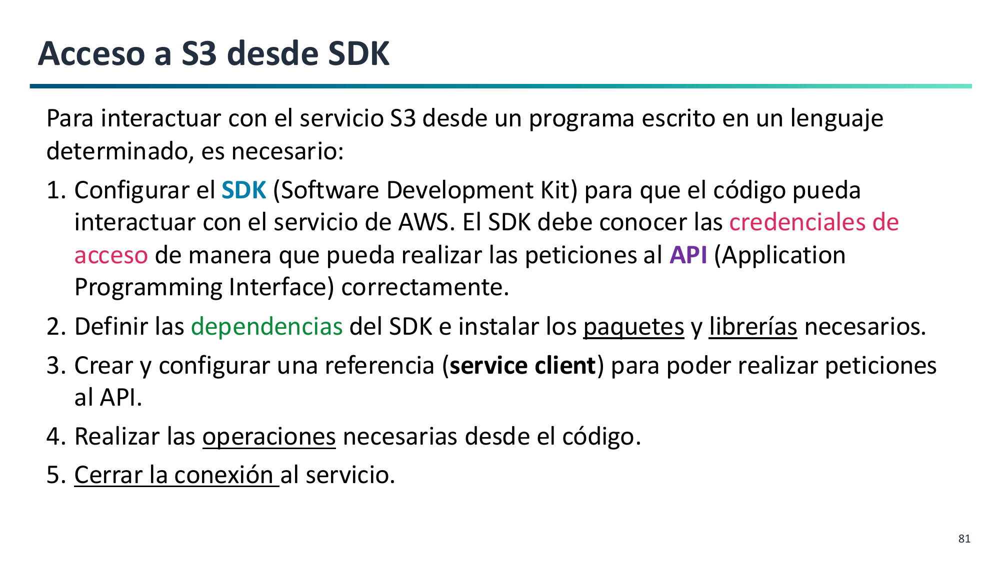

# 7. Interacción con SDK de Python (Boto3)

La automatización de tareas sobre Amazon S3 se lleva a cabo principalmente a través de la herramienta de línea de comandos (**AWS CLI**) y del kit de desarrollo de software (**SDK Boto3** para Python).


Para integrar el almacenamiento de S3 en aplicaciones y scripts en Python, AWS proporciona la biblioteca oficial **Boto3**:



### Instalación
```bash
pip install boto3
```

Boto3 lee automáticamente las credenciales configuradas en el entorno local (`~/.aws/credentials`).

### Cliente (`client`) frente a Recurso (`resource`)

- `boto3.client('s3')`: Interfaz de bajo nivel que mapea exactamente los métodos de la API de AWS y devuelve diccionarios estándar de Python. Es la opción más actualizada y recomendada.
- `boto3.resource('s3')`: Abstracción orientada a objetos de más alto nivel (`Bucket('mi-bucket')`).

---

### Código Esencial en Python

#### 1. Creación de un bucket (con la particularidad de `us-east-1`)
En la región `us-east-1` **no se debe especificar** `CreateBucketConfiguration`, mientras que en el resto de regiones es obligatorio:

```python
import boto3

def crear_bucket(nombre_bucket: str, region: str = "us-east-1"):
    s3 = boto3.client("s3", region_name=region)
    if region == "us-east-1":
        s3.create_bucket(Bucket=nombre_bucket)
    else:
        s3.create_bucket(
            Bucket=nombre_bucket,
            CreateBucketConfiguration={"LocationConstraint": region}
        )
    print(f"Bucket {nombre_bucket} creado en {region}")
```

#### 2. Subida y descarga de archivos con metadatos
```python
import boto3

s3 = boto3.client("s3")

# Subir archivo asignando clase y metadatos
s3.upload_file(
    Filename="documento.pdf",
    Bucket="mi-bucket-2026",
    Key="docs/documento.pdf",
    ExtraArgs={
        "StorageClass": "INTELLIGENT_TIERING",
        "ContentType": "application/pdf",
        "Metadata": {"departamento": "ventas"}
    }
)

# Descargar archivo
s3.download_file("mi-bucket-2026", "docs/documento.pdf", "descargado.pdf")
```

---

## URLs Prefirmadas (Presigned URLs)

Una **URL prefirmada** permite conceder acceso de lectura o escritura temporal a un tercero **sin credenciales de AWS y sin hacer público el bucket**:

```python
import boto3

s3 = boto3.client("s3")

# Genera un enlace válido durante 15 minutos (900 segundos) para un archivo privado
url = s3.generate_presigned_url(
    ClientMethod="get_object",
    Params={"Bucket": "mi-bucket-privado", "Key": "informe_secreto.pdf"},
    ExpiresIn=900
)

print("Enlace temporal de descarga:", url)
```

Al vencer los 15 minutos, cualquier intento de abrir el enlace devolverá inmediatamente un error `AccessDenied` (`Request has expired`).
