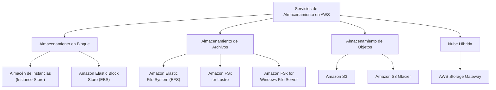

# 1. Introducción a los Servicios de Almacenamiento en Bloque y Sistemas de Ficheros en Red

En la **UT1** estudiamos el almacenamiento de objetos con Amazon S3. Esta unidad amplía el mapa de almacenamiento en AWS centrándose en los servicios de **almacenamiento en bloque (Amazon EBS)** y de **sistemas de ficheros compartidos (Amazon EFS y Amazon FSx)**, fundamentales para dar soporte a instancias EC2, bases de datos y cargas de trabajo empresariales.

---

## Objetivos de la Unidad

- Conocer los diferentes tipos de sistemas de almacenamiento en bloque en la nube.
- Saber seleccionar el tipo de almacenamiento adecuado según los requisitos de la aplicación.
- Crear y administrar instantáneas (*snapshots*) de Amazon EBS.
- Reconocer las distintas clases de almacenamiento de ficheros compartido y sus consideraciones de coste.
- Conocer diferentes herramientas de migración de datos y de *backup*.

---

## Mapa de Servicios de Almacenamiento en AWS

AWS ofrece almacenamiento para tres modelos de datos, cada uno cubierto por servicios específicos:

- **Almacenamiento de objetos:** Los archivos se dividen en objetos que se colocan en *buckets*. Permite almacenar enormes cantidades de datos no estructurados. Cada objeto tiene tres componentes: los datos en sí, metadatos y el identificador.
- **Almacenamiento de archivos:** Los datos se almacenan como ficheros dentro de una jerarquía de carpetas. Las carpetas pueden contener subcarpetas, lo que lo diferencia del modelo plano de objetos.
- **Almacenamiento en bloques:** Guarda los datos en unidades llamadas **bloques**. Cada bloque recibe un identificador único para poder ser recuperado. Los bloques se distribuyen entre múltiples entornos y, al solicitar los datos, se vuelven a ensamblar para el usuario.

---

## Selección del Servicio Adecuado

Una guía rápida para elegir el servicio según la necesidad:

| Si necesitas... | Piensa en utilizar... |
| :--- | :--- |
| Almacenamiento de bloques **persistente** para Amazon EC2, ideal para bases de datos y aplicaciones | **Amazon Elastic Block Store (Amazon EBS)** |
| Una plataforma escalable y duradera accesible desde Internet para contenido web, backups o Big Data | **Amazon Simple Storage Service (Amazon S3)** |
| Almacenamiento seguro, duradero y de coste extremadamente bajo para archivado a largo plazo | **Amazon S3 Glacier** |
| Un sistema de archivos **NFS** simple y escalable para cargas de trabajo Linux en la nube y on-premise | **Amazon Elastic File System (Amazon EFS)** |
| Almacenamiento híbrido que amplía tu entorno local con la nube para DR, *tiering* o migraciones | **AWS Storage Gateway** |

---

## Almacenamiento para Instancias EC2

Una instancia de EC2 siempre tendrá un **volumen raíz** y, opcionalmente, puede tener uno o más **volúmenes de datos**. La siguiente tabla resume qué servicios cubren cada necesidad:

| Recurso de almacenamiento | Volumen raíz | Volúmenes de datos (instancia única) | Datos compartidos entre instancias Linux | Datos compartidos entre instancias Windows |
| :--- | :---: | :---: | :---: | :---: |
| **Amazon EBS** (solo SSD) | ✅ | ✅ | ❌ | ❌ |
| **Instance Store** | ✅ | ✅ | ❌ | ❌ |
| **Amazon EFS** (Linux) | ❌ | ❌ | ✅ | ❌ |
| **Amazon FSx for Windows** | ❌ | ❌ | ❌ | ✅ |

---

## Almacén de Instancias (*Instance Store*)

Un almacén de instancias proporciona almacenamiento **efímero (no persistente)** a una instancia EC2. Los datos se almacenan en discos físicamente conectados al servidor anfitrión (*host*) donde se ejecuta la instancia.

### Características

- **Baja latencia e IOPS elevado:** Acceso directo al hardware local (HDD o SSD — SATA o NVMe).
- **Dependencia del tipo de instancia:** El tipo de instancia EC2 determina el tamaño y tipo de hardware disponible para los volúmenes del almacén. La mayoría de tipos de instancias los admiten, pero no todos.
- **Datos efímeros:** Los datos del almacén de instancias **se perderán** cuando la instancia se **detenga (*stop*)** o se **termine (*terminate*)**. Si únicamente se **reinicia (*reboot*)**, los datos se conservan.

### Casos de uso

- Buffers y cachés temporales.
- Datos de pruebas y ficheros intermedios de procesamiento.

!!! warning "Almacén de instancias ≠ Almacenamiento persistente"
    Nunca uses el almacén de instancias para datos que necesites conservar a largo plazo. Si la instancia se detiene por cualquier motivo (mantenimiento del host, fallo de hardware, acción del usuario), **todos los datos del almacén de instancias se perderán irremediablemente**. Para datos persistentes, utiliza Amazon EBS.

---

## Comparativa Rápida: Instance Store vs. EBS vs. EFS

| Característica | Instance Store | Amazon EBS | Amazon EFS |
| :--- | :--- | :--- | :--- |
| **Persistencia** | ❌ Efímero | ✅ Persistente | ✅ Persistente |
| **Ámbito** | Instancia única | Zona de Disponibilidad | Regional (Multi-AZ) |
| **Acceso compartido** | No | No (salvo Multi-Attach) | Sí (múltiples instancias) |
| **Protocolo** | Disco local | NVMe / iSCSI en red | NFSv4.1 |
| **Rendimiento** | Muy alto (acceso local) | Alto (red dedicada) | Alto (elástico) |
| **Caso típico** | Caché, buffers | SO, bases de datos | Ficheros compartidos |
