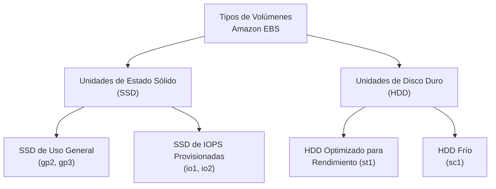
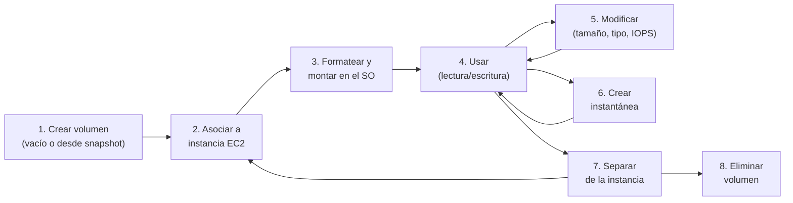

# 2. Amazon EBS: Elastic Block Store

Amazon Elastic Block Store (Amazon EBS) es el servicio de almacenamiento en bloque persistente de AWS, diseñado para ofrecer volúmenes de disco de alto rendimiento conectados en red a instancias EC2.

---

## Características Principales

- **Almacenamiento a nivel de bloque** similar a un disco duro externo, dividido en bloques de tamaño fijo.
- **Datos persistentes:** Los datos se almacenan de forma independiente de la vida de la instancia EC2. Si la instancia falla por un defecto de hardware, el volumen y sus datos permanecen intactos.
- **Vinculación a una Zona de Disponibilidad:** Un volumen EBS se puede asociar a cualquier instancia dentro de la **misma Zona de Disponibilidad (AZ)**.
- **Soporte HDD y SSD:** Utiliza unidades de disco duro (HDD) o de estado sólido (SSD) con interfaz SATA o NVMe.
- **Cifrado integrado:** Los volúmenes EBS se pueden cifrar de forma transparente mediante AWS KMS.
- **Instantáneas (*snapshots*):** Admite la creación de copias de seguridad incrementales almacenadas de forma persistente en Amazon S3.

### Casos de uso

- Volúmenes de arranque (*boot*) y almacenamiento para instancias EC2.
- Bases de datos sobre instancias EC2 (MySQL, PostgreSQL, Oracle, SQL Server).
- Almacenamiento general de datos de aplicaciones.

---

## Independencia del Volumen EBS respecto a la Instancia EC2

Los volúmenes de EBS **no forman parte de la instancia EC2**: son un recurso de red independiente. Sin importar si se detiene la máquina virtual o si falla por un defecto de hardware, el volumen y los datos permanecerán intactos.

!!! note "Comportamiento de `DeleteOnTermination`"
    - **Volumen raíz:** Por defecto, AWS establece el atributo `DeleteOnTermination` a `true`. Esto significa que al **terminar** la instancia EC2, el volumen raíz se eliminará automáticamente.
    - **Volúmenes de datos adicionales:** Por defecto, `DeleteOnTermination` se establece a `false`. Estos volúmenes **permanecerán** incluso tras terminar la instancia.

!!! tip "Amazon EBS Multi-Attach"
    Aunque un volumen EBS está pensado para asociarse a una **única instancia**, existe la funcionalidad **Multi-Attach** que permite asociar un volumen `io1`/`io2` a **varias instancias EC2 simultáneamente** dentro de la misma Zona de Disponibilidad. Es útil para aplicaciones en clúster que requieren acceso concurrente al mismo almacenamiento en bloque.

---

## Tipos de Volúmenes de Amazon EBS

Amazon EBS ofrece cuatro tipos de volúmenes agrupados en dos familias de hardware, lo que permite ajustar el rendimiento y el coste a las necesidades de cada aplicación:



### Volúmenes con respaldo de SSD

Los volúmenes SSD están optimizados para cargas de trabajo **transaccionales** con operaciones de lectura/escritura frecuentes de tamaño pequeño, donde el atributo de rendimiento dominante es **IOPS** (Operaciones de Entrada/Salida Por Segundo).

| Atributo | SSD de Uso General (gp3) | SSD de Uso General (gp2) | IOPS Provisionadas (io2 Block Express) | IOPS Provisionadas (io1) |
| :--- | :--- | :--- | :--- | :--- |
| **Tamaño del volumen** | 1 GiB – 16 TiB | 1 GiB – 16 TiB | 4 GiB – 64 TiB | 4 GiB – 16 TiB |
| **IOPS máximas** | 16.000 | 16.000 | 256.000 | 64.000 |
| **Rendimiento máximo** | 1.000 MiB/s | 250 MiB/s | 4.000 MiB/s | 1.000 MiB/s |
| **Volumen de arranque** | ✅ Sí | ✅ Sí | ✅ Sí | ✅ Sí |
| **Multi-Attach** | ❌ No | ❌ No | ✅ Sí | ✅ Sí |

### Volúmenes con respaldo de HDD

Los volúmenes HDD están optimizados para cargas de trabajo de **streaming** secuencial donde la métrica de rendimiento clave es el **throughput** (MiB/s), no las IOPS. **No pueden usarse como volúmenes raíz o de arranque.**

| Atributo | HDD Optimizado para Rendimiento (st1) | HDD Frío (sc1) |
| :--- | :--- | :--- |
| **Tamaño del volumen** | 125 GiB – 16 TiB | 125 GiB – 16 TiB |
| **IOPS máximas** | 500 | 250 |
| **Rendimiento máximo** | 500 MiB/s | 250 MiB/s |
| **Volumen de arranque** | ❌ No | ❌ No |

---

## Casos de Uso por Tipo de Volumen

| Tipo de volumen | Recomendado para... | No recomendado para... |
| :--- | :--- | :--- |
| **gp3 (SSD Uso General)** | Opción predeterminada para la mayoría de cargas: volúmenes de arranque, aplicaciones con carga de E/S baja a media, entornos de desarrollo | Cargas de trabajo que requieran IOPS garantizadas por encima de 16.000 |
| **io2 / io1 (SSD IOPS Provisionadas)** | Bases de datos críticas para el negocio (Oracle, SAP HANA), cargas intensivas en E/S aleatoria | Almacenamiento de bajo coste o archivos secuenciales |
| **st1 (HDD Rendimiento)** | Cargas de trabajo con E/S secuencial y grandes volúmenes de datos: Big Data, *data warehousing*, procesamiento de logs | Cargas que requieran E/S pequeña y aleatoria |
| **sc1 (HDD Frío)** | Almacenamiento de bajo coste para datos con accesos poco frecuentes y secuenciales | Cargas que requieran E/S aleatoria o baja latencia |

!!! tip "Regla de oro para elegir tipo de volumen"
    Comienza siempre con **gp3** como opción por defecto. Si la carga de trabajo requiere más IOPS de las que gp3 puede ofrecer, pasa a **io2**. Si la carga es fundamentalmente secuencial y masiva, valora **st1**. Si además el coste es prioritario y el acceso es infrecuente, elige **sc1**.

---

## Instancias Optimizadas para Amazon EBS

Determinados tipos de instancias EC2 pueden configurarse como **optimizados para EBS**, lo que proporciona una **conexión de red dedicada** entre la instancia y los volúmenes EBS asociados.

### Beneficios

- Conexión de red dedicada exclusiva para el tráfico de E/S hacia los volúmenes EBS.
- Mayor rendimiento de E/S al eliminar la contención con el tráfico de red general.
- Las instancias basadas en el **sistema Nitro** de Amazon EC2 obtienen un rendimiento aún mayor.

### Uso

- Para los tipos de instancias optimizadas para EBS, la optimización está **habilitada de forma predeterminada**.
- Para otros tipos de instancias que admiten la optimización, se la debe habilitar de forma manual y se paga una cuota por hora adicional.

---

## Ciclo de Vida del Volumen de Amazon EBS

El ciclo de vida de un volumen EBS abarca desde su creación hasta su eliminación, pasando por múltiples operaciones de gestión:



### Descripción de las etapas

1. **Crear:** Se puede crear un volumen vacío o a partir de una instantánea (*snapshot*) existente.
2. **Asociar:** El volumen debe asociarse a una instancia EC2 que esté en la **misma Zona de Disponibilidad**.
3. **Formatear y montar:** Desde el sistema operativo de la instancia, se formatea el volumen (`mkfs`, `format`) y se monta en un punto de montaje.
4. **Usar:** Se lee y escribe en el volumen como en cualquier disco local.
5. **Modificar:** Es posible cambiar el tamaño, el tipo o las IOPS del volumen en cualquier momento **sin tiempo de inactividad**.
6. **Crear instantánea:** Se generan copias de seguridad incrementales del volumen.
7. **Separar:** Se puede desasociar el volumen de una instancia y reasociarlo a otra.
8. **Eliminar:** Si el volumen ya no es necesario, se elimina para dejar de incurrir en costes.

### Comandos CLI para gestión de volúmenes

```bash
# Crear un volumen de 80 GiB en la zona us-east-1a de tipo gp3
aws ec2 create-volume --size 80 \
  --availability-zone us-east-1a --volume-type gp3

# Consultar información de un volumen
aws ec2 describe-volumes --volume-ids vol-0e5e5193f8d093d5f

# Asociar un volumen a una instancia
aws ec2 attach-volume --volume-id vol-12345678 \
  --instance-id i-abc1234 --device /dev/sdf
```

!!! note "Tareas desde el sistema operativo"
    Muchas acciones del ciclo de vida se ejecutan desde la consola de AWS o la CLI, pero otras requieren conectarse a la instancia y ejecutar comandos del sistema operativo: formatear el volumen (`mkfs -t ext4 /dev/xvdf`), montarlo (`mount /dev/xvdf /mnt/datos`), administrar particiones (`fdisk`, `parted`) y verificar el espacio libre (`df -h`).

---

## Monitorización de Volúmenes EBS

Amazon CloudWatch proporciona métricas de EBS por defecto, recopiladas a intervalos de **1 minuto**:

| Métrica | Descripción |
| :--- | :--- |
| `VolumeReadOps` / `VolumeWriteOps` | Número de operaciones de lectura/escritura completadas |
| `VolumeReadBytes` / `VolumeWriteBytes` | Bytes transferidos en operaciones de lectura/escritura |
| `VolumeQueueLength` | Número de operaciones de E/S en cola pendientes |
| `VolumeThroughputPercentage` | Porcentaje del rendimiento de E/S utilizado (solo volúmenes io) |
| `VolumeConsumedReadWriteOps` | Operaciones consumidas (solo volúmenes io) |

---

## Instantáneas de Amazon EBS (*Snapshots*)

### ¿Qué son?

Las instantáneas son **copias de seguridad incrementales a nivel de bloque** de los volúmenes EBS. Los datos se copian a la infraestructura de Amazon S3, donde se almacenan de forma redundante en múltiples instalaciones.

- **Fiabilidad de volúmenes:** Los volúmenes EBS tienen una tasa de errores anual (AFR) de entre **0,1% y 0,2%** (el tipo `io2` tiene un AFR del 0,001%). Aun siendo baja, es importante crear copias de seguridad de forma regular.
- **Incrementalidad:** Si se tiene un volumen de 5 GiB con 1 GiB de datos utilizados, la primera instantánea tendrá un tamaño aproximado de 1 GiB. Las instantáneas posteriores solo conservan los **bloques que han cambiado**, reduciendo el tamaño y el coste.
- **Facturación:** Las instantáneas se cobran por la cantidad de gigabytes almacenados.

### Creación de instantáneas

```bash
# Crear una instantánea de un volumen
aws ec2 create-snapshot --volume-id vol-1234567890abcdef0 \
  --description "This is my root volume snapshot"
```

!!! tip "Buenas prácticas al crear instantáneas"
    Es recomendable **detener la instancia** o **desmontar el volumen** antes de crear la instantánea para garantizar la consistencia de los datos. Sin embargo, es posible crear una instantánea de un volumen en uso, lo cual está especialmente indicado para volúmenes raíz y configuraciones de servidores de bases de datos o RAID.

### Copia de instantáneas entre regiones

Los **volúmenes** no se pueden copiar directamente entre regiones, pero las **instantáneas sí**. Esto permite implementar estrategias de recuperación ante desastres (*DR*) multirregión:

```bash
# Copiar una instantánea de us-west-2 a us-east-1
aws ec2 copy-snapshot --region us-east-1 \
  --source-region us-west-2 \
  --source-snapshot-id snap-1234567890abcdef0 \
  --description "This is my copied snapshot"

# Comprobar el estado de la copia
aws ec2 describe-snapshots \
  --snapshot-ids snap-0b3c2a7c2a7e4eec6 \
  --region us-east-1
```

### Restauración de una instantánea

Las instantáneas se almacenan en Amazon S3, pero **no se puede acceder a ellas directamente** mediante las utilidades de S3. Es necesario utilizar las herramientas de Amazon EBS para restaurarlas:

```bash
# Restaurar una instantánea creando un nuevo volumen
aws ec2 create-volume \
  --size 80 \
  --availability-zone us-east-1a \
  --volume-type gp2 \
  --snapshot-id snap-1234567890abcdef0

# Comprobar el estado del volumen restaurado
aws ec2 describe-volume-status \
  --volume-ids vol-0c108c43c627cb26d
```

---

## Administración del Ciclo de Vida de las Instantáneas

**Amazon Data Lifecycle Manager (Amazon DLM)** permite **automatizar** la creación, retención y eliminación de instantáneas de EBS.

### Componentes de una política DLM

| Componente | Descripción |
| :--- | :--- |
| **Tipo de recurso** | Identifica si la política se aplica a volúmenes EBS individuales o a instancias EC2 completas |
| **Etiqueta de objetivo** | Amazon DLM usa etiquetas (*tags*) para identificar los volúmenes a los que realizará copias de seguridad |
| **Programación** | Define la frecuencia de creación (ej. cada 12 horas) y el número máximo de instantáneas a retener |

---

## Coste de Uso de Amazon EBS

| Concepto | Cómo se cobra |
| :--- | :--- |
| **Tamaño del volumen** | Se factura por el tamaño **aprovisionado**, sin importar cuántos datos se almacenen realmente |
| **Operaciones de E/S** | Solo aplica a volúmenes **Magnetic HDD** (estándar) — se cobra por cada operación de E/S |
| **IOPS provisionadas** | Los volúmenes `io1`/`io2` se cobran adicionalmente en función de las IOPS aprovisionadas |
| **Instantáneas** | Se facturan por los GiB almacenados en S3 |

!!! tip "Consejos para optimizar costes"
    - Usa **gp3** como opción predeterminada. Solo pasa a `io2` si la carga lo requiere.
    - Es posible adjuntar **múltiples volúmenes EBS** a una sola instancia para aumentar capacidad o rendimiento.
    - Utiliza la **calculadora de precios de AWS** para estimar el coste mensual de tu configuración.
    - Elimina los volúmenes que ya no necesites para dejar de acumular cargos.

---

## Otros Aspectos de Amazon EBS

### Cifrado

- Se utiliza el servicio **AWS KMS** (*Key Management Service*) para cifrar volúmenes EBS.
- Soportado para **todos los tipos de volúmenes** y tipos de instancias EC2.
- El cifrado se aplica a los datos en reposo, a los datos en tránsito entre la instancia y el volumen, y a todas las instantáneas creadas a partir del volumen.

### Rendimiento

- Existe una relación entre el rendimiento máximo, el tamaño del volumen, el número de operaciones de E/S y la latencia.
- Cada factor afecta a los demás y distintas aplicaciones son más sensibles a uno u otro.
- Consulta la documentación de [rendimiento de EBS](https://docs.aws.amazon.com/AWSEC2/latest/UserGuide/EBSPerformance.html) para más detalles.

### Papelera de Reciclaje (*Recycle Bin*)

- Función de recuperación que permite **restaurar instantáneas de EBS y AMIs eliminadas accidentalmente**.
- Se definen reglas de retención que mantienen los recursos eliminados durante un período configurable antes de su eliminación definitiva.

### Seguridad

- EBS se integra con **AWS IAM**, permitiendo establecer políticas de acceso basadas en identidades para controlar quién puede crear, modificar, asociar o eliminar volúmenes e instantáneas.

### Monitorización avanzada

- Además de CloudWatch, se pueden usar **CloudTrail** (auditoría de llamadas API), **EventBridge** (eventos y automatización) y **GuardDuty** (detección de amenazas) para monitorizar los volúmenes EBS.
