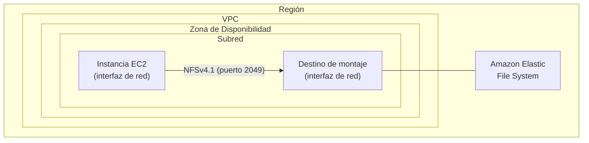
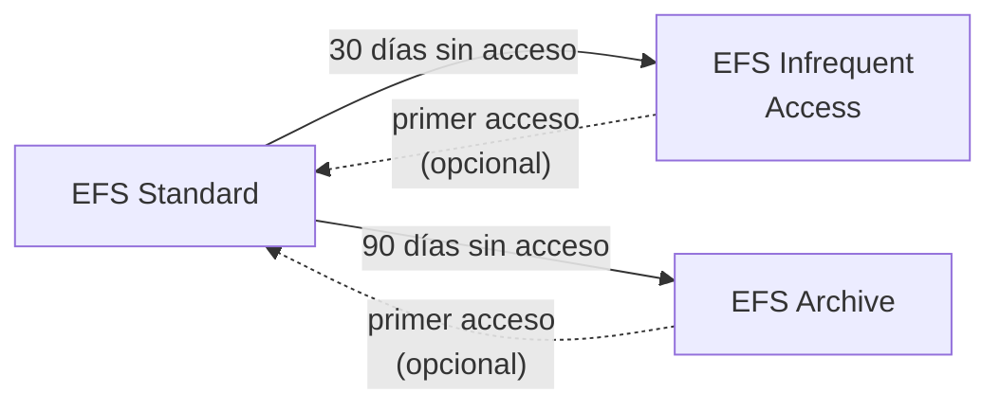
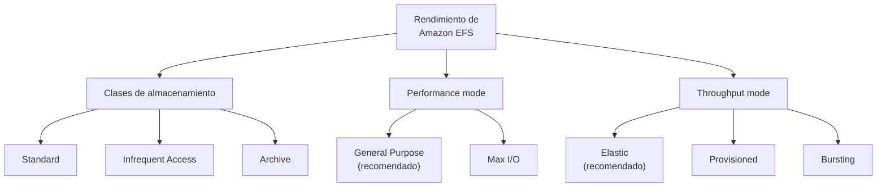
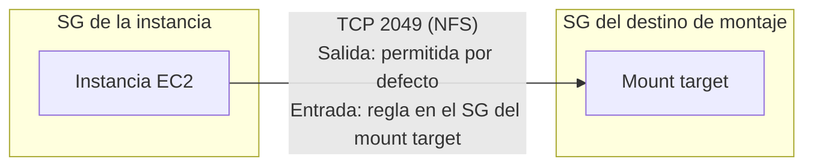

# 3. Amazon EFS: Elastic File System

Amazon Elastic File System (Amazon EFS) es el servicio de **sistema de ficheros compartido** de AWS para cargas de trabajo basadas en Linux. A diferencia de EBS, un mismo sistema de ficheros EFS puede montarse **simultáneamente desde múltiples instancias EC2**, incluso ubicadas en distintas Zonas de Disponibilidad.

---

## Sistemas de Ficheros Compartidos para Instancias EC2

¿Qué sucede si existen **varias instancias** que necesitan usar el **mismo almacenamiento**? Repasemos las opciones disponibles:

| Servicio | ¿Sirve como almacenamiento compartido? | Motivo |
| :--- | :---: | :--- |
| **Amazon EBS** | ❌ | Se asocia a una única instancia (salvo Multi-Attach, con limitaciones) |
| **Amazon S3** | ⚠️ | Es una opción, pero no es ideal: es almacenamiento de objetos, no un sistema de ficheros POSIX |
| **Amazon EFS** | ✅ | Sistema de ficheros compartido para instancias **Linux** (NFS) |
| **Amazon FSx for Windows File Server** | ✅ | Sistema de ficheros compartido para instancias **Windows** (SMB) |

---

## Características Principales

- **Sistema de ficheros compartido:** Soporta lecturas y escrituras en paralelo desde varias instancias EC2 alojadas en diferentes centros de datos.
- **Integración con servicios de cómputo:** Se puede utilizar con **EC2**, **ECS** y **Lambda**, así como desde recursos en las instalaciones locales (*on-premise*).
- **Completamente administrado y autoescalable:** Aumenta o reduce su tamaño automáticamente a medida que se agregan y eliminan ficheros. No es necesario aprovisionar capacidad.
- **Capacidad de petabytes.**
- **Protocolo NFS:** Compatible con las versiones **4.0 y 4.1 (NFSv4)** de *Network File System*.
- **Compatibilidad con todas las AMI basadas en Linux** para Amazon EC2.

!!! note "EBS vs. EFS: diferencia clave en la facturación"
    En **EBS** se paga por el tamaño **aprovisionado** del volumen, se use o no. En **EFS** no se aprovisiona capacidad: se paga únicamente por los **datos realmente almacenados** en cada clase de almacenamiento.

### Casos de uso

Amazon EFS está diseñado para proporcionar rendimiento a una amplia gama de cargas de trabajo y aplicaciones:

- Directorios principales (*home*) de usuarios.
- Sistema de ficheros para aplicaciones empresariales.
- Pruebas y desarrollo de aplicaciones (repositorios de código).
- Copias de seguridad de bases de datos.
- Administración de contenido y servicios web (por ejemplo, varios servidores web sirviendo el mismo contenido).
- Flujos de trabajo multimedia.
- Análisis de Big Data.

---

## Componentes de Amazon EFS

EFS tiene **dos componentes** fundamentales:

- **Sistema de ficheros (*file system*):** Es el recurso que **almacena los datos** en una región de AWS. No se puede acceder a él directamente.
- **Destino de montaje (*mount target*):** Es el recurso que **hace los datos accesibles**. Se crea en una subred y proporciona un punto final de red (una interfaz de red con IP privada) que se utiliza para montar el sistema de ficheros en una instancia EC2 a través de **NFSv4.1**.



### Propiedades de cada recurso

| Recurso | Propiedades |
| :--- | :--- |
| **Sistema de ficheros** | Identificador, token de creación, hora de creación, tamaño en bytes, número de destinos de montaje creados y políticas de ciclo de vida |
| **Destino de montaje** | ID del destino de montaje, ID de la subred en la que se creó, ID del sistema de ficheros al que pertenece, dirección IP de montaje, grupos de seguridad y estado |

### Nombre DNS del sistema de ficheros

Cada sistema de ficheros tiene un **nombre DNS** con el siguiente formato:

```text
file-system-id.efs.aws-region.amazonaws.com
```

Este nombre se puede utilizar directamente en un comando `mount` con el cliente NFS estándar de Linux:

```bash
sudo mount -t nfs \
  -o nfsvers=4.1,rsize=1048576,wsize=1048576,hard,timeo=600,retrans=2,noresvport \
  file-system-DNS-name:/ ~/efs-mount-point
```

---

## Destinos de Montaje y Zonas de Disponibilidad

!!! warning "Un destino de montaje por Zona de Disponibilidad"
    Solo se puede crear **un destino de montaje por Zona de Disponibilidad**. Si una AZ tiene varias subredes, el destino de montaje se crea en **una sola de ellas**. Mientras exista un destino de montaje en una AZ, las instancias EC2 lanzadas en **cualquiera de sus subredes** pueden compartirlo.

AWS recomienda crear un destino de montaje **en cada Zona de Disponibilidad** donde haya instancias que vayan a usar el sistema de ficheros. Así se evita tráfico entre zonas (con su coste y latencia asociados) y se mantiene el acceso aunque caiga una AZ.

---

## Montaje del Sistema de Ficheros

Una vez creados el sistema de ficheros y sus destinos de montaje, hay que montarlo en el sistema operativo de la instancia. Existen dos alternativas:

- **EFS mount helper (`amazon-efs-utils`):** Utilidad **recomendada por Amazon** para montar sistemas EFS en instancias EC2 Linux. Simplifica el montaje y permite activar el cifrado en tránsito (TLS) y la autorización IAM.
- **Cliente NFS estándar de Linux:** Montaje manual con `mount -t nfs` (ver ejemplo anterior).

Con el *mount helper* se puede identificar el sistema de ficheros mediante cualquiera de estas propiedades:

=== "Nombre DNS"

    ```bash
    sudo mount -t efs -o tls fs-abcd123456789ef0.efs.us-east-2.amazonaws.com efs/
    ```

=== "ID del sistema de ficheros"

    ```bash
    sudo mount -t efs -o tls fs-abcd123456789ef0:/ efs/
    ```

=== "Dirección IP del destino de montaje"

    ```bash
    sudo mount -t efs -o tls,mounttargetip=192.0.2.0 fs-abcd123456789ef0 efs/
    ```

### Montaje automático

- **Instancias EC2 nuevas:** Desde la consola, al lanzar la instancia, se puede indicar que monte un sistema EFS existente. Al arrancar, el sistema de ficheros ya estará montado.
- **Instancias EC2 existentes:** Es necesario añadir una entrada al fichero `/etc/fstab`:

```text
file-system-id:/ efs-mount-point efs _netdev,noresvport,tls,iam 0 0
```

| Opción | Significado |
| :--- | :--- |
| `efs` | Tipo de sistema de ficheros (requiere el *mount helper*) |
| `_netdev` | Identifica el sistema de ficheros como **de red**: no se monta hasta que la red esté disponible |
| `noresvport` | Ayuda a que la conexión con EFS no se pierda tras un evento de reconexión de red |
| `tls` | Activa el **cifrado en tránsito** |
| `iam` | Activa la **autorización mediante IAM** |

!!! tip "Puntos de acceso (*access points*)"
    Como vimos en la [Práctica 2.4](practicas/practica-4-amazon-efs.md), un **punto de acceso** permite exponer únicamente un directorio concreto del sistema de ficheros y, opcionalmente, forzar una identidad POSIX (UID/GID) para los clientes que se conecten a través de él. Se monta añadiendo la opción `accesspoint=fsap-xxxxxxxx` al *mount helper*.

---

## Disponibilidad y Durabilidad: Regional vs. One Zone

Amazon EFS ofrece **dos tipos de sistemas de ficheros**, en función de las necesidades de durabilidad y disponibilidad:

- **EFS Regional:** Ofrece los niveles más altos de durabilidad y disponibilidad, almacenando los datos de forma redundante en **varias Zonas de Disponibilidad**.
- **EFS One Zone:** Almacena los datos de forma redundante dentro de **una única Zona de Disponibilidad**. Si esa zona sufre un desastre o fallo, los datos no estarán disponibles y **podrían perderse**.

| Tipo | Diseñado para | Durabilidad | Disponibilidad | Zonas de disponibilidad | Otras consideraciones |
| :--- | :--- | :--- | :--- | :---: | :--- |
| **Regional** | Datos que requieren la máxima durabilidad y disponibilidad | 99,999999999 % (11 nueves) | 99,99 % | ≥ 3 | Ninguna |
| **One Zone** | Datos que no requieren la máxima durabilidad y disponibilidad | 99,999999999 % (11 nueves) | 99,9 % | 1 | No resiste la pérdida de la Zona de Disponibilidad |

=== "Arquitectura Regional"

    ```mermaid
    flowchart TB
        subgraph VPC["Amazon VPC"]
            subgraph AZA["AZ A — Subred 10.0.1.0/24"]
                I1["EC2\n10.0.1.30"]
                I2["EC2\n10.0.1.31"]
                MTA["Mount target\n10.0.1.32"]
            end
            subgraph AZB["AZ B — Subred 10.0.2.0/24"]
                MTB["Mount target\n10.0.2.45"]
            end
            subgraph AZC["AZ C"]
                I3["EC2\n10.0.4.1\n(subred 10.0.4.0/24)"]
                MTC["Mount target\n10.0.3.15\n(subred 10.0.3.0/24)"]
            end
            EFS["Amazon EFS\n(Regional)"]
        end
        I1 --> MTA
        I2 --> MTA
        I3 --> MTC
        MTA --- EFS
        MTB --- EFS
        MTC --- EFS
    ```

    Hay un destino de montaje en cada AZ. Observa que en la AZ C la instancia y el destino de montaje están en **subredes distintas** de la misma AZ: la instancia usa igualmente ese destino de montaje.

=== "Arquitectura One Zone"

    ```mermaid
    flowchart TB
        subgraph VPC["Amazon VPC"]
            subgraph AZA["AZ A — Subred 10.0.1.0/24"]
                I1["EC2\n10.0.1.31"]
                MTA["Mount target\n10.0.1.32"]
                EFS["Amazon EFS\n(One Zone)"]
            end
            subgraph AZB["AZ B — Subred 10.0.2.0/24"]
                I2["EC2\n10.0.2.31"]
            end
        end
        I1 --> MTA
        I2 -- "tráfico entre AZ" --> MTA
        MTA --- EFS
    ```

    Solo existe un destino de montaje, en la AZ donde residen los datos. Las instancias de otras AZ pueden acceder, pero generando **tráfico entre zonas** y dependiendo de la disponibilidad de la AZ A.

---

## Clases de Almacenamiento EFS

Al igual que en Amazon S3, EFS ofrece diferentes **clases de almacenamiento** para optimizar el coste según el patrón de acceso a los datos:

- **EFS Standard:** Almacenamiento en **SSD** que ofrece la latencia más baja para ficheros a los que se accede con frecuencia.
- **EFS Infrequent Access (IA):** Optimizada para datos a los que se accede solo **unas cuantas veces cada trimestre**.
- **EFS Archive:** Rentable para datos a los que se accede **unas pocas veces al año o menos**.

| Clase | Diseñada para | Latencia primer byte | Durabilidad | SLA de disponibilidad | Zonas de disponibilidad | Cargo mínimo por fichero | Duración mínima |
| :--- | :--- | :--- | :--- | :--- | :--- | :--- | :--- |
| **Standard** | Datos activos que requieren latencia inferior al milisegundo | Sub-milisegundo | 11 nueves | 99,99 % (Regional) / 99,9 % (One Zone) | ≥ 3 (Regional) / 1 (One Zone) | No aplica | No aplica |
| **Infrequent Access** | Datos inactivos accedidos unas pocas veces por trimestre | Decenas de ms | 11 nueves | 99,99 % (Regional) / 99,9 % (One Zone) | ≥ 3 (Regional) / 1 (One Zone) | 128 KiB | No aplica |
| **Archive** | Datos inactivos accedidos unas pocas veces al año o menos | Decenas de ms | 11 nueves | 99,9 % (Regional) | ≥ 3 (Regional) | 128 KiB | 90 días |

### Consejos para elegir la clase de almacenamiento

- **Acceso frecuente** → **Standard** o **One Zone**, que ofrecen la menor latencia.
- **Acceso menos frecuente que a diario** → **Standard–IA** o **One Zone–IA** para reducir costes de almacenamiento. Ten en cuenta que **aumenta la latencia del primer byte** y conlleva un **coste adicional por acceso a los datos**.
- **No se necesita alta disponibilidad** → **One Zone** o **One Zone–IA**. No replican los datos entre varios centros de datos, por lo que la disponibilidad prometida baja al 99,9 %.

!!! warning "Durabilidad ≠ protección frente a desastres"
    Todas las clases están diseñadas para una durabilidad del **99,999999999 %**. Sin embargo, en las clases **One Zone** es imprescindible hacer **copias de seguridad** para poder recuperar los datos en caso de destrucción del centro de datos.

---

## Administración del Ciclo de Vida de EFS

Mediante **políticas de ciclo de vida**, EFS puede mover automáticamente los ficheros entre clases de almacenamiento en función del tiempo transcurrido desde su último acceso:

| Política | Qué hace | Valor por defecto |
| :--- | :--- | :--- |
| **Transición a IA** | Mueve a *Infrequent Access* los ficheros no accedidos en Standard durante N días | **30 días** sin acceso |
| **Transición a Archive** | Mueve a *Archive* los ficheros no accedidos en Standard durante N días | **90 días** sin acceso |
| **Transición a Standard** | Devuelve los ficheros de IA o Archive a Standard | **Desactivada** (los ficheros permanecen en IA/Archive) |



!!! tip "Transición a Standard en el primer acceso"
    Para casos de uso sensibles al rendimiento que exigen la latencia más baja (por ejemplo, aplicaciones que trabajan con un gran volumen de ficheros pequeños), es recomendable activar la transición **a Standard en el primer acceso** (*On first access*).

---

## Opciones de Rendimiento de Amazon EFS

La latencia, el rendimiento (*throughput*) y las operaciones de E/S por segundo de un sistema EFS dependen de tres factores:



### Modos de *Performance*

| Modo | Descripción |
| :--- | :--- |
| **General Purpose** | Latencia por operación más baja. Es el modo **predeterminado** y el recomendado para la mayoría de cargas, incluidas las sensibles a la latencia |
| **Max I/O** | Diseñado para cargas de trabajo **altamente paralelizadas** que pueden tolerar latencias más altas |

### Modos de *Throughput*

| Modo | Cuándo usarlo | Cómo funciona |
| :--- | :--- | :--- |
| **Elastic** | Cargas **impredecibles** o con picos, difíciles de pronosticar | Modo **predeterminado**. El rendimiento escala automáticamente con la actividad y se paga por los datos transferidos |
| **Provisioned** | Se conocen los requisitos de rendimiento de la carga | Se fija una **tasa de rendimiento** (MiB/s) que el sistema mantiene **independientemente de su tamaño**. Se paga por el rendimiento aprovisionado |
| **Bursting** (ráfagas) | Se quiere que el rendimiento **escale con la cantidad de datos almacenados** | Usa un **sistema de créditos**: se consumen al superar una tasa base y se recuperan cuando se está por debajo |

!!! note "Nomenclatura en la consola"
    En la consola actual, los modos **Elastic** y **Provisioned** aparecen agrupados bajo la opción **Enhanced**, mientras que **Bursting** aparece como opción independiente.

---

## Precios de Amazon EFS

En EFS se paga por:

- La **cantidad de datos (GB)** almacenados en cada clase de almacenamiento.
- El **acceso a los datos** cuando se leen ficheros de **Infrequent Access** o **Archive**, y por los datos que se mueven entre clases mediante la gestión del ciclo de vida. Recuerda que IA y Archive tienen un **cargo mínimo de facturación de 128 KiB por fichero**.
- **Precios adicionales** para sistemas que utilizan rendimiento **aprovisionado** o en **ráfaga**.

| Concepto | Precio orientativo |
| :--- | :--- |
| **Standard** (GB-mes) | 0,33 USD |
| **Infrequent Access** (GB-mes) | 0,02 USD |
| **Archive** (GB-mes) | 0,01 USD |
| **Copia de seguridad** en caliente / en frío (GB-mes) | 0,055 USD / 0,011 USD |
| Todas las clases: **lecturas** (por GB transferido) | 0,03 USD |
| Todas las clases: **escrituras** (por GB transferido) | 0,07 USD |
| Infrequent Access: lecturas (cargo incremental por GB) | 0,011 USD |
| Infrequent Access: transición entre niveles (por GB) | 0,011 USD |
| Archive: lecturas (cargo incremental por GB) | 0,033 USD |
| Archive: transición entre niveles (por GB) | 0,033 USD |

!!! example "Ejemplo: coste de 5 GB en EFS"
    Suponiendo que los datos se acceden **varias veces al día** y que se necesita **alta disponibilidad**, se elige la clase **Standard** (Regional).

    **Coste de almacenamiento:** 5 GB × 0,33 USD = **1,65 USD al mes**

!!! tip "Calculadora de precios"
    Los precios varían según la región y cambian con el tiempo. Utiliza la [calculadora de precios de AWS](https://calculator.aws/) para estimar el coste real de tu configuración.

---

## Seguridad en Amazon EFS

### Cifrado

Amazon EFS admite dos formas de cifrado complementarias:

| Tipo | Características |
| :--- | :--- |
| **Cifrado en reposo** | Opción **predeterminada** al crear el sistema de ficheros. Datos y metadatos se cifran automáticamente antes de escribirse y se descifran al leerse, de forma transparente para la aplicación. Utiliza **AES-256** con claves de AWS KMS |
| **Cifrado en tránsito** | Utiliza **TLS** al montar el sistema de ficheros con el *mount helper*, que crea un túnel cifrado (**stunnel**) |

```bash
# Montaje con cifrado en tránsito
sudo mount -t efs -o tls fs-12345678:/ /mnt/efs
```

!!! warning "El cifrado en reposo no se puede cambiar"
    Una vez creado un sistema de ficheros EFS, **no se puede modificar su configuración de cifrado en reposo**. Si se creó sin cifrar, habría que crear un nuevo sistema cifrado y migrar los datos.

### Control de acceso a la red

El acceso de red se controla mediante **grupos de seguridad** asociados tanto a las **instancias EC2** como a los **destinos de montaje**. El tráfico NFS utiliza el **puerto 2049 (TCP)**.

Para que una instancia EC2 pueda montar un sistema EFS se deben cumplir **dos condiciones**:

1. **Grupo de seguridad del destino de montaje:** Debe tener una regla que permita conexiones **entrantes** en el puerto NFS (2049) desde la instancia (por dirección IP o, preferiblemente, por grupo de seguridad).
2. **Grupo de seguridad de la instancia:** Debe permitir conexiones **salientes** al puerto NFS hacia uno de los destinos de montaje (por defecto, los grupos de seguridad permiten todo el tráfico saliente).



### Gestión de identidades y acceso (IAM)

Amazon EFS se integra con **AWS IAM**, soportando, entre otras, políticas basadas en identidad, **políticas basadas en recursos** (políticas del sistema de ficheros), claves de condición específicas del servicio, credenciales temporales y roles de servicio. **No** soporta ACL y el soporte de ABAC (etiquetas en políticas) es **parcial**.

!!! danger "Política por defecto: acceso anónimo completo"
    La política predeterminada de un sistema EFS **no utiliza IAM para autenticar** y concede **acceso completo a cualquier cliente anónimo** que pueda conectarse a través de un destino de montaje. La única barrera es, por tanto, la red (grupos de seguridad).

Los clientes NFS pueden identificarse mediante un **rol de IAM** al conectarse (opción `iam` del *mount helper*). En ese caso, EFS evalúa la **política de recursos del sistema de ficheros** junto con las **políticas de IAM basadas en identidad** para determinar los permisos. Las acciones disponibles para clientes son:

| Acción | Descripción |
| :--- | :--- |
| `elasticfilesystem:ClientMount` | Acceso de **solo lectura** al sistema de ficheros |
| `elasticfilesystem:ClientWrite` | Permisos de **escritura** en el sistema de ficheros |
| `elasticfilesystem:ClientRootAccess` | Permite actuar como usuario **root** al acceder al sistema de ficheros |

**Ejemplo:** política de sistema de ficheros que otorga lectura y escritura al rol `Testing_Role`, siempre que el acceso se haga a través de un destino de montaje:

```json
{
    "Statement": [
        {
            "Effect": "Allow",
            "Principal": {
                "AWS": "arn:aws:iam::111122223333:role/Testing_Role"
            },
            "Action": [
                "elasticfilesystem:ClientWrite",
                "elasticfilesystem:ClientMount"
            ],
            "Resource": "arn:aws:elasticfilesystem:us-east-2:111122223333:file-system/fs-1234abcd",
            "Condition": {
                "Bool": {
                    "elasticfilesystem:AccessedViaMountTarget": "true"
                }
            }
        }
    ]
}
```

!!! tip "Opciones de política habituales en la consola"
    Al crear el sistema de ficheros, la consola ofrece casillas que generan la política automáticamente:

    - **Prevent root access by default:** impide el acceso como root (no concede `ClientRootAccess`).
    - **Enforce read-only access by default:** solo concede `ClientMount`.
    - **Prevent anonymous access:** exige que el cliente se identifique con IAM.
    - **Enforce in-transit encryption for all clients:** deniega cualquier acción si `aws:SecureTransport` es `false`, obligando a montar con TLS.

---

## Replicación de Sistemas EFS

Para una mayor resiliencia y protección de datos, es posible **replicar un sistema de ficheros EFS en otra región de AWS** (o en la misma).

- Cuando la replicación está habilitada, EFS replica **automáticamente y de forma transparente** los datos y metadatos del sistema de ficheros de **origen** a un sistema de ficheros de **destino** (de solo lectura mientras dure la replicación).
- En caso de desastre o durante simulacros, se puede **conmutar (*failover*)** al sistema de ficheros réplica. Para reanudar las operaciones normales, basta con volver al sistema de ficheros principal.
- El proceso de creación del destino y su sincronización se gestionan mediante una **configuración de replicación**, accesible desde la consola o la CLI:

```bash
aws efs describe-replication-configurations --file-system-id fs-0123456789abcdef1
```

---

## Copias de Seguridad con AWS Backup

Aunque AWS garantiza una durabilidad del **99,999999999 %** para los datos de EFS (y la clase Standard los replica entre varios centros de datos), la durabilidad **no protege frente a errores humanos** como el borrado accidental de ficheros. Por ello, es imprescindible hacer copias de seguridad.

**AWS Backup** es un servicio **centralizado** de protección de datos para realizar copias de seguridad y restaurar datos de múltiples servicios: EC2, EBS, S3, RDS, DynamoDB, EFS, y muchos más.

Para crear copias de seguridad de un sistema EFS se necesitan tres componentes:

| Componente | Descripción |
| :--- | :--- |
| **Vault** (almacén) | Contenedor donde se agrupan y guardan las copias de seguridad |
| **Plan** | Define **cuándo y cómo** se realizan las copias de los recursos (frecuencia, retención, ventana, etc.) |
| **Recovery point** (punto de recuperación) | Contiene toda la información necesaria para restaurar un recurso. También se le llama *snapshot* |


!!! tip "Backups automáticos al crear el sistema EFS"
    Al crear un sistema de ficheros desde la consola, la opción **Automatic backups** viene marcada por defecto: crea automáticamente un plan de AWS Backup con la configuración recomendada. Puedes profundizar en este servicio en la [Práctica 2.6](practicas/practica-6-aws-backup.md).

---

## Otros Aspectos de Amazon EFS

### Transferencia de datos

| Servicio | Descripción |
| :--- | :--- |
| **AWS DataSync** | Servicio de transferencia de datos *online* para copiar datos entre servidores NFS, SMB, almacenamiento de objetos, buckets de S3 y sistemas EFS y FSx |
| **AWS Transfer Family** | Permite la transferencia de ficheros hacia/desde EFS utilizando los protocolos **SFTP (SSH)**, **FTPS** y **FTP** |

### Monitorización

Como mínimo, se debería monitorizar:

- El **rendimiento de red** del sistema de ficheros.
- El **número de conexiones** de clientes.
- El **número de bytes** por cada tipo de operación: lectura de datos, escritura de datos y operaciones de metadatos.

Para ello se utilizan **Amazon CloudWatch** (métricas y alarmas) y **AWS CloudTrail** (auditoría de llamadas a la API). Por ejemplo, se podría definir una alarma que avise si hay algún intento de crear un sistema EFS con el **cifrado en reposo deshabilitado**.

---

## Creación de un Sistema EFS desde la Consola

El asistente de creación de la consola recoge, en orden, las siguientes opciones:

| Paso | Opciones principales |
| :--- | :--- |
| **1. General** | Nombre, tipo de sistema de ficheros (**Regional** / **One Zone**), backups automáticos, políticas de ciclo de vida (IA, Archive, Standard) y cifrado en reposo |
| **2. Rendimiento** | *Throughput mode* (Enhanced → Elastic / Provisioned, o Bursting) y *Performance mode* (General Purpose / Max I/O) |
| **3. Red** | VPC, y para cada AZ: subred, dirección IP (automática o manual) y grupos de seguridad del destino de montaje |
| **4. Política del sistema de ficheros** | Opciones de seguridad predefinidas (sin root, solo lectura, sin acceso anónimo, cifrado en tránsito) o política personalizada en JSON |
| **5. Revisión y creación** | Resumen de la configuración |

!!! warning "Grupo de seguridad de los destinos de montaje"
    El grupo de seguridad asociado a los destinos de montaje **debe permitir el tráfico entrante NFS (TCP 2049)** desde las instancias. Si se deja el grupo de seguridad por defecto de la VPC, es habitual que el montaje se quede colgado sin dar error.

Una vez creado el sistema y en estado **Available**, se puede utilizar su **nombre DNS** (por ejemplo, `fs-0fbe4e2eb56e1bf12.efs.us-east-1.amazonaws.com`) para montarlo desde cualquier instancia lanzada en cualquiera de las Zonas de Disponibilidad asociadas al sistema de ficheros.

---

## Amazon FSx for Windows File Server

Mientras que EFS está orientado a Linux (NFS), **Amazon FSx for Windows File Server** proporciona almacenamiento de sistema de ficheros compartido **completamente administrado** para instancias **Microsoft Windows** EC2.

- Compatibilidad nativa con Microsoft Windows.
- Sistema de ficheros **NTFS** (*New Technology File System*).
- Protocolo **SMB** (*Server Message Block*) nativo, versiones 2.0 a 3.1.1.
- Espacios de nombres **DFS** (*Distributed File System*) y **DFS Replication**.
- Integración con **Microsoft Active Directory** y soporte de **listas de control de acceso (ACL)** de Windows.
- Respaldado por almacenamiento **SSD** de alto rendimiento.

### Comparativa EFS vs. FSx for Windows File Server

| Característica | Amazon EFS | Amazon FSx for Windows File Server |
| :--- | :--- | :--- |
| **Sistema operativo cliente** | Linux | Windows |
| **Protocolo** | NFSv4.0 / NFSv4.1 | SMB 2.0 – 3.1.1 |
| **Sistema de ficheros** | POSIX | NTFS |
| **Autenticación / permisos** | IAM + permisos POSIX | Active Directory + ACL de Windows |
| **Capacidad** | Elástica (crece y decrece sola) | Aprovisionada |
| **Caso típico** | Contenido web compartido, *home* de usuarios Linux, contenedores | Recursos compartidos de Windows, aplicaciones .NET, SharePoint, *home* de usuarios Windows |
