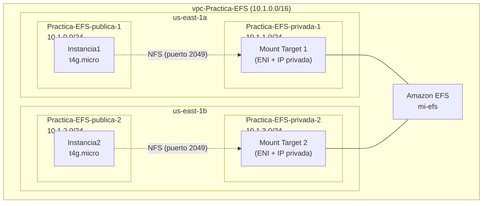

# Práctica 4: Amazon EFS — Creación de un Sistema de Ficheros NFS

- **Módulo:** Administración de Bases de Datos y Almacenamiento en la Nube (ABDAN)
- **Unidad de Trabajo:** UT2. Servicios de almacenamiento en bloque y sistemas de ficheros en red

---

## Introducción

**Amazon Elastic File System (EFS)** es un servicio completamente administrado, de alta disponibilidad y durabilidad, que proporciona un almacenamiento de ficheros totalmente elástico y sin servidor. Permite compartir datos de archivos sin necesidad de aprovisionar o administrar la capacidad de almacenamiento y el rendimiento. Los sistemas de ficheros de Amazon EFS escalan automáticamente hasta PBytes de datos y permiten que miles de servidores, instancias o máquinas virtuales puedan acceder simultáneamente y de forma consistente.

En esta práctica exploraremos el servicio de Amazon EFS y aprenderemos cómo crear un sistema de archivos NFS (*Network File System*) utilizando Amazon EFS en una infraestructura de red prediseñada. Montaremos el sistema de ficheros en dos instancias de Amazon EC2, crearemos puntos de acceso (*access points*) para restringir la visibilidad de un directorio concreto y configuraremos el montaje persistente a través de `/etc/fstab`.

### Arquitectura propuesta



### Requerimientos

- Disponer de acceso a los recursos de AWS a través de un sandbox de **AWS Academy Learner Lab**.
- Disponer de una máquina con la **AWS CLI** configurada con las credenciales de AWS Academy Learner Lab.

---

## Fase 1: Configuración de la infraestructura de red

El objetivo de esta práctica no es configurar la infraestructura de red, por lo que automatizaremos su despliegue mediante **AWS CloudFormation**.

1. Descarga los dos archivos de plantilla necesarios:

    - [`practica-efs.yaml`](practica-4-efs/practica-efs.yaml) — plantilla principal que crea las instancias EC2.
    - [`vpc.yaml`](practica-4-efs/vpc.yaml) — plantilla anidada que crea la VPC, subredes y demás recursos de red.


2. Desde la AWS CLI, crea un bucket de Amazon S3 para alojar los recursos de CloudFormation (el nombre del bucket debe ser único globalmente):

    ```bash
    aws s3 mb s3://<nombre-bucket> --region us-east-1
    ```

3. A continuación, ubícate en el directorio donde se encuentran los archivos descargados y ejecuta las siguientes instrucciones para empaquetar y desplegar la infraestructura:

    ```bash
    aws cloudformation package \
        --s3-bucket <nombre-bucket> \
        --template-file practica-efs.yaml \
        --output-template-file packaged.yaml \
        --region us-east-1

    aws cloudformation deploy \
        --template-file packaged.yaml \
        --stack-name efs-stack \
        --region us-east-1
    ```

    !!! note "¿Qué hace el comando `package`?"
        CloudFormation no puede referenciar plantillas anidadas desde archivos locales. El comando `package` sube la plantilla `vpc.yaml` a S3 y reescribe la referencia `TemplateURL` en `practica-efs.yaml` para que apunte a la URL de S3, generando el archivo `packaged.yaml`.

4. Tras esperar unos minutos, se habrá completado el despliegue. La arquitectura desplegada contiene los siguientes recursos:

    | Recurso | Descripción |
    | :--- | :--- |
    | **VPC** `vpc-Practica-EFS` | Bloque CIDR `10.1.0.0/16`, 2 zonas de disponibilidad |
    | **Subred** `Practica-EFS-publica-1` | CIDR `10.1.0.0/24`, zona `us-east-1a` |
    | **Subred** `Practica-EFS-publica-2` | CIDR `10.1.2.0/24`, zona `us-east-1b` |
    | **Subred** `Practica-EFS-privada-1` | CIDR `10.1.1.0/24`, zona `us-east-1a` |
    | **Subred** `Practica-EFS-privada-2` | CIDR `10.1.3.0/24`, zona `us-east-1b` |
    | **Instancia1** | `t4g.micro`, desplegada en `Practica-EFS-publica-1` |
    | **Instancia2** | `t4g.micro`, desplegada en `Practica-EFS-publica-2` |
    | **Grupo de seguridad** `sg-ec2` | Asignado a las instancias EC2, sin reglas de entrada (se administran mediante AWS SSM) |

---

## Fase 2: Creación del grupo de seguridad para EFS

Amazon EFS escucha las solicitudes a través del protocolo NFS por el **puerto 2049 TCP**. Debemos crear un grupo de seguridad que permita el tráfico entrante por este puerto, restringiendo el origen únicamente a nuestras instancias EC2.

1. Desde la consola de **Amazon EC2**, accede al menú lateral **Network & Security → Security Groups** y presiona el botón **Create security group**.

2. Configura el grupo de seguridad con los siguientes valores:

    | Campo | Valor |
    | :--- | :--- |
    | **Security group name** | `efs-sg` |
    | **Description** | `Grupo de seguridad para el sistema de ficheros EFS` |
    | **VPC** | `vpc-Practica-EFS` |

3. En el apartado **Inbound rules**, añade una nueva regla:

    | Campo | Valor |
    | :--- | :--- |
    | **Type** | `NFS` |
    | **Source** | `Custom` → selecciona el grupo de seguridad `sg-ec2` |

    !!! tip "Buenas prácticas de seguridad"
        Al indicar como origen el grupo de seguridad `sg-ec2` en lugar de una dirección IP o un bloque CIDR, estamos siguiendo el principio de mínimo privilegio. Solo las instancias que tengan asignado ese grupo de seguridad podrán acceder al sistema de ficheros EFS.

4. En el apartado **Tags**, añade una etiqueta con clave `Name` y valor `sg-efs`.

5. Presiona el botón **Create security group**.

6. Desde el menú **Network & Security → Security Groups**, comprueba que ya dispones de los dos grupos de seguridad necesarios: `sg-ec2` y `sg-efs`.

---

## Fase 3: Creación del sistema de ficheros Amazon EFS

1. Desde la consola del servicio **Amazon EFS**, accede a la opción **File Systems** del menú lateral y presiona el botón **Create file system**.

2. En la ventana emergente, presiona directamente el botón **Customize** (sin introducir ningún otro valor).

3. **Paso 1 — File system settings.** Configura los siguientes campos:

    | Campo | Valor |
    | :--- | :--- |
    | **Name** | `mi-efs` |
    | **Storage class** | `Standard` |
    | **Automatic backups** | Desmarcar la casilla |
    | **Lifecycle management** | Dejar los valores por defecto |
    | **Encryption** | Dejar el valor por defecto (cifrado habilitado) |
    | **Throughput mode** | `Elastic` |

    !!! note "Modos de rendimiento (Throughput mode)"
        - **Elastic:** Para cargas de trabajo impredecibles. Recomendado en la mayoría de casos.
        - **Provisioned:** Permite ajustar el rendimiento en MiB/s. Útil cuando se conocen los requisitos de la carga.
        - **Bursting:** Escala la productividad proporcionalmente a la cantidad de almacenamiento del sistema de ficheros.

    Presiona el botón **Next**.

4. **Paso 2 — Network.** Configura la información de red:

    - En **Virtual Private Cloud (VPC)**, selecciona `vpc-Practica-EFS`.
    - En el apartado **Mount targets**, para cada zona de disponibilidad:
        - En **Subnet ID**, selecciona las **subredes privadas** (`Practica-EFS-privada-1` y `Practica-EFS-privada-2`).
        - En **Security groups**, elimina el grupo de seguridad `default` y añade el grupo de seguridad `sg-efs`.

    !!! important "¿Por qué subredes privadas?"
        Los destinos de montaje (*mount targets*) se despliegan en las subredes privadas para que el tráfico NFS no salga a Internet. Las instancias EC2 en las subredes públicas accederán al sistema de ficheros a través de la red interna de la VPC.

    Presiona el botón **Next**.

5. **Paso 3 — File system policy.** En este paso se puede configurar una política basada en el recurso para controlar el acceso mediante permisos de AWS IAM. Para simplificar esta práctica, **no configuraremos ninguna política**. Presiona el botón **Next**.

6. **Paso 4 — Review and create.** Revisa la configuración elegida y presiona el botón **Create** para crear el sistema de ficheros.

7. En cuestión de pocos segundos, el sistema de ficheros estará creado y podrá visualizarse desde la consola de Amazon EFS.

---

## Fase 4: Verificación de los destinos de montaje

1. Desde la consola de Amazon EFS, haz clic en el nombre del sistema de ficheros (`mi-efs`) y activa la pestaña **Network**.

2. Comprueba que se ha creado un **destino de montaje** (*mount target*) en cada una de las dos zonas de disponibilidad:

    | Zona de Disponibilidad | Subred | Dirección IP |
    | :--- | :--- | :--- |
    | `us-east-1a` | `Practica-EFS-privada-1` | IP privada del bloque `10.1.1.0/24` |
    | `us-east-1b` | `Practica-EFS-privada-2` | IP privada del bloque `10.1.3.0/24` |

    Cada punto de montaje está implementado mediante una **Interfaz de Red Elástica (ENI)** con una IP privada dentro del bloque CIDR de la subred correspondiente.

    !!! note "Resolución DNS condicional"
        Amazon EFS asigna un nombre DNS al sistema de ficheros que se resuelve de forma privada y condicional: los clientes en `us-east-1a` resolverán a la IP del mount target de esa misma zona, y los clientes en `us-east-1b` resolverán a la IP del mount target de su zona. Esto garantiza que el tráfico NFS no cruce entre zonas de disponibilidad, minimizando la latencia.

3. **Copia el nombre DNS** del sistema de ficheros (o su ID, como `fs-xxxxxxxxxxxxxxxxx`), ya que lo necesitarás en los siguientes pasos.

---

## Fase 5: Montaje del sistema de ficheros en la Instancia1

1. Accede a la consola de **Amazon EC2**. Comprueba que las dos instancias EC2 (`Instancia1` e `Instancia2`) están en ejecución.

2. Selecciona la instancia `Instancia1` y presiona el botón **Connect**. Ubícate en la pestaña **Session Manager** y presiona **Connect** para abrir una sesión de terminal.

3. Instala los paquetes necesarios:

    ```bash
    sudo yum install -y amazon-efs-utils tree
    ```

    !!! note "amazon-efs-utils"
        Este paquete proporciona el helper de montaje `mount.efs`, que simplifica el montaje de sistemas de ficheros EFS con soporte integrado para cifrado en tránsito (TLS) y la autenticación IAM.

4. Crea el directorio de montaje y monta el sistema de ficheros EFS. Sustituye `<nombre-dns-efs>` por el nombre DNS de tu sistema de ficheros:

    ```bash
    fs=<nombre-dns-efs>
    sudo mkdir /mnt/efs
    sudo mount -t efs -o tls $fs:/ /mnt/efs
    ```

5. Crea un directorio llamado `instancia2` e introduce archivos de prueba tanto en la raíz del sistema EFS como dentro de dicho directorio:

    ```bash
    sudo mkdir /mnt/efs/instancia2
    sudo bash -c "echo 'Fichero 1. Sólo accesible por la instancia1' > /mnt/efs/fichero1.txt"
    sudo bash -c "echo 'Fichero 2. Accesible por ambas instancias' > /mnt/efs/instancia2/fichero2.txt"
    ```

6. Visualiza la estructura de ficheros creada:

    ```bash
    tree /mnt/efs
    ```

    La salida esperada debería ser similar a:

    ```
    /mnt/efs
    ├── fichero1.txt
    └── instancia2
        └── fichero2.txt
    ```

---

## Fase 6: Montaje con punto de acceso en la Instancia2

En esta fase montaremos el sistema de ficheros EFS en la `Instancia2`, pero **restringiendo la visibilidad** al directorio `instancia2`. Para ello, crearemos un **punto de acceso** (*access point*) en Amazon EFS.

### Creación del punto de acceso

1. Desde la consola de **Amazon EFS**, en el menú lateral, selecciona la opción **Access points** y presiona el botón **Create access point**.

2. Configura el punto de acceso con los siguientes valores:

    | Campo | Valor |
    | :--- | :--- |
    | **File system** | `mi-efs` |
    | **Name** | `Punto de acceso para Instancia2` |
    | **Root directory path** | `/instancia2` |

    !!! note "¿Qué es un punto de acceso?"
        Un punto de acceso de Amazon EFS permite definir un directorio raíz específico y, opcionalmente, una identidad POSIX (UID/GID) para todas las operaciones realizadas por los clientes NFS que se conecten a través de él. Esto permite segmentar y restringir el acceso al sistema de ficheros sin necesidad de modificar permisos a nivel de sistema operativo.

    Los campos del grupo **POSIX user** y **Root directory creation permissions** se dejarán con sus valores por defecto.

3. Presiona el botón **Create access point**. En breves instantes, el punto de acceso estará disponible.

4. **Copia el ID del punto de acceso** (por ejemplo, `fsap-xxxxxxxxxxxxxxxxx`).

### Montaje en la Instancia2

5. Abre una sesión en la `Instancia2` mediante **Session Manager** (igual que en el apartado anterior).

6. Instala los paquetes necesarios:

    ```bash
    sudo yum install -y amazon-efs-utils tree
    ```

7. Monta el sistema de ficheros EFS utilizando el punto de acceso. Sustituye los *placeholders* por tus valores:

    ```bash
    fs=<nombre-dns-efs>
    fsap=<ID-punto-acceso>
    sudo mkdir /mnt/efs
    sudo mount -t efs -o tls,accesspoint=$fsap $fs:/ /mnt/efs
    ```

8. Comprueba que desde el directorio `/mnt/efs` solo se ve el contenido del directorio `/instancia2` del sistema de ficheros EFS:

    ```bash
    tree /mnt/efs
    ```

    La salida esperada debería ser:

    ```
    /mnt/efs
    └── fichero2.txt
    ```

    !!! tip "Verificación cruzada"
        Puedes leer el contenido de `fichero2.txt` desde ambas instancias para comprobar que se trata del mismo archivo compartido: `cat /mnt/efs/instancia2/fichero2.txt` (desde Instancia1) y `cat /mnt/efs/fichero2.txt` (desde Instancia2).

---

## Fase 7: Montaje persistente mediante `/etc/fstab`

La solución de montaje adoptada hasta ahora es **temporal**: si reiniciamos las instancias EC2, habría que montar de nuevo el sistema de ficheros. Para que el sistema de ficheros EFS se monte automáticamente en cada arranque, es necesario añadir una entrada en el archivo `/etc/fstab`.

### Instancia1 (montaje completo)

1. En la sesión de la `Instancia1`, ejecuta la siguiente orden (la variable `$fs` debe contener el nombre DNS del sistema de ficheros):

    ```bash
    sudo bash -c "echo '$fs:/ /mnt/efs nfs4 nfsvers=4.1,rsize=1048576,hard,timeo=600,retrans=2,noresvport,_netdev 0 0' >> /etc/fstab"
    ```

2. Comprueba el contenido de `/etc/fstab`:

    ```bash
    cat /etc/fstab
    ```

3. Reinicia la instancia y verifica que el montaje se realiza automáticamente:

    ```bash
    sudo reboot
    ```

    Tras reconectar a la sesión, ejecuta:

    ```bash
    df -hT /mnt/efs
    tree /mnt/efs
    ```

### Instancia2 (montaje con punto de acceso)

4. En la sesión de la `Instancia2`, la sintaxis es ligeramente diferente al utilizar un punto de acceso. Ejecuta la siguiente orden (las variables `$fs` y `$fsap` deben contener los valores correspondientes):

    ```bash
    sudo bash -c "echo '$fs /mnt/efs efs _netdev,tls,accesspoint=$fsap 0 0' >> /etc/fstab"
    ```

5. Reinicia la instancia y verifica que el montaje con punto de acceso se realiza automáticamente:

    ```bash
    sudo reboot
    ```

    Tras reconectar a la sesión, ejecuta:

    ```bash
    df -hT /mnt/efs
    tree /mnt/efs
    ```

!!! warning "Variables de entorno tras el reinicio"
    Si has utilizado variables de shell (`$fs`, `$fsap`) para definir los valores, recuerda que **deben tener valor en el momento de ejecutar el `echo`**, ya que el contenido se escribe literalmente en `/etc/fstab`. Tras un reinicio las variables de shell se pierden, pero la línea escrita en el archivo ya contiene los valores reales.

---

## Fase 8: Limpieza del laboratorio

Para liberar los recursos creados y evitar el consumo innecesario de créditos de AWS Academy Learner Labs, sigue estos pasos **en orden**:

1. **Eliminar el sistema de ficheros de Amazon EFS.** Desde la consola del servicio Amazon EFS, selecciona el sistema de ficheros `mi-efs` y presiona el botón **Delete**.

2. **Eliminar el grupo de seguridad del EFS.** Desde la consola de Amazon EC2, accede al menú lateral **Network & Security → Security Groups**, selecciona el grupo de seguridad `sg-efs` y presiona **Actions → Delete security groups**.

3. **Desaprovisionar la infraestructura de red y las instancias EC2.** Desde la terminal de tu máquina local, ejecuta:

    ```bash
    aws cloudformation delete-stack --stack-name efs-stack --region us-east-1
    ```

    !!! note
        La instrucción anterior no devuelve resultado alguno, pero en cuestión de pocos minutos la infraestructura de red y las instancias EC2 se habrán desaprovisionado completamente.

---

## Entregables

1. **Captura 1 — Infraestructura desplegada:** Captura de la consola de Amazon EC2 mostrando las dos instancias (`Instancia1` e `Instancia2`) en estado *Running*.

2. **Captura 2 — Grupos de seguridad:** Captura desde la consola de EC2 (Security Groups) mostrando los grupos de seguridad `sg-ec2` y `sg-efs`, con la regla de entrada NFS (puerto 2049) del grupo `sg-efs` visible.

3. **Captura 3 — Mount targets del sistema de ficheros:** Captura de la pestaña **Network** del sistema de ficheros `mi-efs` en la consola de Amazon EFS, mostrando los dos destinos de montaje en las subredes privadas con sus direcciones IP.

4. **Captura 4 — Montaje en Instancia1:** Salida del terminal de la `Instancia1` tras ejecutar `tree /mnt/efs`, donde se aprecie la estructura completa del sistema de ficheros (con `fichero1.txt` e `instancia2/fichero2.txt`).

5. **Captura 5 — Montaje con punto de acceso en Instancia2:** Salida del terminal de la `Instancia2` tras ejecutar `tree /mnt/efs`, donde se aprecie que únicamente es visible el contenido del directorio `instancia2` (`fichero2.txt`).

6. **Captura 6 — Persistencia tras reinicio:** Salida de `df -hT /mnt/efs` y `tree /mnt/efs` en cualquiera de las dos instancias **después** de ejecutar `sudo reboot`, demostrando que el montaje automático vía `/etc/fstab` funciona correctamente.
