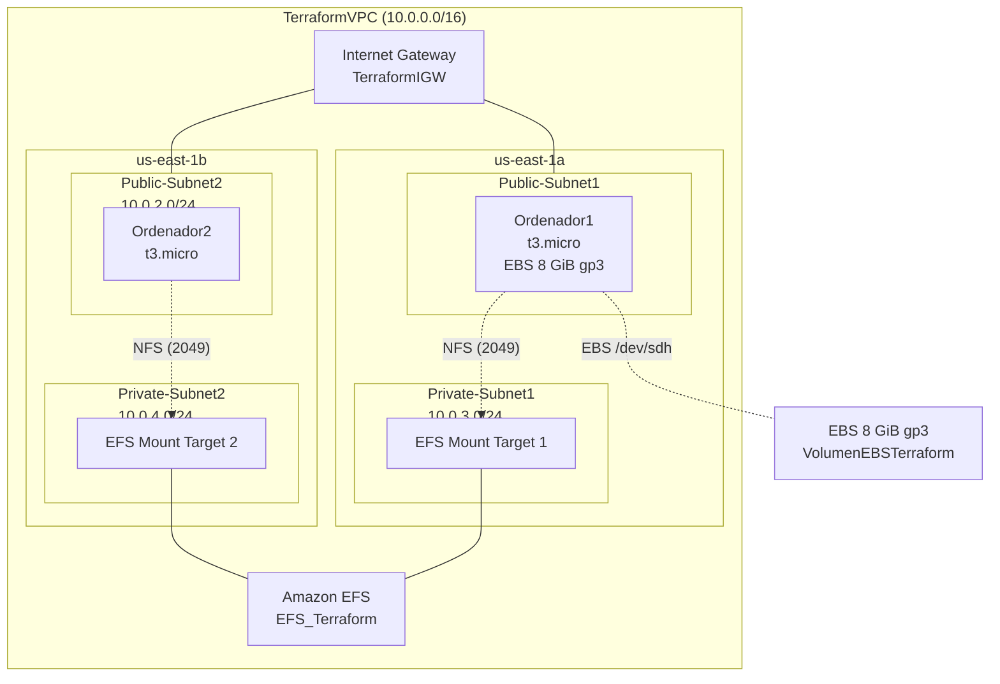

# Práctica 5: Despliegue de infraestructura de almacenamiento con Terraform (EBS + EFS)

- **Módulo:** Administración de Bases de Datos y Almacenamiento en la Nube (ABDAN)
- **Unidad de Trabajo:** UT2. Servicios de almacenamiento en bloque y sistemas de ficheros en red

---

## Introducción

En las prácticas anteriores hemos trabajado con volúmenes EBS y sistemas de ficheros EFS de forma manual, creando y configurando cada recurso desde la consola web de AWS o mediante CloudFormation. En esta práctica daremos un paso adelante y **automatizaremos el despliegue completo de una infraestructura que combina ambos servicios de almacenamiento** utilizando **Terraform**, una herramienta de Infraestructura como Código (*Infrastructure as Code*, IaC) que permite definir, aprovisionar y gestionar recursos en la nube de forma declarativa y reproducible.

Para completar los bloques de configuración, utilizaremos **GitHub Copilot** como asistente de código y la **documentación oficial de Terraform** como referencia para validar y corregir las sugerencias.

### Objetivos

- Configurar un entorno de desarrollo con Visual Studio Code, la extensión de Terraform y GitHub Copilot.
- Comprender la estructura de un proyecto Terraform y la función de cada fichero de configuración.
- Completar bloques de recursos Terraform a partir de las especificaciones de la arquitectura, utilizando las sugerencias de GitHub Copilot y la documentación oficial del proveedor AWS.
- Desplegar una infraestructura completa de red (VPC, subredes, Internet Gateway, tablas de rutas), grupos de seguridad, almacenamiento (EBS + EFS) e instancias EC2 mediante código.
- Gestionar el ciclo de vida completo de la infraestructura: despliegue, verificación y destrucción.

### Arquitectura propuesta

El despliegue creará la siguiente arquitectura:



| Recurso | Descripción |
| :--- | :--- |
| **VPC** `TerraformVPC` | Bloque CIDR `10.0.0.0/16`, DNS habilitado |
| **Subred pública 1** `Public-Subnet1` | CIDR `10.0.1.0/24`, zona `us-east-1a`, IP pública automática |
| **Subred pública 2** `Public-Subnet2` | CIDR `10.0.2.0/24`, zona `us-east-1b`, IP pública automática |
| **Subred privada 1** `Private-Subnet1` | CIDR `10.0.3.0/24`, zona `us-east-1a` |
| **Subred privada 2** `Private-Subnet2` | CIDR `10.0.4.0/24`, zona `us-east-1b` |
| **Internet Gateway** `TerraformIGW` | Conecta la VPC a Internet |
| **Tabla de rutas** | Ruta por defecto `0.0.0.0/0` → IGW, asociada a ambas subredes públicas |
| **Ordenador1** | `t3.micro` en `Public-Subnet1`, con volumen EBS adicional de 8 GiB y EFS montado |
| **Ordenador2** | `t3.micro` en `Public-Subnet2`, con EFS montado |
| **Volumen EBS** `VolumenEBSTerraform` | 8 GiB, tipo `gp3`, zona `us-east-1a`, asociado a Ordenador1 |
| **EFS** `EFS_Terraform` | Sistema de ficheros elástico con mount targets en las subredes privadas |
| **Grupos de seguridad** | SSH (22), tráfico de salida, NFS (2049) referenciado por grupo de seguridad |

### Requerimientos

- Disponer de acceso a los recursos de AWS a través de un sandbox de **AWS Academy Learner Lab**.
- Disponer de una máquina con la **AWS CLI** configurada con las credenciales de AWS Academy Learner Lab.
- Tener instalado [**Terraform**](https://developer.hashicorp.com/terraform/install) (versión ≥ 1.5.0).
- Tener instalado [**Visual Studio Code**](https://code.visualstudio.com/).
- Disponer de una cuenta de **GitHub** (registrada con el correo `@alu.edu.gva.es`).

---

## Fase 1: Preparación del entorno de desarrollo

Antes de comenzar a escribir código Terraform, vamos a configurar Visual Studio Code con las extensiones necesarias para contar con autocompletado inteligente, resaltado de sintaxis y sugerencias de código asistidas por IA.

### Instalación de la extensión de Terraform

1. Abre **Visual Studio Code**.

2. Accede al panel de extensiones (`Ctrl+Shift+X`) y busca **HashiCorp Terraform**.

3. Instala la extensión oficial **HashiCorp Terraform** (publicada por HashiCorp). Esta extensión proporciona:

    - Resaltado de sintaxis para archivos `.tf`.
    - Autocompletado de recursos, atributos y funciones del proveedor AWS.
    - Validación de errores en tiempo real.
    - Formateo automático del código (`terraform fmt`).

### Configuración de GitHub Copilot

4. En el panel de extensiones, busca e instala **GitHub Copilot**.

5. Una vez instalada, VS Code te solicitará iniciar sesión con tu cuenta de GitHub. **Utiliza tu cuenta de GitHub registrada con el correo `@alu.edu.gva.es`** para autenticarte, ya que el plan GitHub Education incluye acceso gratuito a Copilot.

6. Tras autenticarte, verifica que Copilot está activo: debería aparecer el icono de Copilot en la barra de estado inferior de VS Code.

!!! important "Flujo de trabajo con Copilot y documentación oficial"
    A lo largo de esta práctica, los bloques de recursos Terraform se proporcionan **vacíos** (solo con el tipo y el nombre del recurso). Tu tarea consiste en:

    1. **Escribir los argumentos** necesarios dentro de cada bloque, apoyándote en las **sugerencias de GitHub Copilot** (que aparecerán automáticamente al escribir dentro de un bloque).
    2. **Validar y corregir** las sugerencias consultando la [**documentación oficial del proveedor AWS de Terraform**](https://registry.terraform.io/providers/hashicorp/aws/latest/docs).
    3. Utilizar `terraform validate` y `terraform plan` para comprobar que la configuración es correcta antes de aplicarla.

    Copilot es una herramienta de asistencia que **no siempre genera código correcto**. La documentación oficial es la referencia definitiva para conocer los argumentos obligatorios, opcionales y sus valores válidos.

### Creación del directorio de trabajo

7. Crea un directorio de trabajo para el proyecto y ábrelo en VS Code:

    ```bash
    mkdir terraform-ebs-efs
    cd terraform-ebs-efs
    code .
    ```

!!! note "Convención de ficheros en Terraform"
    Aunque podríamos escribir toda la configuración en un único fichero, la comunidad Terraform recomienda separar los recursos por responsabilidad: `terraform.tf` (proveedor), `networking.tf` (red), `security.tf` (seguridad), `compute.tf` (cómputo), `storage.tf` (almacenamiento), etc. Terraform procesa todos los archivos `.tf` de un directorio como una única configuración.

---

## Fase 2: Configuración del proveedor — `terraform.tf`

El primer fichero define el proveedor de AWS y la versión de Terraform requerida. Crea el fichero `terraform.tf` con el siguiente contenido:

```hcl
terraform {
  required_providers {
    aws = {
      source  = "hashicorp/aws"
      version = "~> 6.70"
    }
  }

  required_version = ">= 1.5.0"
}

provider "aws" {
  region = "us-east-1"
}
```

!!! note "Restricción de versiones"
    - `required_version = ">= 1.5.0"` garantiza que se utilice una versión de Terraform igual o superior a la 1.5.0.
    - `version = "~> 6.70"` permite cualquier versión del proveedor AWS compatible con la 6.70.x (operador *pessimistic constraint*).

Tras crear este fichero, ejecuta `terraform init` desde el terminal integrado de VS Code para descargar el proveedor de AWS. Esto también activará el autocompletado de la extensión de Terraform para los recursos del proveedor AWS.

```bash
terraform init
```

---

## Fase 3: Infraestructura de red — `networking.tf`

En este fichero definimos todos los recursos de red necesarios: VPC, subredes, Internet Gateway, tabla de rutas y asociaciones.

Crea el fichero `networking.tf` y define los siguientes bloques de recursos. **Completa cada bloque con los argumentos necesarios** según la tabla de la arquitectura propuesta, apoyándote en las sugerencias de Copilot y en la documentación oficial:

- [`aws_vpc`](https://registry.terraform.io/providers/hashicorp/aws/latest/docs/resources/vpc)
- [`aws_subnet`](https://registry.terraform.io/providers/hashicorp/aws/latest/docs/resources/subnet)
- [`aws_internet_gateway`](https://registry.terraform.io/providers/hashicorp/aws/latest/docs/resources/internet_gateway)
- [`aws_route_table`](https://registry.terraform.io/providers/hashicorp/aws/latest/docs/resources/route_table)
- [`aws_route_table_association`](https://registry.terraform.io/providers/hashicorp/aws/latest/docs/resources/route_table_association)

```hcl
resource "aws_vpc" "vpc_terraform" {
  # CIDR: 10.0.0.0/16
  # Habilitar soporte DNS y hostnames DNS
  # Tag Name: "TerraformVPC"
}

resource "aws_subnet" "public_subnet1" {
  # VPC: vpc_terraform
  # CIDR: 10.0.1.0/24
  # Zona de disponibilidad: us-east-1a
  # Asignar IP pública automáticamente
  # Tag Name: "Public-Subnet1"
}

resource "aws_subnet" "public_subnet2" {
  # VPC: vpc_terraform
  # CIDR: 10.0.2.0/24
  # Zona de disponibilidad: us-east-1b
  # Asignar IP pública automáticamente
  # Tag Name: "Public-Subnet2"
}

resource "aws_internet_gateway" "igw" {
  # VPC: vpc_terraform
  # Tag Name: "TerraformIGW"
}

resource "aws_route_table" "public_route_table" {
  # VPC: vpc_terraform
  # Ruta: 0.0.0.0/0 → Internet Gateway (igw)
}

resource "aws_route_table_association" "public_subnet1_association" {
  # Subred: public_subnet1
  # Tabla de rutas: public_route_table
}

resource "aws_route_table_association" "public_subnet2_association" {
  # Subred: public_subnet2
  # Tabla de rutas: public_route_table
}

resource "aws_subnet" "private_subnet1" {
  # VPC: vpc_terraform
  # CIDR: 10.0.3.0/24
  # Zona de disponibilidad: us-east-1a
  # Tag Name: "Private-Subnet1"
}

resource "aws_subnet" "private_subnet2" {
  # VPC: vpc_terraform
  # CIDR: 10.0.4.0/24
  # Zona de disponibilidad: us-east-1b
  # Tag Name: "Private-Subnet2"
}
```

!!! tip "Cómo aprovechar Copilot"
    Sitúa el cursor dentro de un bloque vacío y comienza a escribir el nombre de un argumento (por ejemplo, `cidr`). Copilot sugerirá automáticamente el argumento completo con un valor. Puedes aceptar la sugerencia con `Tab` o rechazarla con `Esc`. **Revisa siempre que los valores coincidan con los de la tabla de la arquitectura propuesta.**

!!! important "Subredes públicas vs. privadas"
    - Las **subredes públicas** tienen `map_public_ip_on_launch = true` y están asociadas a una tabla de rutas con ruta hacia el Internet Gateway. Las instancias en estas subredes reciben una IP pública y pueden comunicarse con Internet.
    - Las **subredes privadas** no tienen salida a Internet. Se utilizarán para los mount targets de EFS, de modo que el tráfico NFS circule exclusivamente por la red interna de la VPC.

---

## Fase 4: Grupos de seguridad — `security.tf`

Los grupos de seguridad actúan como firewalls virtuales para controlar el tráfico de entrada y salida de las instancias y los servicios.

Crea el fichero `security.tf` y completa los siguientes bloques. Consulta la documentación de los recursos:

- [`aws_security_group`](https://registry.terraform.io/providers/hashicorp/aws/latest/docs/resources/security_group)
- [`aws_vpc_security_group_ingress_rule`](https://registry.terraform.io/providers/hashicorp/aws/latest/docs/resources/vpc_security_group_ingress_rule)
- [`aws_vpc_security_group_egress_rule`](https://registry.terraform.io/providers/hashicorp/aws/latest/docs/resources/vpc_security_group_egress_rule)

```hcl
# --- Grupo de seguridad: SSH ---
resource "aws_security_group" "allow_ssh" {
  # Nombre: "SSH_Terraform"
  # Descripción: "Allow SSH inbound traffic"
  # VPC: vpc_terraform
}

resource "aws_vpc_security_group_ingress_rule" "allow_ssh_rule" {
  # Grupo de seguridad: allow_ssh
  # Puerto: 22
  # Protocolo: tcp
  # Origen: 0.0.0.0/0 (cualquier IP)
}

# --- Grupo de seguridad: Tráfico de salida ---
resource "aws_security_group" "allow_outbound" {
  # Nombre: "Outbound_Terraform"
  # Descripción: "Allow all outbound traffic"
  # VPC: vpc_terraform
}

resource "aws_vpc_security_group_egress_rule" "allow_outbound_rule" {
  # Grupo de seguridad: allow_outbound
  # Protocolo: -1 (todos)
  # Destino: 0.0.0.0/0 (cualquier IP)
}

# --- Grupo de seguridad: Bastion ---
resource "aws_security_group" "bastion_sg" {
  # Nombre: "Bastion_SG"
  # Descripción: "Security group for Bastion host"
  # VPC: vpc_terraform
}

resource "aws_vpc_security_group_egress_rule" "bastion_sg" {
  # Grupo de seguridad: bastion_sg
  # Puertos: 0-0
  # Protocolo: -1 (todos)
  # Destino: 0.0.0.0/0
}

# --- Grupo de seguridad: EFS ---
resource "aws_security_group" "efs_sg" {
  # Nombre: "EFS_SG"
  # Descripción: "Security group for EFS"
  # VPC: vpc_terraform
}

resource "aws_vpc_security_group_ingress_rule" "efs_ingress_rule" {
  # Grupo de seguridad: efs_sg
  # Puerto: 2049 (NFS)
  # Protocolo: tcp
  # Origen: grupo de seguridad bastion_sg (usar referenced_security_group_id)
}
```

Se definen **cuatro grupos de seguridad**:

| Grupo de seguridad | Propósito |
| :--- | :--- |
| `SSH_Terraform` | Permite tráfico de entrada SSH (puerto 22) desde cualquier IP |
| `Outbound_Terraform` | Permite todo el tráfico de salida (necesario para descargar paquetes, etc.) |
| `Bastion_SG` | Grupo asignado a las instancias que actúan como origen del tráfico NFS |
| `EFS_SG` | Permite tráfico NFS (puerto 2049) únicamente desde instancias con el grupo `Bastion_SG` |

!!! tip "Seguridad basada en grupos de seguridad"
    La regla de entrada del grupo `EFS_SG` utiliza `referenced_security_group_id` en lugar de un bloque CIDR. Esto significa que **solo las instancias que tengan asignado el grupo `Bastion_SG`** podrán acceder al sistema de ficheros EFS por el puerto 2049. Es una práctica recomendada que aplica el principio de mínimo privilegio.

---

## Fase 5: Almacenamiento — `storage.tf`

En este fichero definimos los recursos de almacenamiento: un volumen EBS independiente y un sistema de ficheros EFS con sus mount targets.

Crea el fichero `storage.tf` y completa los bloques. Consulta la documentación de:

- [`aws_ebs_volume`](https://registry.terraform.io/providers/hashicorp/aws/latest/docs/resources/ebs_volume)
- [`aws_volume_attachment`](https://registry.terraform.io/providers/hashicorp/aws/latest/docs/resources/volume_attachment)
- [`aws_efs_file_system`](https://registry.terraform.io/providers/hashicorp/aws/latest/docs/resources/efs_file_system)
- [`aws_efs_mount_target`](https://registry.terraform.io/providers/hashicorp/aws/latest/docs/resources/efs_mount_target)

```hcl
# --- Volumen EBS ---
resource "aws_ebs_volume" "ebs_volume_terraform" {
  # Zona de disponibilidad: us-east-1a
  # Tamaño: 8 GiB
  # Tipo: gp3
  # Tag Name: "VolumenEBSTerraform"
}

resource "aws_volume_attachment" "ebs_volume_attachment_terraform" {
  # Dispositivo: /dev/sdh
  # Volumen: ebs_volume_terraform
  # Instancia: ordenador1
}

# --- Sistema de ficheros EFS ---
resource "aws_efs_file_system" "efs_file_system_terraform" {
  # Token de creación: "EFS_Terraform"
  # Modo de rendimiento: generalPurpose
  # Tag Name: "EFS_Terraform"
}

resource "aws_efs_mount_target" "efs_mount_target1_terraform" {
  # Sistema de ficheros: efs_file_system_terraform
  # Subred: private_subnet1
  # Grupos de seguridad: [efs_sg]
}

resource "aws_efs_mount_target" "efs_mount_target2_terraform" {
  # Sistema de ficheros: efs_file_system_terraform
  # Subred: private_subnet2
  # Grupos de seguridad: [efs_sg]
}

output "efs_file_system_id" {
  value = aws_efs_file_system.efs_file_system_terraform.id
}

output "efs_dns_name" {
  value = aws_efs_file_system.efs_file_system_terraform.dns_name
}
```

Aspectos clave del fichero:

- El **volumen EBS** de 8 GiB (tipo `gp3`) se crea en `us-east-1a` y se asocia (`aws_volume_attachment`) automáticamente al `Ordenador1` como dispositivo `/dev/sdh`.
- El **sistema de ficheros EFS** se crea con modo de rendimiento `generalPurpose` y un token de creación que lo identifica de forma única.
- Se crean **dos mount targets**, uno en cada subred privada, para que las instancias de ambas zonas de disponibilidad puedan acceder al EFS a través de la red interna.
- Los **outputs** (ya completados) permiten consultar el ID y el nombre DNS del sistema de ficheros EFS tras el despliegue.

!!! important "Mount targets en subredes privadas"
    Los mount targets se despliegan en las subredes privadas por seguridad. El tráfico NFS entre las instancias (subredes públicas) y los mount targets (subredes privadas) circula por la red interna de la VPC, sin exponerse a Internet.

---

## Fase 6: Cómputo — `compute.tf`

Este fichero define las instancias EC2, la clave SSH y los outputs con las IPs públicas. Incluye además la automatización del montaje de EFS y EBS mediante `cloud-init` en el `user_data`.

### Generación del par de claves SSH

Antes de crear el fichero de cómputo, genera un par de claves SSH que Terraform subirá a AWS:

```bash
ssh-keygen -t ed25519 -f clave -N ""
```

Esto creará dos archivos: `clave` (clave privada) y `clave.pub` (clave pública).

### Fichero de cómputo

Crea el fichero `compute.tf` y completa los bloques. Consulta la documentación de:

- [`aws_ami` (data source)](https://registry.terraform.io/providers/hashicorp/aws/latest/docs/data-sources/ami)
- [`aws_instance`](https://registry.terraform.io/providers/hashicorp/aws/latest/docs/resources/instance)
- [`aws_key_pair`](https://registry.terraform.io/providers/hashicorp/aws/latest/docs/resources/key_pair)

```hcl
data "aws_ami" "al_2023" {
  # Seleccionar la AMI más reciente
  # Propietario: 137112412989 (Amazon)
  # Filtro por nombre: al2023-ami-2023.*-kernel-*-x86_64
  # Filtro por tipo de virtualización: hvm
}

resource "aws_instance" "ordenador1" {
  # AMI: data.aws_ami.al_2023
  # Tipo de instancia: t3.micro
  # Subred: public_subnet1
  # Grupos de seguridad: [allow_ssh, allow_outbound, bastion_sg]
  # Par de claves: my_key_pair
  #
  # Disco raíz (root_block_device):
  #   - Tamaño: 10 GiB
  #   - Tipo: gp3
  #
  # user_data: (se proporciona completo más abajo)
  #
  # depends_on: ambos mount targets de EFS
  #
  # Tag Name: "Ordenador1"
}

resource "aws_instance" "ordenador2" {
  # AMI: data.aws_ami.al_2023
  # Tipo de instancia: t3.micro
  # Subred: public_subnet2
  # Grupos de seguridad: [allow_ssh, allow_outbound, bastion_sg]
  # Par de claves: my_key_pair
  #
  # Disco raíz (root_block_device):
  #   - Tamaño: 10 GiB
  #   - Tipo: gp3
  #
  # user_data: (se proporciona completo más abajo)
  #
  # depends_on: ambos mount targets de EFS
  #
  # Tag Name: "Ordenador2"
}

resource "aws_key_pair" "my_key_pair" {
  # Nombre de la clave: "my-key-pair"
  # Clave pública: leer del fichero "clave.pub" con la función file()
}

output "instance_public_ip" {
  value = aws_instance.ordenador1.public_ip
}

output "instance_public_ip2" {
  value = aws_instance.ordenador2.public_ip
}
```

### Bloque `user_data` para Ordenador1

El `user_data` del Ordenador1 utiliza **cloud-init** para automatizar la instalación de paquetes, el montaje del EFS y el formateo/montaje del volumen EBS. Copia el siguiente bloque **exactamente** dentro del recurso `aws_instance.ordenador1`:

```bash
  #!/bin/bash
  dnf install -y amazon-efs-utils
  mkdir -p /mnt/efs


  for i in $(seq 1 30); do
  if mount -t efs -o tls,mounttargetip=${efs_mount_ip} ${efs_id}:/ /mnt/efs; then 
      echo "${efs_id}:/ /mnt/efs efs defaults,_netdev,tls 0 0" >> /etc/fstab
      break; 
  fi
  sleep 5
  done

  DEVICE=""
  for i in $(seq 1 30); do
  if [ -b /dev/sdh ]; then DEVICE="/dev/sdh"; break
  elif [ -b /dev/xvdh ]; then DEVICE="/dev/xvdh"; break
  else
      CANDIDATE=$(lsblk -d -n -o NAME,TYPE | awk '$2=="disk" && $1!~"nvme0n1" {print "/dev/"$1; exit}')
      if [ -n "$CANDIDATE" ] && [ -b "$CANDIDATE" ]; then DEVICE="$CANDIDATE"; break; fi
  fi
  sleep 2
  done
  if [ -n "$DEVICE" ]; then
  blkid "$DEVICE" || mkfs -t xfs "$DEVICE"
  mkdir -p /mnt/ebs
  mount "$DEVICE" /mnt/ebs
  UUID=$(blkid -s UUID -o value "$DEVICE")
  [ -n "$UUID" ] && echo "UUID=$UUID /mnt/ebs xfs defaults,nofail 0 2" >> /etc/fstab
```

### Bloque `user_data` para Ordenador2

El Ordenador2 solo necesita montar el EFS (no tiene volumen EBS adicional). Copia el siguiente bloque dentro del recurso `aws_instance.ordenador2`:

```bash
  #!/bin/bash
  dnf install -y amazon-efs-utils
  mkdir -p /mnt/efs


  for i in $(seq 1 30); do
  if mount -t efs -o tls,mounttargetip=${efs_mount_ip} ${efs_id}:/ /mnt/efs; then 
      echo "${efs_id}:/ /mnt/efs efs defaults,_netdev,tls 0 0" >> /etc/fstab
      break; 
  fi
  sleep 5
  done
```

### Explicación del `user_data`

=== "Ordenador1 (EBS + EFS)"

    1. **`packages`**: Instala `amazon-efs-utils`, el paquete que proporciona el helper de montaje para EFS con soporte TLS.
    2. **`mounts`**: Configura el montaje automático del sistema de ficheros EFS en `/mnt/efs` con cifrado en tránsito (`tls`) y la opción `_netdev` (esperar a que la red esté disponible antes de montar).
    3. **`runcmd`**: Ejecuta un script que:
        - Espera hasta 60 segundos (30 iteraciones × 2 s) a que el dispositivo EBS esté disponible.
        - Busca el dispositivo como `/dev/sdh`, `/dev/xvdh` o el primer disco adicional detectado por `lsblk`.
        - Si el disco no tiene sistema de ficheros, lo formatea con **XFS** (`mkfs -t xfs`).
        - Monta el volumen en `/mnt/ebs` y añade la entrada correspondiente en `/etc/fstab` para persistencia.

=== "Ordenador2 (solo EFS)"

    1. **`packages`**: Instala `amazon-efs-utils`.
    2. **`mounts`**: Configura el montaje automático del EFS en `/mnt/efs`.

!!! note "Interpolación de Terraform en user_data"
    La expresión `${aws_efs_file_system.efs_file_system_terraform.id}` se resuelve durante el `terraform apply`, insertando el ID real del sistema de ficheros EFS (por ejemplo, `fs-0abc123def456`) directamente en el script de cloud-init. Esto permite que las instancias monten automáticamente el EFS correcto sin intervención manual.

!!! note "depends_on"
    Las instancias dependen explícitamente de los mount targets de EFS (`depends_on`). Esto garantiza que Terraform cree los mount targets antes de lanzar las instancias, evitando que el montaje del EFS falle durante el arranque.

---

## Fase 7: Validación y despliegue de la infraestructura

Con todos los ficheros completados, el directorio del proyecto debería tener la siguiente estructura:

```
terraform-ebs-efs/
├── clave
├── clave.pub
├── compute.tf
├── networking.tf
├── security.tf
├── storage.tf
└── terraform.tf
```

### Validación de la configuración

1. Antes de desplegar, valida que la sintaxis y las referencias entre recursos son correctas:

    ```bash
    terraform validate
    ```

    Si hay errores, Terraform indicará el fichero y la línea del problema. Corrígelos consultando la documentación oficial del recurso correspondiente.

    !!! warning "Errores comunes"
        - **Argumentos desconocidos:** Copilot puede sugerir argumentos que no existen o que han sido renombrados en versiones recientes del proveedor. Consulta siempre la documentación oficial.
        - **Referencias a recursos inexistentes:** Asegúrate de que los nombres de los recursos referenciados (por ejemplo, `aws_vpc.vpc_terraform.id`) coincidan exactamente con los nombres definidos en los bloques `resource`.
        - **Argumentos obligatorios ausentes:** Cada recurso tiene argumentos obligatorios (*required*) que deben estar presentes. La documentación los marca claramente.

### Planificación del despliegue

2. Genera un plan de ejecución para visualizar los recursos que se crearán:

    ```bash
    terraform plan
    ```

    Revisa la salida con atención. Terraform mostrará un resumen con todos los recursos que va a crear. Deberías ver un mensaje similar a:

    ```
    Plan: 21 to add, 0 to change, 0 to destroy.
    ```

    !!! tip "Buenas prácticas con `terraform plan`"
        Siempre ejecuta `terraform plan` antes de `terraform apply` para revisar los cambios que se van a realizar. Esto es especialmente importante en entornos de producción para evitar modificaciones no deseadas.

### Aplicación del despliegue

3. Aplica la configuración para crear los recursos en AWS:

    ```bash
    terraform apply
    ```

    Terraform solicitará confirmación. Escribe `yes` y pulsa Intro. El despliegue tardará varios minutos.

    Al finalizar, Terraform mostrará los **outputs** definidos en los ficheros de configuración:

    ```
    Apply complete! Resources: 21 added, 0 changed, 0 destroyed.

    Outputs:

    efs_dns_name = "fs-0abc123def456.efs.us-east-1.amazonaws.com"
    efs_file_system_id = "fs-0abc123def456"
    instance_public_ip = "X.X.X.X"
    instance_public_ip2 = "Y.Y.Y.Y"
    ```

---

## Fase 8: Verificación del despliegue

### Verificación desde la consola de AWS

1. Accede a la consola de **Amazon EC2** y comprueba que las dos instancias (`Ordenador1` y `Ordenador2`) están en estado *Running*.

2. En **Elastic Block Store > Volumes**, verifica que existe el volumen `VolumenEBSTerraform` de 8 GiB asociado a `Ordenador1`.

3. Accede a la consola de **Amazon EFS** y comprueba que el sistema de ficheros `EFS_Terraform` está creado, con dos mount targets en las subredes privadas.

4. En **EC2 > Security Groups**, verifica que se han creado los cuatro grupos de seguridad: `SSH_Terraform`, `Outbound_Terraform`, `Bastion_SG` y `EFS_SG`.

### Verificación por SSH — Ordenador1

5. Conéctate por SSH al Ordenador1 utilizando la clave privada generada:

    ```bash
    ssh -i clave ec2-user@<IP_PUBLICA_ORDENADOR1>
    ```

6. Verifica que el volumen EBS se ha montado correctamente en `/mnt/ebs`:

    ```bash
    df -hT /mnt/ebs
    lsblk
    ```

    Deberías ver el volumen de 8 GiB montado con formato XFS.

7. Verifica que el sistema de ficheros EFS se ha montado en `/mnt/efs`:

    ```bash
    df -hT /mnt/efs
    ```

8. Crea un fichero de prueba en el EFS para verificar el almacenamiento compartido:

    ```bash
    sudo bash -c "echo 'Hola desde Ordenador1' > /mnt/efs/prueba.txt"
    cat /mnt/efs/prueba.txt
    ```

### Verificación por SSH — Ordenador2

9. En otra terminal, conéctate por SSH al Ordenador2:

    ```bash
    ssh -i clave ec2-user@<IP_PUBLICA_ORDENADOR2>
    ```

10. Verifica que el EFS está montado y que el fichero creado desde el Ordenador1 es visible:

    ```bash
    df -hT /mnt/efs
    cat /mnt/efs/prueba.txt
    ```

    Deberías ver el mensaje `Hola desde Ordenador1`, confirmando que ambas instancias comparten el mismo sistema de ficheros.

11. Añade una segunda línea desde el Ordenador2:

    ```bash
    sudo bash -c "echo 'Hola desde Ordenador2' >> /mnt/efs/prueba.txt"
    ```

12. Vuelve al Ordenador1 y comprueba que la línea añadida desde el Ordenador2 es visible:

    ```bash
    cat /mnt/efs/prueba.txt
    ```

---

## Fase 9: Consulta del estado de Terraform

Terraform mantiene un fichero de estado (`terraform.tfstate`) que registra todos los recursos gestionados y sus atributos actuales.

1. Lista los recursos gestionados por Terraform:

    ```bash
    terraform state list
    ```

2. Consulta los outputs del despliegue en cualquier momento:

    ```bash
    terraform output
    ```

3. Puedes consultar los detalles de un recurso concreto:

    ```bash
    terraform state show aws_efs_file_system.efs_file_system_terraform
    ```

!!! warning "No modifiques `terraform.tfstate` manualmente"
    El fichero de estado es crítico para que Terraform sepa qué recursos gestiona. Modificarlo manualmente puede causar inconsistencias o pérdida de control sobre la infraestructura. En entornos colaborativos se utiliza un backend remoto (como S3) para compartir el estado de forma segura.

---

## Fase 10: Destrucción de la infraestructura

Para liberar todos los recursos creados y evitar el consumo innecesario de créditos de AWS Academy Learner Labs:

```bash
terraform destroy
```

Terraform mostrará todos los recursos que va a eliminar y solicitará confirmación. Escribe `yes` para proceder.

!!! tip "Ventaja de Terraform frente a la limpieza manual"
    A diferencia de la limpieza manual (donde debemos eliminar cada recurso en el orden correcto para respetar las dependencias), `terraform destroy` se encarga automáticamente del **orden de destrucción**: primero elimina las instancias y volúmenes, luego los grupos de seguridad, las subredes y finalmente la VPC.

---

## Entregables

1. **Captura 1 — `terraform plan`:** Captura de la salida del comando `terraform plan` mostrando el resumen de los recursos que se van a crear (la línea `Plan: X to add, 0 to change, 0 to destroy`).

2. **Captura 2 — `terraform apply` completado:** Captura de la salida final del comando `terraform apply`, mostrando el mensaje `Apply complete!` y los valores de los outputs (IPs públicas, ID y DNS del EFS).

3. **Captura 3 — Instancias en la consola de AWS:** Captura de la consola de Amazon EC2 mostrando las dos instancias (`Ordenador1` y `Ordenador2`) en estado *Running*.

4. **Captura 4 — Montaje del EBS en Ordenador1:** Salida de `df -hT /mnt/ebs` y `lsblk` en el Ordenador1, mostrando el volumen EBS de 8 GiB montado con formato XFS.

5. **Captura 5 — EFS compartido entre ambas instancias:** Salida de `cat /mnt/efs/prueba.txt` en el Ordenador1 mostrando las dos líneas escritas desde ambas instancias, demostrando el almacenamiento compartido.

6. **Captura 6 — `terraform destroy`:** Captura de la salida final del comando `terraform destroy` mostrando la confirmación de que todos los recursos han sido destruidos.

7. **Entrega del código Terraform:** Comprime el directorio del proyecto (excluyendo los ficheros `terraform.tfstate`, `terraform.tfstate.backup`, el directorio `.terraform/` y la clave privada `clave`) y adjúntalo como parte de la entrega.
