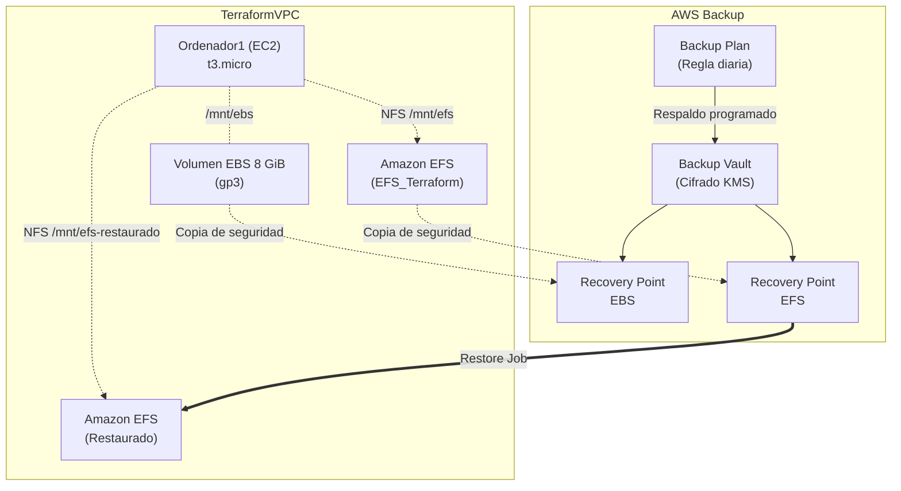

# Práctica 6: Centralización de copias de seguridad con AWS Backup (EBS y EFS)

- **Módulo:** Administración de Bases de Datos y Almacenamiento en la Nube (ABDAN)
- **Unidad de Trabajo:** UT2. Servicios de almacenamiento en bloque y sistemas de ficheros en red

---

## Introducción

En las prácticas anteriores hemos gestionado de forma individual el ciclo de vida y la persistencia de volúmenes **Amazon EBS** y sistemas de ficheros en red **Amazon EFS**. En entornos empresariales reales, gestionar copias de seguridad de forma manual o dispersa en cada servicio resulta ineficiente, propenso a errores y difícil de auditar.

**AWS Backup** es un servicio completamente administrado y centralizado que permite automatizar y coordinar la protección de datos en múltiples servicios de AWS (Amazon EBS, Amazon EFS, Amazon EC2, Amazon RDS, Amazon S3, DynamoDB, etc.). Con AWS Backup es posible definir políticas de retención, programar ventanas de respaldo, centralizar puntos de recuperación en almacenes cifrados (*Backup Vaults*) y realizar restauraciones granulares con unos pocos clics.

En esta práctica desplegaremos una infraestructura base adaptando el código **Terraform de la Práctica 2.5** y, sobre ella, implementaremos una estrategia de copias de seguridad centralizada con **AWS Backup** para proteger tanto el almacenamiento en bloque (EBS) como el almacenamiento de ficheros (EFS), finalizando con la restauración y verificación íntegra del sistema de ficheros.

### Objetivos

- Reutilizar y adaptar la infraestructura como código (IaC) en Terraform desarrollada en la práctica anterior.
- Crear y configurar un almacén de copias de seguridad (*Backup Vault*).
- Diseñar un plan de copias de seguridad (*Backup Plan*) con reglas de planificación horaria, ventanas de ejecución y políticas de retención.
- Asignar recursos heterogéneos (volumen EBS y sistema de ficheros EFS) al plan utilizando el rol IAM `LabRole`.
- Monitorizar la ejecución de los trabajos de respaldo (*Backup Jobs*) y comprobar los puntos de recuperación (*Recovery Points*).
- Restaurar un sistema de ficheros EFS a partir de un punto de recuperación y validar la integridad de los datos montándolo en la instancia EC2.
- Gestionar la eliminación ordenada de las copias y la infraestructura para evitar sobrecostes.

### Arquitectura de la práctica



### Requerimientos

- Acceso a la consola de AWS a través del sandbox de **AWS Academy Learner Lab**.
- Proyecto Terraform de la **Práctica 2.5** disponible en tu equipo.
- Cliente SSH o terminal para conectarse a la instancia EC2.

---

## Fase 1: Despliegue de la infraestructura base con Terraform

Para esta práctica no crearemos la infraestructura desde cero: **reutilizaremos y adaptaremos el proyecto Terraform de la Práctica 2.5** (`terraform-ebs-efs`).

Para optimizar los créditos del Learner Lab, en esta práctica únicamente necesitamos una instancia (`Ordenador1`), su volumen EBS adicional de 8 GiB y el sistema EFS compartido.

1. Copia tu directorio de la Práctica 2.5 a una nueva carpeta para esta práctica:

    ```bash
    cp -r terraform-ebs-efs terraform-backup
    cd terraform-backup
    ```

2. Abre el proyecto en Visual Studio Code:

    ```bash
    code .
    ```

3. **Adaptación de `compute.tf`:**
   En este laboratorio no necesitamos la segunda máquina (`Ordenador2`). En `compute.tf`, puedes eliminar o comentar el bloque de recurso `aws_instance "ordenador2"` y su output `instance_public_ip2`. Mantén únicamente:
   - Data source `aws_ami.al_2023`.
   - Recurso `aws_instance.ordenador1` (con sus grupos de seguridad, par de claves, disco raíz de 10 GiB y su script `user_data` de cloud-init).
   - Recurso `aws_key_pair.my_key_pair`.
   - Output `instance_public_ip`.

4. Asegúrate de disponer de la clave privada (`clave`) y pública (`clave.pub`) en el directorio, tal como se configuró en la práctica anterior. Si no existen, genéralas:

    ```bash
    ssh-keygen -t ed25519 -f clave -N ""
    ```

5. Inicializa y despliega la infraestructura:

    ```bash
    terraform init
    terraform apply -auto-approve
    ```

6. Una vez completado el despliegue, anota los siguientes valores que aparecen en los outputs y en la consola:
    - **Dirección IP pública de Ordenador1** (`instance_public_ip`).
    - **ID del volumen EBS adicional de 8 GiB** (puedes consultarlo en la consola EC2 > Volumes, con la etiqueta `VolumenEBSTerraform`).
    - **ID del sistema de ficheros EFS** (`efs_file_system_id`).

### Creación de datos de prueba en la instancia

7. Conéctate por SSH a `Ordenador1`:

    ```bash
    ssh -i clave ec2-user@<IP_PUBLICA_ORDENADOR1>
    ```

8. Comprueba que tanto el volumen EBS como el sistema EFS están montados:

    ```bash
    df -hT /mnt/ebs /mnt/efs
    ```

    Ambos deben aparecer en la salida (`/mnt/ebs` como `xfs` y `/mnt/efs` como `nfs4`).

9. Genera archivos de prueba con fecha y datos tanto en el volumen EBS como en el sistema EFS:

    ```bash
    # Datos de prueba en el volumen EBS
    sudo bash -c "echo 'Backup Test EBS - Creado el: $(date)' > /mnt/ebs/test_ebs.txt"
    sudo bash -c "echo 'Registro de datos criticos en EBS' >> /mnt/ebs/test_ebs.txt"

    # Datos de prueba en el sistema EFS
    sudo bash -c "echo 'Backup Test EFS - Creado el: $(date)' > /mnt/efs/test_efs.txt"
    sudo bash -c "echo 'Archivo maestro compartido EFS' >> /mnt/efs/test_efs.txt"
    ```

10. Comprueba el contenido creado:

    ```bash
    cat /mnt/ebs/test_ebs.txt
    cat /mnt/efs/test_efs.txt
    ```

---

## Fase 2: Creación del almacén de copias de seguridad (Backup Vault)

Un **Backup Vault** es un contenedor cifrado que almacena y organiza los puntos de recuperación generados por los servicios respaldados.

1. En la barra de búsqueda superior de la consola de AWS, escribe **AWS Backup** y accede al servicio.

2. En el menú de navegación lateral izquierdo, pulsa sobre **Backup vaults**.

3. Haz clic en el botón **Create Backup vault** y configura los siguientes parámetros:

    | Campo | Valor |
    | :--- | :--- |
    | **Backup vault name** | `vault-abdan` |
    | **Encryption key** | `(default) aws/backup` |
    | **Tags** | Clave: `Ambiente`, Valor: `Laboratorio` |

4. Pulsa en **Create Backup vault**. En unos segundos, el almacén aparecerá con estado listo para recibir respaldos.

---

## Fase 3: Creación del plan de copias de seguridad (Backup Plan)

Un **Backup Plan** define la política de protección: cuándo se realizan las copias, con qué frecuencia, en qué ventana horaria y cuánto tiempo deben retenerse.

1. En el menú lateral de AWS Backup, selecciona **Backup plans**.

2. Pulsa en el botón **Create Backup plan**.

3. En las opciones de inicio, selecciona **Build a new plan**.

4. En la sección **Backup plan details**:
    - **Backup plan name:** `plan-backup-ebs-efs`

5. En la sección **Backup rule** (Regla de copia):
    - **Rule name:** `regla-diaria-recursos`
    - **Backup vault:** Selecciona el almacén creado anteriormente: `vault-abdan`.
    - **Backup frequency:** `Daily` (Diaria).
    - **Backup window:**
        - Selecciona **Customize backup window**.
        - **Backup window start time:** Selecciona una hora cercana al momento actual (ten en cuenta si la consola muestra la hora en UTC o en tu zona local).
        - **Start within:** `1 hour` (Iniciar dentro de 1 hora).
        - **Complete within:** `4 hours` (Completar en 4 horas).
    - **Lifecycle rule (Retención):**
        - **Total retention period:** Selecciona `Days` e indica `7` (retención de una semana).

    !!! note "Ventana de ejecución y copias bajo demanda"
        En AWS Backup, las copias programadas entran en una cola y se ejecutan dentro del intervalo definido en *Start within*. Si tu clase o laboratorio requiere acelerar el proceso para no esperar a la ventana horaria, AWS Backup también permite ejecutar copias bajo demanda (*On-Demand Backup*) dirigidas al mismo Vault, tal como veremos en la siguiente fase.

6. Deja el resto de opciones por defecto y haz clic en **Create plan**.

---

## Fase 4: Asignación de recursos al plan de backup

Una vez definida la regla, debemos indicar a qué recursos concretos de nuestra infraestructura se les aplicará.

1. En la pantalla de resumen del plan recién creado (`plan-backup-ebs-efs`), dirígete a la sección inferior **Resource assignments** y pulsa en **Assign resources**.

2. Configura los parámetros de asignación:
    - **Resource assignment name:** `asignacion-ebs-efs`
    - **IAM role:**
        - Selecciona **Choose an existing role**.
        - En el desplegable, selecciona **`LabRole`**.

    !!! important "Uso obligatorio de `LabRole` en AWS Academy"
        En el entorno de AWS Academy Learner Lab, los usuarios no tienen privilegios para crear nuevos roles de servicio IAM (`Default role`). Es indispensable seleccionar el rol preexistente **`LabRole`**, el cual ya dispone de las políticas necesarias (`AWSBackupServiceRolePolicyForBackup`) para interactuar con EBS y EFS.

3. En la sección **Resource selection**:
    - Selecciona **Include specific resource types**.
    - En el desplegable **Select specific resource types**:
        - Selecciona **EBS** y marca la opción **Volume IDs**. En el desplegable o mediante su identificador, selecciona el volumen EBS de 8 GiB (`vol-xxxxxxxxxxxxxxxxx`, correspondiente a `VolumenEBSTerraform`).
        - Pulsa en **Add resource type** y selecciona **EFS**. En el desplegable **File system IDs**, selecciona tu sistema de ficheros (`fs-xxxxxxxxxxxxxxxxx`, correspondiente a `EFS_Terraform`).

4. Revisa la selección y pulsa en **Assign resources**.

---

## Fase 5: Monitorización de los trabajos de backup

1. En el menú lateral de AWS Backup, haz clic en **Jobs** y sitúate en la pestaña **Backup jobs**.

2. Los trabajos pueden tardar unos instantes en iniciarse según la ventana programada.

    !!! tip "Ejecución inmediata bajo demanda (On-demand backup)"
        Si la ventana de la regla programada tarda en arrancar y deseas completar el laboratorio inmediatamente sin esperar:
        1. En el menú lateral pulsa en **Protected resources** y haz clic en **Create on-demand backup**.
        2. Selecciona **EFS**, elige el ID de tu sistema de ficheros, fija el almacén en `vault-abdan`, retención en `7 días` y selecciona el IAM Role **`LabRole`**.
        3. Repite el proceso seleccionando el recurso **EBS** (tu volumen de 8 GiB).
        4. Ambos métodos generarán los puntos de recuperación en el mismo Vault.

3. Monitoriza la lista de trabajos en **Backup jobs**. Verás cómo el estado transiciona por:
   - `Running` (En ejecución).
   - `Completed` (Completado con éxito).

4. Dirígete a **Backup vaults** en el menú lateral y haz clic en `vault-abdan`.
   Comprueba que en la sección **Recovery points** aparecen **dos puntos de recuperación**:
   - Uno de tipo **EBS**.
   - Uno de tipo **EFS**.
   Ambos deben figurar con estado **Completed**.

---

## Fase 6: Restauración de la copia de seguridad del sistema EFS

Una de las pruebas fundamentales en cualquier plan de recuperación ante desastres es validar que los datos respaldados pueden restaurarse funcionalmente. Restauraremos el punto de recuperación de EFS creando un nuevo sistema de ficheros.

1. Dentro de tu almacén `vault-abdan`, localiza la tabla **Recovery points**.

2. Selecciona el punto de recuperación correspondiente al recurso **EFS**.

3. Haz clic en el botón desplegable **Actions** y selecciona **Restore** (o haz clic directamente en el botón **Restore** si está visible).

4. En la pantalla de opciones de restauración (**Restore backup**), configura:

    | Opción | Valor |
    | :--- | :--- |
    | **Restore location** | `Restore to a new file system` |
    | **Performance mode** | `General Purpose` |
    | **Throughput mode** | `Bursting` o `Elastic` |
    | **Encryption** | Dejar marcado (clave por defecto `aws/elasticfilesystem`) |
    | **IAM role** | Selecciona `Choose an existing role` y elige **`LabRole`** |

5. Haz clic en **Restore backup**.

6. En el menú lateral, dirígete a **Jobs** y haz clic en la pestaña **Restore jobs**.
   Observa el progreso del trabajo de restauración hasta que su estado cambie a **Completed** (puede tardar de 2 a 5 minutos).

---

## Fase 7: Creación de destinos de montaje y verificación en la EC2

Cuando AWS Backup restaura un sistema de ficheros EFS, crea el recurso de almacenamiento pero **no crea automáticamente los Mount Targets (destinos de montaje)** en la VPC. Para poder montarlo en nuestra instancia, debemos configurarlos manualmente.

### Creación de destinos de montaje para el EFS restaurado

1. Dirígete a la consola del servicio **Amazon EFS** (puedes buscarlo en la barra superior).

2. En la lista de sistemas de ficheros, verás dos sistemas:
   - El sistema original creado por Terraform (`EFS_Terraform`).
   - El **nuevo sistema de ficheros restaurado** por AWS Backup (cuyo nombre o etiqueta contendrá una referencia a la restauración de AWS Backup).

3. Haz clic sobre el **nuevo sistema de ficheros restaurado** y accede a la pestaña **Network**.

4. Pulsa en **Manage** (Administrar) para configurar los destinos de montaje:
   - **VPC:** Asegúrate de que esté seleccionada `TerraformVPC`.
   - Para cada una de las subredes de la VPC (en especial las subredes privadas o la subred pública donde reside la máquina `Ordenador1`, `Public-Subnet1` / `Private-Subnet1`):
     - Selecciona la subred correspondiente.
     - **Security Groups:** Elimina el grupo `default` y asigna el grupo de seguridad **`EFS_SG`** (que permite el puerto 2049 desde la instancia).

5. Guarda los cambios pulsando en **Save**. Espera un minuto a que el estado de los destinos pase a **Available**.

6. Copia el **File system ID** o el **DNS name** del nuevo sistema de ficheros restaurado.

### Montaje y verificación de archivos en Ordenador1

7. Regresa a la terminal SSH de tu instancia `Ordenador1`.

8. Crea un nuevo directorio para montar el sistema de ficheros restaurado:

    ```bash
    sudo mkdir -p /mnt/efs-restaurado
    ```

9. Monta el nuevo sistema de ficheros sustituyendo `<ID_NUEVO_EFS>` por el ID del EFS restaurado:

    ```bash
    sudo mount -t efs -o tls <ID_NUEVO_EFS>:/ /mnt/efs-restaurado
    ```

10. Comprueba que ambos sistemas de ficheros están montados simultáneamente:

    ```bash
    df -hT /mnt/efs /mnt/efs-restaurado
    ```

11. Inspecciona el contenido del EFS restaurado:

    ```bash
    sudo ls -laR /mnt/efs-restaurado
    ```

    !!! note "Estructura restaurada por AWS Backup"
        AWS Backup suele restaurar el contenido dentro de una carpeta raíz con la marca temporal y el identificador del trabajo (por ejemplo, `/mnt/efs-restaurado/aws-backup-restore_.../`).

12. Comprueba que el archivo `test_efs.txt` generado en la Fase 1 existe y conserva su contenido original intacto:

    ```bash
    cat /mnt/efs-restaurado/aws-backup-restore_*/test_efs.txt
    ```

    El contenido debe coincidir exactamente con el mensaje de prueba original.

---

## Fase 8: Limpieza del laboratorio (Control de costes)

Para evitar consumos de créditos indeseados en el Learner Lab, realiza la limpieza siguiendo estrictamente este orden:

1. **Desmontar la unidad restaurada en la EC2:**

    ```bash
    sudo umount /mnt/efs-restaurado
    exit
    ```

2. **Eliminar el EFS restaurado:**
   En la consola de Amazon EFS, selecciona el sistema de ficheros restaurado y elimínalo (**Delete**). Confirma escribiendo su ID.

3. **Eliminar los Recovery Points del Backup Vault:**
   En la consola de AWS Backup > **Backup vaults** > `vault-abdan`:
   - Selecciona todos los recovery points.
   - En **Actions**, haz clic en **Delete**.
   - Confirma la eliminación.

    !!! warning "Vault no eliminable con puntos de recuperación"
        AWS no permite eliminar un Backup Vault si aún contiene puntos de recuperación activos.

4. **Eliminar el Backup Plan y el Vault:**
   - En **Backup plans**, selecciona `plan-backup-ebs-efs`, elimina primero las asignaciones de recursos en su interior y luego elimina el plan.
   - En **Backup vaults**, elimina `vault-abdan`.

5. **Destruir la infraestructura base desplegada por Terraform:**
   Desde la terminal de tu equipo local, dentro de la carpeta `terraform-backup`:

    ```bash
    terraform destroy -auto-approve
    ```

---

## Entregables

1. **Captura 1 — Plan de backup y asignación de recursos:** Captura de la consola de AWS Backup mostrando el plan `plan-backup-ebs-efs` con su regla diaria y la sección **Resource assignments** con el volumen EBS y el sistema EFS asignados bajo el rol `LabRole`.

2. **Captura 2 — Trabajos de backup completados:** Captura de la pestaña **Backup jobs** mostrando los dos trabajos (EBS y EFS) con estado `Completed`.

3. **Captura 3 — Puntos de recuperación en el Vault:** Captura del almacén `vault-abdan` mostrando los dos puntos de recuperación generados en estado `Completed`.

4. **Captura 4 — Trabajo de restauración (Restore Job):** Captura de la pestaña **Restore jobs** mostrando el trabajo de restauración de EFS con estado `Completed`.

5. **Captura 5 — Verificación de los datos restaurados en la terminal:** Captura del terminal SSH de `Ordenador1` donde se aprecie:
   - La salida de `df -hT` con `/mnt/efs` y `/mnt/efs-restaurado` montados.
   - La lectura (`cat`) del archivo restaurado `test_efs.txt` mostrando el contenido original.

6. **Captura 6 — Limpieza final:** Captura de la terminal local mostrando la salida final de `terraform destroy` completada con éxito.
