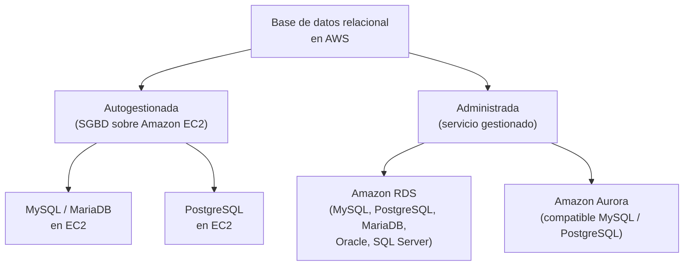

# 1. Introducción a las Bases de Datos Relacionales en la Nube

En las unidades anteriores hemos trabajado con los servicios de **almacenamiento** de AWS: objetos (S3), bloques (EBS) y ficheros en red (EFS). Con esta unidad comenzamos el **Bloque II** del módulo, dedicado a las **bases de datos en la nube**, empezando por las bases de datos **relacionales**, que siguen siendo el corazón de la mayoría de aplicaciones empresariales.

---

## Objetivos de la Unidad

- Comprender las características de las bases de datos relacionales transaccionales (OLTP).
- Distinguir entre una base de datos **autogestionada** sobre una instancia EC2 y un servicio de base de datos **administrado**.
- Instalar, configurar y securizar un sistema gestor de bases de datos (MySQL y PostgreSQL) sobre Amazon EC2.
- Desplegar y administrar instancias de **Amazon RDS** y clústeres de **Amazon Aurora**.
- Configurar la alta disponibilidad, las copias de seguridad y la seguridad de las bases de datos administradas.

---

## Bases de Datos Relacionales y OLTP

Una **base de datos relacional** organiza la información en **tablas** (filas y columnas) relacionadas entre sí mediante claves, y se consulta con el lenguaje **SQL**. Sus principales características son:

- **Esquema definido:** La estructura de las tablas (columnas, tipos de datos, restricciones) se define antes de insertar los datos.
- **Integridad referencial:** Las claves primarias y ajenas garantizan la coherencia entre tablas.
- **Transacciones ACID:** Las operaciones cumplen las propiedades de **A**tomicidad, **C**onsistencia, a**I**slamiento y **D**urabilidad.

Las bases de datos relacionales se utilizan habitualmente en sistemas **OLTP** (*Online Transaction Processing*): aplicaciones con muchas operaciones cortas y concurrentes de lectura y escritura, como tiendas online, sistemas de reservas, aplicaciones bancarias o ERPs.

!!! note "OLTP vs. OLAP"
    Los sistemas **OLTP** están optimizados para muchas transacciones pequeñas y rápidas sobre datos actuales. Los sistemas **OLAP** (*Online Analytical Processing*), que veremos en la UT9, están optimizados para consultas analíticas complejas sobre grandes volúmenes de datos históricos.

Los sistemas gestores de bases de datos relacionales (SGBD) más utilizados son **MySQL**, **MariaDB**, **PostgreSQL**, **Oracle Database** y **Microsoft SQL Server**.

---

## Opciones para Desplegar una Base de Datos Relacional en AWS

En AWS podemos desplegar una base de datos relacional de dos formas principales:

- **Base de datos autogestionada en EC2:** Instalamos el SGBD nosotros mismos en una instancia EC2. Tenemos **control total** sobre el sistema operativo y la configuración, pero también somos responsables de todas las tareas de administración.
- **Base de datos administrada (Amazon RDS / Aurora):** AWS se encarga de las tareas operativas (instalación, parcheado, copias de seguridad, alta disponibilidad...) y nosotros nos centramos en el diseño de la base de datos y en la aplicación.

### ¿Quién se encarga de qué?

| Tarea | En local (*on-premise*) | SGBD en Amazon EC2 | Amazon RDS / Aurora |
| :--- | :---: | :---: | :---: |
| Instalación y mantenimiento del hardware | 👤 Cliente | ☁️ AWS | ☁️ AWS |
| Instalación y parcheado del sistema operativo | 👤 Cliente | 👤 Cliente | ☁️ AWS |
| Instalación y parcheado del SGBD | 👤 Cliente | 👤 Cliente | ☁️ AWS |
| Copias de seguridad | 👤 Cliente | 👤 Cliente | ☁️ AWS |
| Alta disponibilidad y escalado | 👤 Cliente | 👤 Cliente | ☁️ AWS |
| Diseño del esquema y optimización de consultas | 👤 Cliente | 👤 Cliente | 👤 Cliente |
| Gestión de usuarios y permisos de la base de datos | 👤 Cliente | 👤 Cliente | 👤 Cliente |

!!! tip "¿Por qué empezamos por EC2?"
    Antes de utilizar Amazon RDS, instalaremos y configuraremos **MySQL** y **PostgreSQL** directamente sobre instancias EC2. Hacerlo "a mano" nos permite entender qué hay realmente detrás de una base de datos (instalación del servidor, ficheros de configuración, usuarios, acceso remoto, grupos de seguridad...) y valorar mejor todo el trabajo que un servicio administrado nos ahorra.

---

## Contenidos de la Unidad

1. **Bases de datos relacionales autogestionadas en EC2:** instalación y configuración de MySQL y PostgreSQL, acceso remoto y seguridad de red.
2. **Amazon RDS:** despliegue de instancias, motores soportados, grupos de parámetros y de opciones.
3. **Alta disponibilidad y escalado:** despliegues Multi-AZ y réplicas de lectura (*Read Replicas*).
4. **Copias de seguridad:** backups automáticos, instantáneas manuales y restauración a un momento dado (*Point-In-Time Restore*).
5. **Amazon Aurora:** arquitectura de almacenamiento distribuido, Aurora Serverless v2 y Global Database.
6. **Seguridad:** cifrado con KMS, autenticación IAM y control de acceso de red.
