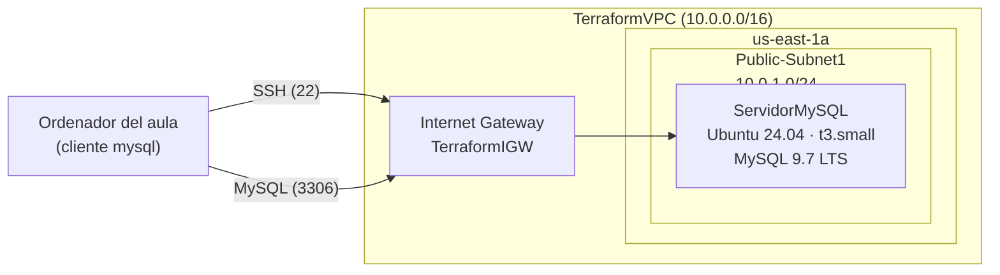

# Práctica 1: Instalación de MySQL en una instancia EC2 desplegada con Terraform

- **Módulo:** Administración de Bases de Datos y Almacenamiento en la Nube (ABDAN)
- **Unidad de Trabajo:** UT3. Servicios administrados de bases de datos relacionales

---

## Introducción

Antes de trabajar con servicios de bases de datos administrados como Amazon RDS, vamos a desplegar un servidor **MySQL autogestionado** sobre una instancia EC2. De esta forma seremos nosotros los responsables de todo el proceso: aprovisionar la máquina, instalar el sistema gestor, cargar los datos, crear usuarios y abrir el acceso remoto de forma controlada.

La infraestructura (red, grupos de seguridad e instancia) la desplegaremos con **Terraform**, reutilizando el proyecto de la [Práctica 2.5](../../UT2/practicas/practica-5-terraform-ebs-efs.md). Lo único que haremos a mano será la instalación y configuración de MySQL dentro de la instancia.

### Objetivos

- Reutilizar y adaptar un proyecto Terraform existente para desplegar una instancia **Ubuntu Server 24.04 LTS**.
- Instalar **MySQL 9.7 LTS** desde los **repositorios oficiales de MySQL**.
- Descargar y restaurar la base de datos de ejemplo **Sakila**.
- Abrir el puerto **3306** añadiendo un nuevo grupo de seguridad con Terraform.
- Crear un **usuario remoto** y conectarse al servidor desde el ordenador del aula con el cliente `mysql` en modo texto.

### Arquitectura propuesta



| Recurso | Descripción |
| :--- | :--- |
| **Red** | La misma VPC, subredes, Internet Gateway y tabla de rutas de la Práctica 2.5 |
| **ServidorMySQL** | Instancia `t3.small` con **Ubuntu Server 24.04 LTS** en `Public-Subnet1`, disco raíz de 10 GiB `gp3` |
| **Grupos de seguridad** | `SSH_Terraform` (22), `Outbound_Terraform` (salida) y, en una segunda fase, `MySQL_Terraform` (3306) |
| **Par de claves** | Generado con `ssh-keygen` y subido a AWS por Terraform |

---

## Fase 1: Preparación del proyecto Terraform

Partiremos de una copia del proyecto de la Práctica 2.5.

1. Copia el directorio del proyecto con un nuevo nombre:

    ```bash
    cp -r terraform-ebs-efs terraform-mysql
    cd terraform-mysql
    ```

2. Elimina el **estado** de Terraform y el directorio de proveedores de la copia, así como el fichero de almacenamiento, que en esta práctica no necesitamos:

    ```bash
    rm -rf .terraform terraform.tfstate terraform.tfstate.backup .terraform.lock.hcl
    rm storage.tf
    ```

    !!! danger "No reutilices el fichero de estado"
        El fichero `terraform.tfstate` registra los recursos que gestiona **ese** proyecto. Si lo copias, Terraform creerá que los recursos de la Práctica 2.5 pertenecen también a este proyecto y podría modificarlos o destruirlos. Cada proyecto debe tener su propio estado.

3. Edita `security.tf` y **elimina** los grupos de seguridad relacionados con EFS (`bastion_sg`, `efs_sg` y sus reglas). Deja únicamente `allow_ssh` y `allow_outbound` con sus reglas.

4. El fichero `networking.tf` puede quedarse tal cual. Las subredes privadas no se utilizarán, pero no generan coste.

---

## Fase 2: Adaptación de `compute.tf` a Ubuntu 24.04

Sustituye el contenido de `compute.tf` por una única instancia basada en **Ubuntu Server 24.04 LTS (Noble Numbat)**:

```hcl
data "aws_ami" "ubuntu_2404" {
  most_recent = true
  owners      = ["099720109477"] # Canonical

  filter {
    name   = "name"
    values = ["ubuntu/images/hvm-ssd-gp3/ubuntu-noble-24.04-amd64-server-*"]
  }

  filter {
    name   = "virtualization-type"
    values = ["hvm"]
  }
}

resource "aws_key_pair" "my_key_pair" {
  key_name   = "my-key-pair"
  public_key = file("clave.pub")
}

resource "aws_instance" "servidor_mysql" {
  ami           = data.aws_ami.ubuntu_2404.id
  instance_type = "t3.small"
  subnet_id     = aws_subnet.public_subnet1.id
  key_name      = aws_key_pair.my_key_pair.key_name

  vpc_security_group_ids = [
    aws_security_group.allow_ssh.id,
    aws_security_group.allow_outbound.id,
  ]

  root_block_device {
    volume_size = 10
    volume_type = "gp3"
  }

  tags = {
    Name = "ServidorMySQL"
  }
}

output "instance_public_ip" {
  value = aws_instance.servidor_mysql.public_ip
}
```

!!! note "Cambios respecto a la Práctica 2.5"
    - **AMI:** El propietario de las AMI oficiales de Ubuntu es **Canonical** (`099720109477`). El filtro selecciona la imagen más reciente de Ubuntu 24.04 para `amd64` con disco `gp3`.
    - **Tipo de instancia:** Usamos `t3.small` (2 GiB de RAM). Con `t3.micro` (1 GiB) MySQL funciona, pero va muy justo de memoria.
    - **Sin `user_data`:** Ya no montamos EBS ni EFS. La instalación de MySQL la haremos a mano.

!!! tip "Par de claves"
    Si no copiaste los ficheros `clave` y `clave.pub` de la Práctica 2.5, genéralos de nuevo con `ssh-keygen -t ed25519 -f clave -N ""`.

---

## Fase 3: Despliegue y conexión por SSH

1. Inicializa el proyecto, valida la configuración y revisa el plan:

    ```bash
    terraform init
    terraform validate
    terraform plan
    ```

2. Aplica la configuración:

    ```bash
    terraform apply
    ```

    Al finalizar, Terraform mostrará la IP pública de la instancia:

    ```
    Outputs:

    instance_public_ip = "X.X.X.X"
    ```

3. Conéctate por SSH. En las AMI de Ubuntu, el usuario por defecto es **`ubuntu`** (no `ec2-user`):

    ```bash
    ssh -i clave ubuntu@$(terraform output -raw instance_public_ip)
    ```

4. Actualiza los paquetes del sistema:

    ```bash
    sudo apt update && sudo apt upgrade -y
    ```

---

## Fase 4: Instalación de MySQL desde los repositorios oficiales

Ubuntu incluye MySQL en sus propios repositorios, pero vamos a usar el **repositorio APT oficial de MySQL**. Así podemos elegir la versión exacta del servidor y recibir las actualizaciones directamente de Oracle.

1. Descarga el paquete de configuración del repositorio:

    ```bash
    wget https://dev.mysql.com/get/mysql-apt-config_0.8.36-1_all.deb
    ```

    !!! note "Versión del paquete"
        El número de versión de `mysql-apt-config` cambia con el tiempo. Consulta la última versión disponible en [https://dev.mysql.com/downloads/repo/apt/](https://dev.mysql.com/downloads/repo/apt/) y ajusta el nombre del fichero si es necesario.

2. Instala el paquete. Se abrirá un asistente en modo texto:

    ```bash
    sudo dpkg -i mysql-apt-config_*_all.deb
    ```

    En el asistente, selecciona **MySQL Server & Cluster** → **mysql-9.7-lts** y, a continuación, **Ok**.

3. Actualiza la lista de paquetes (ahora incluirá el repositorio de MySQL) e instala el servidor:

    ```bash
    sudo apt update
    sudo apt install -y mysql-server
    ```

    Durante la instalación se solicitará la **contraseña del usuario `root`** de MySQL. Elige una contraseña robusta y apúntala.

4. Comprueba que el servicio está en ejecución y la versión instalada:

    ```bash
    systemctl status mysql
    mysql --version
    ```

5. Accede al servidor como `root`:

    ```bash
    mysql -u root -p
    ```

    ```sql
    SELECT VERSION();
    SHOW DATABASES;
    EXIT;
    ```

---

## Fase 5: Restauración de la base de datos Sakila

**Sakila** es la base de datos de ejemplo oficial de MySQL. Modela un videoclub con películas, actores, clientes, alquileres y pagos.

1. Descarga y descomprime Sakila:

    ```bash
    wget https://downloads.mysql.com/docs/sakila-db.tar.gz
    tar -xzf sakila-db.tar.gz
    ls sakila-db
    ```

    El directorio contiene dos scripts:

    | Fichero | Contenido |
    | :--- | :--- |
    | `sakila-schema.sql` | Crea la base de datos `sakila` con sus tablas, vistas, procedimientos, funciones y *triggers* |
    | `sakila-data.sql` | Inserta los datos de ejemplo |

2. Restaura primero el esquema y después los datos:

    ```bash
    mysql -u root -p < sakila-db/sakila-schema.sql
    mysql -u root -p < sakila-db/sakila-data.sql
    ```

    !!! warning "El orden importa"
        Si ejecutas antes `sakila-data.sql`, fallará porque las tablas todavía no existen.

3. Verifica que la restauración se ha realizado correctamente:

    ```bash
    mysql -u root -p sakila
    ```

    ```sql
    SHOW FULL TABLES;

    SELECT COUNT(*) FROM film;      -- 1000
    SELECT COUNT(*) FROM customer;  -- 599
    SELECT COUNT(*) FROM rental;    -- 16044

    -- Las 5 categorías con más películas
    SELECT c.name, COUNT(*) AS peliculas
    FROM category c
    JOIN film_category fc ON fc.category_id = c.category_id
    GROUP BY c.name
    ORDER BY peliculas DESC
    LIMIT 5;
    ```

---

## Fase 6: Apertura del puerto 3306 con Terraform

Por ahora solo podemos acceder a MySQL desde dentro de la instancia. Para permitir conexiones remotas, añadiremos un nuevo grupo de seguridad **desde Terraform**, sin tocar la consola.

1. En el **ordenador del aula** (no en la instancia), añade al final de `security.tf`:

    ```hcl
    # --- Grupo de seguridad: MySQL ---
    resource "aws_security_group" "allow_mysql" {
      name        = "MySQL_Terraform"
      description = "Allow MySQL inbound traffic"
      vpc_id      = aws_vpc.vpc_terraform.id
    }

    resource "aws_vpc_security_group_ingress_rule" "allow_mysql_rule" {
      security_group_id = aws_security_group.allow_mysql.id
      from_port         = 3306
      to_port           = 3306
      ip_protocol       = "tcp"
      cidr_ipv4         = "0.0.0.0/0"
    }
    ```

2. En `compute.tf`, añade el nuevo grupo a la lista `vpc_security_group_ids` de la instancia:

    ```hcl
      vpc_security_group_ids = [
        aws_security_group.allow_ssh.id,
        aws_security_group.allow_outbound.id,
        aws_security_group.allow_mysql.id,
      ]
    ```

3. Revisa el plan y aplica los cambios:

    ```bash
    terraform plan
    terraform apply
    ```

    El plan debería indicar que se **crean 2 recursos** (el grupo de seguridad y su regla) y se **modifica 1** (la instancia):

    ```
    Plan: 2 to add, 1 to change, 0 to destroy.
    ```

    !!! note "Modificación sin reemplazo"
        Cambiar los grupos de seguridad de una instancia es una modificación **in situ** (`~ update in-place`): la instancia no se reinicia ni se recrea, por lo que MySQL y los datos de Sakila siguen intactos. Revisa siempre el plan: si apareciera `-/+ destroy and then create replacement`, perderíamos la instancia.

!!! warning "Puerto 3306 abierto a todo Internet"
    Abrir el puerto de la base de datos a `0.0.0.0/0` es aceptable en un laboratorio de corta duración, pero **nunca en producción**. Lo correcto es restringir el origen a la IP pública del aula (`cidr_ipv4 = "X.X.X.X/32"`, que puedes averiguar con `curl ifconfig.me`) o, mejor aún, no exponer la base de datos a Internet y acceder a través de una VPN o un *bastion host*.

---

## Fase 7: Usuario remoto y conexión desde el aula

### Comprobación de la interfaz de escucha

1. En la instancia, comprueba en qué dirección escucha MySQL:

    ```bash
    sudo ss -tlnp | grep 3306
    ```

    Si aparece `*:3306` (o `0.0.0.0:3306`), MySQL acepta conexiones desde cualquier interfaz. Si aparece `127.0.0.1:3306`, edita `/etc/mysql/mysql.conf.d/mysqld.cnf`, cambia la directiva `bind-address` a `0.0.0.0` y reinicia el servicio con `sudo systemctl restart mysql`.

### Creación del usuario remoto

2. El usuario `root` solo puede conectarse desde `localhost`. Crearemos un usuario específico para el acceso remoto, con permisos únicamente sobre `sakila`:

    ```bash
    mysql -u root -p
    ```

    ```sql
    CREATE USER 'remoto'@'%' IDENTIFIED BY 'Contraseña_Robusta_123';
    GRANT ALL PRIVILEGES ON sakila.* TO 'remoto'@'%';

    -- Comprobación
    SELECT user, host FROM mysql.user;
    SHOW GRANTS FOR 'remoto'@'%';
    ```

    !!! note "El host en las cuentas de MySQL"
        En MySQL, una cuenta se identifica por **usuario y host**: `'remoto'@'%'` permite conectarse desde cualquier origen, mientras que `'remoto'@'X.X.X.X'` solo lo permitiría desde esa IP. `'root'@'localhost'` y `'root'@'%'` serían cuentas distintas.

### Conexión desde el ordenador del aula

3. Desde el ordenador del aula, conéctate al servidor con el cliente en modo texto:

    ```bash
    mysql -h $(terraform output -raw instance_public_ip) -u remoto -p sakila
    ```

4. Ejecuta algunas consultas para comprobar la conexión remota:

    ```sql
    SELECT USER(), CURRENT_USER(), @@hostname;
    SELECT title, release_year, rating FROM film LIMIT 10;
    ```

    !!! tip "`USER()` vs. `CURRENT_USER()`"
        `USER()` muestra el usuario y la IP desde la que te conectas (la IP pública del aula), mientras que `CURRENT_USER()` muestra la cuenta de MySQL con la que el servidor te ha autenticado (`remoto@%`).

5. Intenta conectarte como `root` desde el aula y comprueba que el servidor **rechaza** la conexión:

    ```bash
    mysql -h $(terraform output -raw instance_public_ip) -u root -p
    ```

---

## Fase 8: Limpieza del laboratorio

Cuando termines, destruye toda la infraestructura para no consumir créditos:

```bash
terraform destroy
```

---

## Entregables

1. **Captura 1 — `terraform apply`:** Salida final del primer `terraform apply` con el mensaje `Apply complete!` y la IP pública de la instancia.

2. **Captura 2 — Instalación de MySQL:** Salida de `systemctl status mysql` y `mysql --version` en la instancia, donde se aprecie la versión 9.7 LTS.

3. **Captura 3 — Sakila restaurada:** Resultado de `SHOW FULL TABLES` y de los `SELECT COUNT(*)` sobre las tablas `film`, `customer` y `rental`.

4. **Captura 4 — Apertura del puerto 3306:** Salida de `terraform plan` mostrando `Plan: 2 to add, 1 to change, 0 to destroy`.

5. **Captura 5 — Conexión remota:** Terminal del ordenador del aula conectado como `remoto` al servidor MySQL, con el resultado de `SELECT USER(), CURRENT_USER(), @@hostname;`.

6. **Captura 6 — `terraform destroy`:** Salida final confirmando que todos los recursos se han destruido.

7. **Entrega del código Terraform:** Comprime el directorio del proyecto (excluyendo `terraform.tfstate`, `terraform.tfstate.backup`, el directorio `.terraform/` y la clave privada `clave`) y adjúntalo a la entrega.
