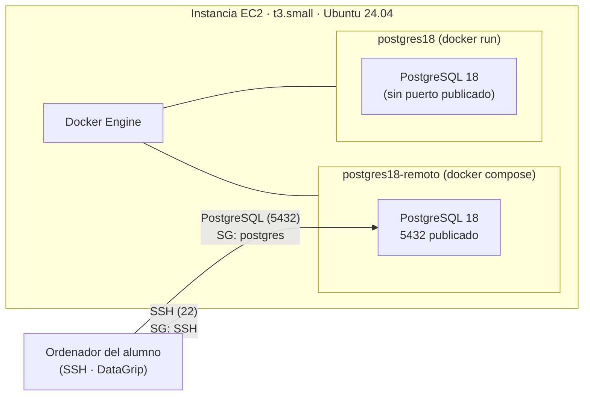

# Práctica 2: PostgreSQL 18 en una instancia EC2 con Docker y Docker Compose

- **Módulo:** Administración de Bases de Datos y Almacenamiento en la Nube (ABDAN)
- **Unidad de Trabajo:** UT3. Servicios administrados de bases de datos relacionales

---

## Introducción

En la práctica anterior instalamos MySQL directamente sobre el sistema operativo de una instancia EC2. En esta práctica desplegaremos **PostgreSQL 18** de una forma distinta: dentro de **contenedores Docker**. Esta es una manera muy habitual de ejecutar bases de datos en entornos de desarrollo y pruebas, ya que permite tener una versión concreta del servidor funcionando en segundos y sin "ensuciar" el sistema anfitrión.

Crearemos dos contenedores de PostgreSQL. El primero lo lanzaremos con `docker run` y cargaremos a mano la base de datos de ejemplo **Pagila** (la adaptación a PostgreSQL de Sakila, la que usamos en MySQL). El segundo lo definiremos de forma declarativa con **Docker Compose**: publicará el puerto 5432 y cargará Pagila automáticamente al arrancar. Finalmente, nos conectaremos a este segundo servidor desde nuestro ordenador con un cliente gráfico.

### Objetivos

- Crear y configurar una instancia EC2 con **Ubuntu Server 24.04 LTS** desde la consola de AWS.
- Crear un **par de claves** y un **grupo de seguridad** para el acceso SSH.
- Instalar **Docker Engine** y el plugin **Docker Compose** desde los repositorios oficiales de Docker.
- Ejecutar **PostgreSQL 18** en un contenedor con almacenamiento persistente y cargar **Pagila** manualmente.
- Definir un servicio de PostgreSQL con **Docker Compose** que inicialice la base de datos automáticamente.
- Abrir el puerto **5432** en un grupo de seguridad y conectarse con **DataGrip**.

### Arquitectura propuesta



---

## Fase 1: Creación de la instancia EC2

1. Desde la consola de **Amazon EC2**, pulsa **Launch instance** y configura la instancia con los siguientes valores:

    | Parámetro | Valor |
    | :--- | :--- |
    | **Name** | `PostgreSQL` |
    | **AMI** | Ubuntu Server 24.04 LTS (HVM), SSD Volume Type — arquitectura **64-bit (x86)** |
    | **Instance type** | `t3.small` |
    | **Key pair** | Crea uno nuevo llamado **`EC2`**, de tipo RSA y formato **`.pem`** |
    | **Network settings** | Crea un grupo de seguridad llamado **`SSH`** con una regla de entrada para el puerto **22** (TCP) |
    | **Storage** | **8 GiB**, tipo **`gp3`** |

2. Al crear el par de claves, el navegador descargará el fichero `EC2.pem`. Guárdalo en un lugar seguro: **AWS no permite volver a descargarlo**.

3. Pulsa **Launch instance** y espera a que la instancia esté en estado *Running*. Anota su **IP pública**.

---

## Fase 2: Acceso por SSH

1. En tu ordenador, restringe los permisos de la clave privada. SSH rechaza las claves que pueden leer otros usuarios:

    ```bash
    chmod 400 EC2.pem
    ```

2. Conéctate a la instancia. En las AMI de Ubuntu, el usuario por defecto es **`ubuntu`**:

    ```bash
    ssh -i EC2.pem ubuntu@<IP_PUBLICA>
    ```

3. Actualiza los paquetes del sistema:

    ```bash
    sudo apt update && sudo apt upgrade -y
    ```

---

## Fase 3: Instalación de Docker y Docker Compose

Para no complicar la práctica, instalaremos Docker y Docker Compose directamente desde los **repositorios de Ubuntu**:

1. Instala los paquetes:

    ```bash
    sudo apt install -y docker.io docker-compose-v2
    ```

    | Paquete | Contenido |
    | :--- | :--- |
    | `docker.io` | Docker Engine (servicio `docker`) y el cliente `docker` |
    | `docker-compose-v2` | Plugin **Docker Compose v2**, que se usa como subcomando: `docker compose` (con espacio) |

    !!! note "`docker compose` vs. `docker-compose`"
        Ubuntu también ofrece el paquete `docker-compose`, que instala el antiguo ejecutable `docker-compose` (con guion), es decir, **Compose v1**, ya obsoleto. Usaremos `docker-compose-v2`.

2. En Ubuntu, el servicio de Docker queda arrancado y habilitado tras la instalación. Compruébalo:

    ```bash
    systemctl status docker
    ```

3. Comprueba la instalación:

    ```bash
    sudo docker --version
    sudo docker compose version
    sudo docker run --rm hello-world
    ```

    !!! note "Docker con `sudo`"
        El servicio de Docker se ejecuta como `root`, por lo que en esta práctica **todos los comandos `docker` se lanzan con `sudo`**.

---

## Fase 4: PostgreSQL 18 en un contenedor con `docker run`

1. Descarga la imagen oficial de PostgreSQL 18:

    ```bash
    sudo docker pull postgres:18
    ```

2. Crea y arranca el contenedor:

    ```bash
    sudo docker run -d \
      --name postgres18 \
      -e POSTGRES_PASSWORD=Contraseña_Robusta_123 \
      --restart always \
      postgres:18
    ```

    | Opción | Significado |
    | :--- | :--- |
    | `-d` | Ejecuta el contenedor en segundo plano (*detached*) |
    | `--name postgres18` | Nombre del contenedor |
    | `-e POSTGRES_PASSWORD=...` | Contraseña del superusuario `postgres` (obligatoria) |
    | `--restart always` | Reinicia el contenedor automáticamente si se detiene o se reinicia la instancia |


3. Comprueba que el contenedor está en ejecución y revisa sus registros:

    ```bash
    sudo docker ps
    sudo docker logs postgres18
    ```

    En los registros deberías ver el mensaje `database system is ready to accept connections`.

4. Accede al cliente `psql` **dentro** del contenedor:

    ```bash
    sudo docker exec -it postgres18 psql -U postgres
    ```

    ```sql
    SELECT version();
    \l
    \q
    ```

---

## Fase 5: Carga manual de la base de datos Pagila

[**Pagila**](https://github.com/devrimgunduz/pagila) es la adaptación a PostgreSQL de **Sakila**: modela el mismo videoclub, con películas, actores, clientes, alquileres y pagos.

1. Clona el repositorio de Pagila en el directorio personal de la instancia (Git viene instalado en Ubuntu):

    ```bash
    cd ~
    git clone https://github.com/devrimgunduz/pagila.git
    ls pagila
    ```

    Los ficheros que nos interesan son:

    | Fichero | Contenido |
    | :--- | :--- |
    | `pagila-schema.sql` | Crea las tablas, vistas, funciones y *triggers* |
    | `pagila-data.sql` | Carga los datos con sentencias `COPY` (más rápido) |

2. Crea la base de datos `pagila`:

    ```bash
    sudo docker exec -it postgres18 psql -U postgres -c "CREATE DATABASE pagila;"
    ```

3. Carga el esquema y después los datos. Los ficheros están en la instancia, no en el contenedor, así que los enviamos por la entrada estándar del comando `docker exec`:

    ```bash
    cat ~/pagila/pagila-schema.sql | sudo docker exec -i postgres18 psql -U postgres -d pagila
    cat ~/pagila/pagila-data.sql   | sudo docker exec -i postgres18 psql -U postgres -d pagila
    ```

    !!! note "`-it` vs. `-i`"
        Para abrir una sesión interactiva de `psql` usamos `-it` (entrada interactiva y terminal). Para enviar un fichero por una tubería (`|`) usamos solo `-i`: si añadimos `-t`, Docker se quejará de que la entrada no es una terminal.

4. Comprueba que la carga se ha realizado correctamente:

    ```bash
    sudo docker exec -it postgres18 psql -U postgres -d pagila
    ```

    ```sql
    \dt

    SELECT COUNT(*) FROM film;      -- 1000
    SELECT COUNT(*) FROM actor;     -- 200
    SELECT COUNT(*) FROM customer;  -- 599

    -- Los 5 actores que aparecen en más películas
    SELECT a.first_name, a.last_name, COUNT(*) AS peliculas
    FROM actor a
    JOIN film_actor fa ON fa.actor_id = a.actor_id
    GROUP BY a.actor_id, a.first_name, a.last_name
    ORDER BY peliculas DESC
    LIMIT 5;
    ```

---

## Fase 6: Segundo servidor PostgreSQL con Docker Compose

El contenedor `postgres18` no publica ningún puerto, así que solo se puede acceder a él desde dentro de la instancia (con `docker exec`). Ahora crearemos un **segundo servidor** que publique el puerto **5432**, pero esta vez lo definiremos en un fichero **`compose.yaml`** en lugar de escribir un largo comando `docker run`.

!!! note "¿Por qué Docker Compose?"
    Con `docker run`, toda la configuración del contenedor (imagen, variables, volúmenes, puertos...) queda en un comando que hay que recordar o copiar. Con **Docker Compose**, esa configuración se escribe en un fichero YAML que se puede versionar con Git, compartir y volver a desplegar con un solo comando. Es la misma idea que Terraform aplicada a los contenedores: **infraestructura declarativa**.

1. Crea un directorio para el proyecto:

    ```bash
    mkdir ~/postgres-compose
    cd ~/postgres-compose
    ```

2. Crea la carpeta `init_scripts` y copia en ella los scripts de Pagila, añadiendo un prefijo numérico para fijar el orden de ejecución:

    ```bash
    mkdir init_scripts
    cp ~/pagila/pagila-schema.sql init_scripts/01-pagila-schema.sql
    cp ~/pagila/pagila-data.sql   init_scripts/02-pagila-data.sql
    ```

3. Crea el fichero **`compose.yaml`** con el siguiente contenido:

    ```yaml
    services:
      postgres:
        image: postgres:18
        container_name: postgres18-remoto
        environment:
          POSTGRES_PASSWORD: Contraseña_Robusta_123
          POSTGRES_DB: pagila
        ports:
          - "5432:5432"
        restart: always
        volumes:
          # Carpeta para los datos de las BD
          - ./datos_postgres:/var/lib/postgresql
          # Carpeta para la auto-inicialización
          - ./init_scripts:/docker-entrypoint-initdb.d
    ```

    | Clave | Significado |
    | :--- | :--- |
    | `image` / `container_name` | Imagen de PostgreSQL 18 y nombre del contenedor |
    | `environment` | Contraseña del usuario `postgres` y `POSTGRES_DB`, que **crea la base de datos `pagila`** al inicializar |
    | `ports` | Publica el puerto 5432 del contenedor en el 5432 de la instancia (`anfitrión:contenedor`) |
    | `restart: always` | Reinicia el contenedor automáticamente si se detiene o se reinicia la instancia |
    | `volumes` | Monta dos carpetas del directorio del proyecto en el contenedor: `./datos_postgres` para los datos (Docker la crea al arrancar) y `./init_scripts` con los scripts de inicialización |

    !!! note "Carpeta de datos en PostgreSQL 18"
        En PostgreSQL 18 la carpeta de datos se monta en **`/var/lib/postgresql`**. Muchos tutoriales antiguos usan `/var/lib/postgresql/data`, que ya no es correcto para esta versión.

    !!! important "Inicialización automática con `/docker-entrypoint-initdb.d`"
        La imagen oficial de PostgreSQL ejecuta, **en orden alfabético**, los ficheros `.sql` y `.sh` que encuentre en `/docker-entrypoint-initdb.d`. Por eso hemos añadido los prefijos `01-` y `02-`: primero el esquema y después los datos. Los scripts se ejecutan sobre la base de datos indicada en `POSTGRES_DB`.

        Esta inicialización **solo ocurre la primera vez**, cuando la carpeta `datos_postgres` está vacía. Si ya contiene datos, los scripts se ignoran.

4. Valida el fichero y levanta el servicio en segundo plano:

    ```bash
    sudo docker compose config
    sudo docker compose up -d
    ```

5. Sigue los registros mientras se carga Pagila (sal con `Ctrl+C`):

    ```bash
    sudo docker compose logs -f
    ```

    Verás cómo se ejecutan `01-pagila-schema.sql` y `02-pagila-data.sql` y, al final, el mensaje `database system is ready to accept connections`.

6. Comprueba el estado del servicio y que el puerto está publicado:

    ```bash
    sudo docker compose ps
    sudo ss -tlnp | grep 5432
    ```

    La columna `STATUS` debería mostrar `Up` y la columna `PORTS`, `0.0.0.0:5432->5432/tcp`.

7. Verifica que Pagila se ha cargado sin haber ejecutado ningún comando de carga:

    ```bash
    sudo docker compose exec postgres psql -U postgres -d pagila -c "SELECT COUNT(*) FROM film;"
    ```

!!! tip "Comandos básicos de Docker Compose"
    | Comando | Acción |
    | :--- | :--- |
    | `sudo docker compose up -d` | Crea y arranca los servicios en segundo plano |
    | `sudo docker compose ps` | Muestra el estado de los servicios |
    | `sudo docker compose logs -f` | Muestra los registros en tiempo real |
    | `sudo docker compose exec <servicio> <cmd>` | Ejecuta un comando dentro de un servicio (se usa el nombre del **servicio**, `postgres`, no el del contenedor) |
    | `sudo docker compose stop` / `start` | Detiene o arranca los servicios sin eliminarlos |
    | `sudo docker compose down` | Elimina los contenedores (los datos se conservan en `datos_postgres`) |

---

## Fase 7: Grupo de seguridad para PostgreSQL

Aunque el puerto esté publicado en la instancia, el **grupo de seguridad** sigue bloqueando el tráfico entrante al puerto 5432.

1. En la consola de EC2, accede a **Security Groups** → **Create security group** y configúralo así:

    | Parámetro | Valor |
    | :--- | :--- |
    | **Name** | `postgres` |
    | **Description** | `Allow PostgreSQL inbound traffic` |
    | **VPC** | La misma VPC de la instancia |
    | **Inbound rule** | Tipo **PostgreSQL**, protocolo TCP, puerto **5432**, origen **Anywhere-IPv4** (`0.0.0.0/0`) |

2. Asigna el grupo a la instancia: selecciona la instancia → **Actions** → **Security** → **Change security groups**, añade el grupo `postgres` (manteniendo el grupo `SSH`) y guarda.

!!! warning "Puerto 5432 abierto a todo Internet"
    Abrir el puerto de la base de datos a `0.0.0.0/0` es aceptable en un laboratorio de corta duración, pero **nunca en producción**: los robots que escanean Internet detectan estos puertos en minutos e intentan adivinar contraseñas. Como mínimo, restringe el origen a tu IP (**My IP** en la consola).

---

## Fase 8: Conexión con DataGrip

1. Abre [**DataGrip**](https://www.jetbrains.com/datagrip/) (gratuito con licencia educativa de JetBrains) y crea una nueva conexión desde **File** → **New** → **Data Source** → **PostgreSQL** con estos datos:

    | Parámetro | Valor |
    | :--- | :--- |
    | **Host** | IP pública de la instancia |
    | **Port** | `5432` |
    | **Database** | `pagila` |
    | **Username** | `postgres` |
    | **Password** | La contraseña definida en `POSTGRES_PASSWORD` |

2. La primera vez, DataGrip mostrará un aviso para descargar el *driver* de PostgreSQL: pulsa **Download missing driver files**. A continuación, pulsa **Test Connection** y, si todo es correcto, **OK**.

3. Una vez conectado, explora el esquema `public` de la base de datos `pagila` y ejecuta alguna consulta desde el editor SQL, por ejemplo:

    ```sql
    SELECT c.name AS categoria, COUNT(*) AS peliculas
    FROM category c
    JOIN film_category fc ON fc.category_id = c.category_id
    GROUP BY c.name
    ORDER BY peliculas DESC;
    ```

!!! tip "Si la conexión falla"
    Revisa, por este orden:

    1. Que el servicio está en ejecución y publica el puerto (`sudo docker compose ps`).
    2. Que el grupo `postgres` está asignado a la instancia y tiene la regla de entrada al 5432.
    3. Que usas la **IP pública** actual: cambia cada vez que se detiene y arranca la instancia.

---

## Fase 9: Finalización de la sesión

Cuando termines la sesión de trabajo, **detén la instancia** desde la consola (**Instance state** → **Stop instance**) para no consumir créditos. Gracias a la política de reinicio `always`, los dos contenedores volverán a arrancar solos la próxima vez que inicies la instancia, con sus datos.

---

## Entregables

Entrega un documento que describa el proceso realizado, haciendo hincapié en los pasos más complejos o importantes, y que incluya al menos las siguientes capturas:

1. **Captura 1 — Instancia EC2:** Detalles de la instancia en la consola (tipo `t3.small`, Ubuntu 24.04, volumen de 8 GiB `gp3` y grupo de seguridad `SSH`).

2. **Captura 2 — Docker y PostgreSQL:** Salida de `sudo docker --version`, `sudo docker compose version` y del `SELECT version();` en el contenedor `postgres18` mostrando PostgreSQL 18.

3. **Captura 3 — Pagila cargada manualmente:** Resultado de `\dt` y de los `SELECT COUNT(*)` sobre las tablas `film`, `actor` y `customer` en el contenedor `postgres18`.

4. **Captura 4 — Docker Compose:** Contenido del fichero `compose.yaml` y salida de `sudo docker compose ps` con el servicio en ejecución y el puerto 5432 publicado.

5. **Captura 5 — Grupo de seguridad `postgres`:** Regla de entrada al puerto 5432 y grupos de seguridad asignados a la instancia.

6. **Captura 6 — Conexión remota:** DataGrip conectado al servidor, mostrando las tablas de `pagila` y el resultado de una consulta.
