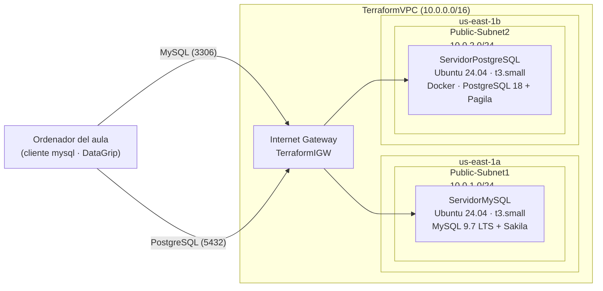

# Práctica 3: Instalación automática de MySQL y PostgreSQL con `user_data`

- **Módulo:** Administración de Bases de Datos y Almacenamiento en la Nube (ABDAN)
- **Unidad de Trabajo:** UT3. Servicios administrados de bases de datos relacionales

---

## Introducción

En las dos prácticas anteriores instalamos MySQL y PostgreSQL **a mano**: nos conectamos por SSH y fuimos ejecutando los comandos uno a uno. En esta práctica vamos a automatizar todo ese trabajo. Escribiremos un **script de arranque** (`user_data`) para cada servidor, de forma que, al hacer `terraform apply`, las instancias se creen y arranquen con la base de datos instalada, los datos de ejemplo cargados y el acceso remoto preparado, **sin entrar por SSH**.

El contenido de los scripts no es nuevo: son los mismos pasos de la [Práctica 3.1](practica-1-mysql-ec2-terraform.md) y de la [Práctica 3.2](practica-2-postgresql-docker.md), adaptados para que se ejecuten solos, sin nadie delante que responda a las preguntas.

### Objetivos

- Entender qué es `user_data` y cuándo se ejecuta.
- Convertir una instalación manual en un **script no interactivo**.
- Desplegar con Terraform **dos servidores de bases de datos** (MySQL y PostgreSQL) que se configuran solos.
- Depurar un script de arranque a partir de los registros de **cloud-init**.
- Comprobar el resultado conectándose desde el ordenador del aula con el cliente `mysql` y con **DataGrip**.

### Arquitectura propuesta



| Recurso | Descripción |
| :--- | :--- |
| **Red** | La misma VPC, subredes, Internet Gateway y tabla de rutas de la Práctica 3.1 |
| **ServidorMySQL** | Instancia `t3.small` con Ubuntu 24.04 en `Public-Subnet1`. Su `user_data` instala MySQL 9.7 LTS, restaura Sakila y crea el usuario `remoto` |
| **ServidorPostgreSQL** | Instancia `t3.small` con Ubuntu 24.04 en `Public-Subnet2`. Su `user_data` instala Docker y levanta PostgreSQL 18 con Pagila mediante Docker Compose |
| **Grupos de seguridad** | `SSH_Terraform` (22), `Outbound_Terraform` (salida), `MySQL_Terraform` (3306) y el nuevo `PostgreSQL_Terraform` (5432) |
| **Scripts** | `scripts/mysql.sh` y `scripts/postgresql.sh`, que escribiremos nosotros |

---

## ¿Qué es `user_data`?

Al lanzar una instancia EC2 podemos adjuntarle un pequeño script en el campo **`user_data`**. Las AMI de Ubuntu incluyen **cloud-init**, un programa que, en el **primer arranque** de la instancia, lee ese script y lo ejecuta **como `root`**.

Ya lo usamos en la Práctica 2.5 para montar los volúmenes EBS y EFS. Ahora lo usaremos para algo más largo: instalar y configurar un servidor de bases de datos completo.

Hay que tener en cuenta varias diferencias con lo que hacíamos por SSH:

| Por SSH (a mano) | En `user_data` |
| :--- | :--- |
| Usuario `ubuntu`, con `sudo` delante de cada comando | Se ejecuta como `root`: **no hace falta `sudo`** |
| Si un comando pregunta algo, respondemos | **Nadie puede responder**: cualquier pregunta deja el script bloqueado o hace que falle |
| Vemos los errores en pantalla | La salida va a un fichero de registro: `/var/log/cloud-init-output.log` |
| Podemos repetir un paso | Se ejecuta **una sola vez**, en el primer arranque |
| `~` es `/home/ubuntu` | El directorio de trabajo es `/` y `~` es `/root`: usa **rutas absolutas** |

---

## Fase 1: Preparación del proyecto Terraform

Partiremos del proyecto de la Práctica 3.1, que ya tiene la red, la instancia Ubuntu y el grupo de seguridad de MySQL.

1. Copia el directorio del proyecto con un nuevo nombre y elimina el estado:

    ```bash
    cp -r terraform-mysql terraform-bd
    cd terraform-bd
    rm -rf .terraform terraform.tfstate terraform.tfstate.backup .terraform.lock.hcl
    ```

2. Crea la carpeta donde guardaremos los scripts:

    ```bash
    mkdir scripts
    ```

---

## Fase 2: Script de MySQL

Crea el fichero `scripts/mysql.sh` a partir de la siguiente plantilla. Las partes marcadas como **RESUELTO** se te dan hechas; las marcadas como **TODO** tienes que completarlas tú a partir de lo que hiciste en la Práctica 3.1.

```bash
#!/bin/bash
# =====================================================================
#  user_data del ServidorMySQL
#  Instala MySQL 9.7 LTS, restaura Sakila y crea el usuario remoto
# =====================================================================
set -eux

# --- RESUELTO: preparación para un script no interactivo -------------
export DEBIAN_FRONTEND=noninteractive
echo 'DPkg::Lock::Timeout "300";' > /etc/apt/apt.conf.d/99-lock-timeout

ROOT_PASS='Root_Robusta_123'
REMOTO_PASS='Contraseña_Robusta_123'

cd /tmp

# --- TODO 1: actualizar la lista de paquetes -------------------------


# --- RESUELTO 2: repositorio oficial de MySQL sin asistente ----------
debconf-set-selections <<EOF
mysql-apt-config mysql-apt-config/select-server select mysql-9.7-lts
mysql-apt-config mysql-apt-config/select-product select Ok
mysql-community-server mysql-community-server/root-pass password ${ROOT_PASS}
mysql-community-server mysql-community-server/re-root-pass password ${ROOT_PASS}
EOF

wget https://dev.mysql.com/get/mysql-apt-config_0.8.36-1_all.deb
dpkg -i mysql-apt-config_0.8.36-1_all.deb

# --- TODO 3: actualizar la lista de paquetes e instalar mysql-server -


# --- TODO 4: descargar Sakila y restaurar esquema y datos ------------


# --- TODO 5: crear el usuario 'remoto'@'%' con permisos sobre sakila -


echo "=== ServidorMySQL listo ==="
```

### Explicación de las partes resueltas

| Línea | Para qué sirve |
| :--- | :--- |
| `set -eux` | `-e`: el script **se detiene en el primer error** (en vez de seguir y ocultarlo). `-u`: da error si se usa una variable sin definir. `-x`: escribe cada comando en el registro antes de ejecutarlo, lo que facilita mucho la depuración |
| `DEBIAN_FRONTEND=noninteractive` | Indica a `apt` y a `dpkg` que no muestren ningún asistente: usarán las respuestas por defecto o las que hayamos dado con `debconf` |
| `DPkg::Lock::Timeout` | En el primer arranque, Ubuntu suele lanzar actualizaciones automáticas que bloquean `apt` durante un rato. Con esta opción, `apt` **espera** hasta 300 s a que quede libre en lugar de fallar con *Could not get lock* |
| `debconf-set-selections` | **Responde de antemano** a las preguntas de los paquetes. Las dos primeras líneas contestan al asistente de `mysql-apt-config` (elegir `mysql-9.7-lts` y pulsar **Ok**); las dos últimas, a la petición de la contraseña de `root` durante la instalación de `mysql-server` |

!!! note "¿Cómo se sabe qué preguntas hace un paquete?"
    Después de instalar un paquete de forma interactiva, el comando `sudo debconf-get-selections | grep mysql` (del paquete `debconf-utils`) muestra las preguntas que hizo y las respuestas que diste. Es la forma habitual de averiguar qué hay que poner en `debconf-set-selections`.

### Pistas para los TODO

- **No uses `sudo`**: el script ya se ejecuta como `root`.
- **`apt-get install -y`**: sin `-y`, `apt` pregunta si quieres continuar.
- **Contraseña en la línea de comandos**: `mysql -u root -p"$ROOT_PASS"`, con la contraseña **pegada** a `-p`, sin espacio. Así `mysql` no la pide por teclado. (Mostrará un aviso de que no es seguro; en este script es aceptable).
- **Ejecutar SQL sin abrir el cliente**: `mysql -u root -p"$ROOT_PASS" -e "SENTENCIA1; SENTENCIA2;"`.
- **Usar variables dentro del SQL**: dentro de comillas dobles, `'${REMOTO_PASS}'` se sustituye por el valor de la variable.

---

## Fase 3: Script de PostgreSQL

Crea el fichero `scripts/postgresql.sh` a partir de esta plantilla. Los pasos son los de la **Fase 3** (instalación de Docker) y la **Fase 6** (Docker Compose) de la Práctica 3.2.

```bash
#!/bin/bash
# =====================================================================
#  user_data del ServidorPostgreSQL
#  Instala Docker y levanta PostgreSQL 18 con Pagila mediante Compose
# =====================================================================
set -eux

# --- RESUELTO: preparación para un script no interactivo -------------
export DEBIAN_FRONTEND=noninteractive
echo 'DPkg::Lock::Timeout "300";' > /etc/apt/apt.conf.d/99-lock-timeout

PG_PASS='Contraseña_Robusta_123'
DIR=/home/ubuntu/postgres-compose

# --- TODO 1: actualizar la lista de paquetes e instalar docker.io,
#             docker-compose-v2 y git ----------------------------------


# --- TODO 2: clonar Pagila en /home/ubuntu/pagila --------------------


# --- TODO 3: crear $DIR/init_scripts y copiar los scripts de Pagila
#             como 01-pagila-schema.sql y 02-pagila-data.sql -----------


# --- TODO 4: crear $DIR/compose.yaml con el mismo contenido que en
#             la Práctica 3.2, usando la variable PG_PASS ---------------


# --- TODO 5: levantar el servicio con docker compose -----------------


echo "=== ServidorPostgreSQL listo ==="
```

### Pistas para los TODO

- **Rutas absolutas**: usa siempre `/home/ubuntu/...` o `$DIR`. En `user_data`, `~` apunta a `/root`.
- **Crear carpetas con subcarpetas**: `mkdir -p` crea todas las carpetas intermedias que falten y no da error si ya existen.
- **Escribir un fichero desde el script**: se usa un *here document*. Todo lo que hay entre la primera línea y `EOF` se escribe en el fichero, respetando los espacios (importante en YAML). Las variables como `${PG_PASS}` se sustituyen por su valor:

    ```bash
    cat > /ruta/al/fichero <<EOF
    línea 1
    línea 2 con ${UNA_VARIABLE}
    EOF
    ```

- **`docker compose` busca `compose.yaml` en el directorio actual**: entra antes en `$DIR` con `cd`.
- No hace falta esperar a que Pagila termine de cargarse: el contenedor lo hace solo después de que el script acabe.

---

## Fase 4: Cambios en Terraform

### Grupo de seguridad de PostgreSQL

1. Añade al final de `security.tf` el grupo de seguridad para el puerto 5432:

    ```hcl
    # --- Grupo de seguridad: PostgreSQL ---
    resource "aws_security_group" "allow_postgres" {
      name        = "PostgreSQL_Terraform"
      description = "Allow PostgreSQL inbound traffic"
      vpc_id      = aws_vpc.vpc_terraform.id
    }

    resource "aws_vpc_security_group_ingress_rule" "allow_postgres_rule" {
      security_group_id = aws_security_group.allow_postgres.id
      from_port         = 5432
      to_port           = 5432
      ip_protocol       = "tcp"
      cidr_ipv4         = "0.0.0.0/0"
    }
    ```

### Las dos instancias

2. En `compute.tf`, conserva el `data "aws_ami"` y el `aws_key_pair`, y sustituye la instancia y el *output* por lo siguiente:

    ```hcl
    resource "aws_instance" "servidor_mysql" {
      ami           = data.aws_ami.ubuntu_2404.id
      instance_type = "t3.small"
      subnet_id     = aws_subnet.public_subnet1.id
      key_name      = aws_key_pair.my_key_pair.key_name

      vpc_security_group_ids = [
        aws_security_group.allow_ssh.id,
        aws_security_group.allow_outbound.id,
        aws_security_group.allow_mysql.id,
      ]

      user_data                   = file("scripts/mysql.sh")
      user_data_replace_on_change = true

      root_block_device {
        volume_size = 10
        volume_type = "gp3"
      }

      tags = {
        Name = "ServidorMySQL"
      }
    }

    resource "aws_instance" "servidor_postgresql" {
      ami           = data.aws_ami.ubuntu_2404.id
      instance_type = "t3.small"
      subnet_id     = aws_subnet.public_subnet2.id
      key_name      = aws_key_pair.my_key_pair.key_name

      vpc_security_group_ids = [
        aws_security_group.allow_ssh.id,
        aws_security_group.allow_outbound.id,
        aws_security_group.allow_postgres.id,
      ]

      user_data                   = file("scripts/postgresql.sh")
      user_data_replace_on_change = true

      root_block_device {
        volume_size = 10
        volume_type = "gp3"
      }

      tags = {
        Name = "ServidorPostgreSQL"
      }
    }

    output "mysql_public_ip" {
      value = aws_instance.servidor_mysql.public_ip
    }

    output "postgres_public_ip" {
      value = aws_instance.servidor_postgresql.public_ip
    }
    ```

    !!! note "`user_data_replace_on_change`"
        El script solo se ejecuta en el **primer arranque**. Si modificas un script y haces `terraform apply` sin esta opción, Terraform actualiza el `user_data` de la instancia existente, pero el script nuevo **no llega a ejecutarse**. Con `user_data_replace_on_change = true`, cualquier cambio en el script hace que Terraform **destruya y vuelva a crear** la instancia, de modo que el script se ejecuta de nuevo desde cero. En el plan lo verás como `-/+ destroy and then create replacement`.

---

## Fase 5: Despliegue

1. Inicializa, valida y aplica:

    ```bash
    terraform init
    terraform validate
    terraform apply
    ```

    Al terminar, Terraform mostrará las dos IP públicas:

    ```
    Outputs:

    mysql_public_ip = "X.X.X.X"
    postgres_public_ip = "Y.Y.Y.Y"
    ```

2. **Espera unos minutos.** `terraform apply` termina en cuanto AWS ha creado las instancias, pero los scripts siguen ejecutándose dentro. La instalación de MySQL y la restauración de Sakila tardan varios minutos.

### Seguimiento de la ejecución (opcional)

Si quieres ver cómo avanza un script, puedes entrar por SSH **solo para mirar**, no para instalar nada:

```bash
ssh -i clave ubuntu@$(terraform output -raw mysql_public_ip)
```

| Comando | Para qué sirve |
| :--- | :--- |
| `cloud-init status --wait` | Espera a que termine `user_data` y muestra el resultado: `status: done` si todo ha ido bien o `status: error` si ha fallado |
| `tail -f /var/log/cloud-init-output.log` | Muestra la salida del script en tiempo real (con `set -x` verás cada comando). `Ctrl+C` para salir |
| `sudo cat /var/lib/cloud/instance/user-data.txt` | Muestra el script que ha recibido la instancia |

---

## Fase 6: Comprobación desde el aula

Todo lo que sigue se hace desde el **ordenador del aula**, sin entrar en las instancias.

### MySQL

1. Conéctate con el cliente en modo texto:

    ```bash
    mysql -h $(terraform output -raw mysql_public_ip) -u remoto -p sakila
    ```

2. Comprueba la versión y que Sakila está completa:

    ```sql
    SELECT VERSION();
    SELECT COUNT(*) FROM film;      -- 1000
    SELECT COUNT(*) FROM customer;  -- 599
    SELECT COUNT(*) FROM rental;    -- 16044
    ```

### PostgreSQL

3. Abre [**DataGrip**](https://www.jetbrains.com/datagrip/) y crea una conexión PostgreSQL igual que en la Práctica 3.2, usando como **Host** la IP de `terraform output -raw postgres_public_ip`, la base de datos `pagila`, el usuario `postgres` y la contraseña de `PG_PASS`.

4. Comprueba la versión y que Pagila está completa:

    ```sql
    SELECT version();
    SELECT COUNT(*) FROM film;      -- 1000
    SELECT COUNT(*) FROM actor;     -- 200
    SELECT COUNT(*) FROM customer;  -- 599
    ```

### Si algo no funciona

| Síntoma | Qué revisar |
| :--- | :--- |
| *Connection refused* o *timed out* nada más terminar `terraform apply` | Probablemente el script aún no ha terminado. Espera y vuelve a intentarlo |
| Sigue sin conectar pasados 10 minutos | Entra por SSH, ejecuta `cloud-init status` y busca el error al final de `/var/log/cloud-init-output.log` |
| El script se ha quedado parado en un paso | Algún comando está esperando una respuesta: revisa los `-y` y que la contraseña vaya pegada a `-p` |
| MySQL conecta pero falta Sakila o el usuario `remoto` | El script falló después de instalar MySQL. El registro indica el último comando ejecutado |

Una vez corregido el script, haz `terraform apply`: el plan mostrará que la instancia **se reemplaza** y el script se ejecutará de nuevo en una máquina limpia.

---

## Fase 7: Limpieza del laboratorio

```bash
terraform destroy
```

!!! tip "Repite el despliegue"
    Antes de destruir, o justo después, prueba a hacer `terraform destroy` y `terraform apply` otra vez. En unos minutos tendrás de nuevo los dos servidores, con los datos y los usuarios, sin haber tecleado un solo comando dentro de ellos. Esa es la gran ventaja de automatizar.

---

## Para reflexionar

Contesta brevemente a estas preguntas en la entrega:

1. Si mañana sale una versión nueva de MySQL y hay que actualizar **20 servidores** creados con este script, ¿basta con cambiar el script y hacer `terraform apply`? ¿Qué pasaría con los datos que se hayan guardado en ellos desde que se crearon?
2. ¿Quién se encarga en estas prácticas de las copias de seguridad, los parches del sistema operativo o la alta disponibilidad? ¿Qué te gustaría que hiciera un servicio de bases de datos administrado por ti?

---

## Entregables

1. **Scripts:** Los ficheros `scripts/mysql.sh` y `scripts/postgresql.sh` completos.

2. **Captura 1 — `terraform apply`:** Salida final con el mensaje `Apply complete!` y las dos IP públicas.

3. **Captura 2 — cloud-init:** Salida de `cloud-init status --wait` con `status: done` en cualquiera de las dos instancias.

4. **Captura 3 — MySQL desde el aula:** Terminal del ordenador del aula conectado como `remoto`, con el resultado de `SELECT VERSION();` y de los `SELECT COUNT(*)`.

5. **Captura 4 — PostgreSQL desde DataGrip:** DataGrip conectado al ServidorPostgreSQL, con el resultado de `SELECT version();` y de los `SELECT COUNT(*)`.

6. **Captura 5 — `terraform destroy`:** Salida final confirmando que todos los recursos se han destruido.

7. **Respuestas** a las preguntas del apartado *Para reflexionar*.

8. **Entrega del código Terraform:** Comprime el directorio del proyecto (excluyendo `terraform.tfstate`, `terraform.tfstate.backup`, el directorio `.terraform/` y la clave privada `clave`) y adjúntalo a la entrega.
